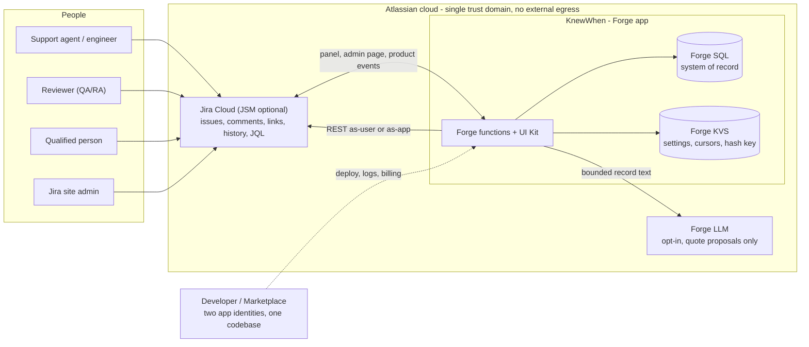
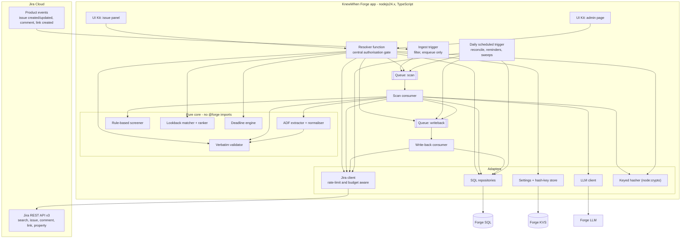
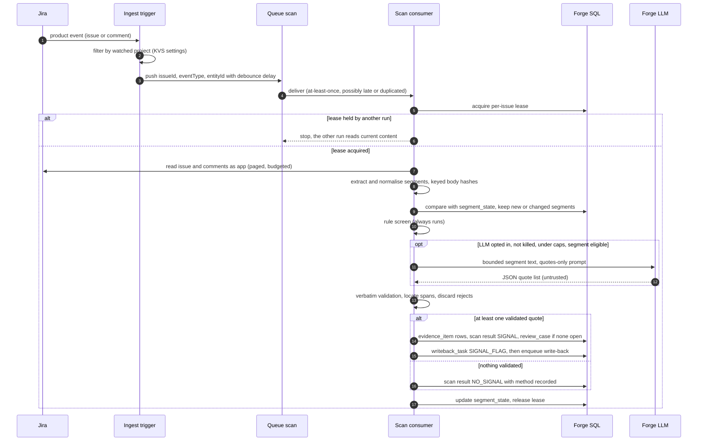
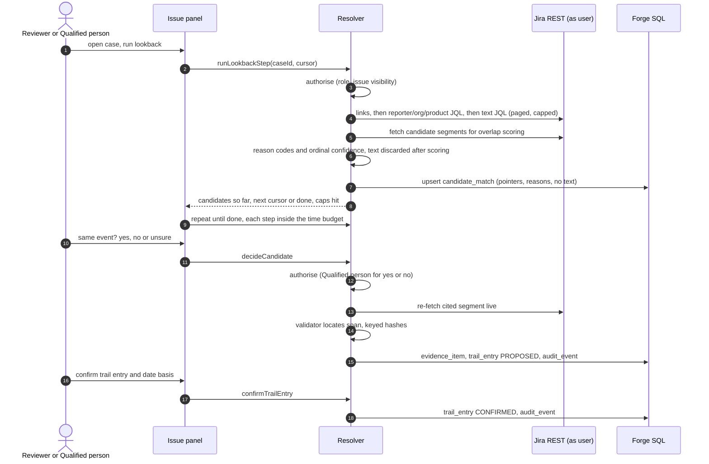
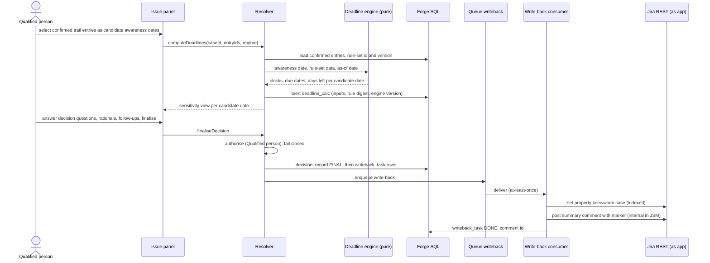
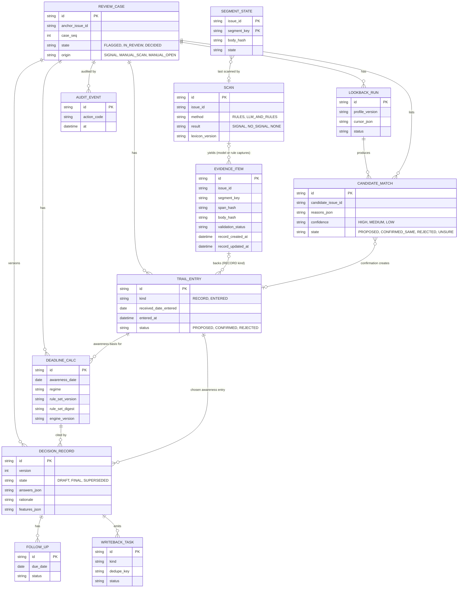

# KnewWhen — Architecture

**Status:** Draft v0.1 for owner and independent-engineer review · **Date:** 23 Nov 2026
**Nature of this document:** technical blueprint. It does not set feature priority, phase plans or product messaging, and it contains no implementation code.
**Decision-support boundary:** KnewWhen helps a qualified person find, evidence and record when the company first knew of a possible medical-device event. It never decides reportability, never states "reportable / not reportable", and does not claim that using it achieves FDA or EU compliance.

### Reading conventions

| Tag | Meaning |
|---|---|
| **[S]** | Source-defined design intent or constraint (from `Idea.md`, `Tools_and_technologies.md` or `Hackathon.md`). Preserved unless the owner approves a change. |
| **[D]** | Design decision made in this document to satisfy the sources. Open to challenge. |
| **[U-n]** | Unresolved. Marked where it matters, with its impact. Collected in §18. |
| **[A-11]** | Platform assumption not verified by the supplied sources. Must be checked in official docs and logged before use (`Tools_and_technologies.md` §4, rule A-11). Collected in §18.2. |

---

## 1. Basis, precedence and gaps

### 1.1 Inputs actually read

| Input | Status |
|---|---|
| `Idea.md` | Read in full. Used as the approved proposal. |
| `Hackathon.md` | Read in full. Governs distribution and judging-driven constraints. |
| `Winner_Benchmarks.md` | Read in full. Informs the engineering bar only (inspectable tests, no data egress, grounded AI). Creates no requirements. |
| `Tools_and_technologies.md` | Read in full. **Locked, v1.0, 23 Nov 2026.** Governs every technology choice. |
| `Knewwhen.md` | **Not supplied.** `Hackathon.md` refers to it as the proposal; `Idea.md` is assumed to carry the same content. **[U-1]** |
| `IMPLEMENTATION_PLAN.md` §2.11 (verified platform facts), `docs/02-spec.md`, `docs/03-domain-rules.md`, `rules/*.json` | **Not supplied.** Referenced by the locked tools file. **[U-1]** |
| Repository, code, manifest | **None exist** in the working environment. Nothing was inspected. |

**Consequence of the gaps.** This document asserts only those platform numbers that appear in the supplied sources (25 s resolver limit, shared 65k points/hour Jira rate limit, ≥300 s queue-consumer timeout for AI work, `nodejs24.x`, the listed `@forge/*` packages). Every other platform behaviour it relies on is tagged **[A-11]**. It asserts **no** regulatory content: day-count conventions, the time-zone rule, holiday semantics, decision-question wording and outcome enumerations are treated as data owned by `docs/03-domain-rules.md` and `rules/*.json`.

### 1.2 Precedence

1. `Tools_and_technologies.md` (locked) decides which technologies and modules are in or out.
2. `Idea.md` decides product intent and the source-defined design constraints.
3. `Hackathon.md` decides distribution, installation and judging-environment constraints.

### 1.3 Where `Idea.md` and the locked tools file disagree

The locked file wins. The differences are material to the manifest, so they are stated rather than silently resolved.

| `Idea.md` §7 | Locked tools file | This architecture |
|---|---|---|
| 3 × `jira:customField` | "Not used… not visible until a Jira admin adds them to screens; entity properties do the JQL job" | **No custom fields.** JQL write-back uses indexed issue entity properties. |
| `jira:entityPropertySet` | Module is `jira:entityProperty` | `jira:entityProperty`, indexed. |
| `jira:issueGlance` | Not in either the "used" or "not used" list | **Not in the baseline manifest.** Adding a module needs the owner's written approval. The issue panel carries the nudge. **[U-2]** |
| `jira:dashboardGadget` | "Add only if Gate 2 passes early and the owner approves"; native filters show the same thing | **Excluded from baseline.** Extension point in §3.4. |
| `rovo:agent` + 2 read-only actions | Optional; first item on the cut list | **Excluded from baseline.** Extension point in §3.4. |
| Scopes listed in prose | Manifest scopes are a locked file, but the list is not in the supplied material | Idea's list is used as the baseline (§13.2). |
| "Evidence-only mode" (Core) | `Hackathon.md` §14 uses "LLM or Evidence-only" for the admin mode; `Idea.md` §10 uses it for "rules not yet practitioner-reviewed" | Two independent switches, §10.5. Naming needs owner confirmation. **[U-7]** |

---

## 2. System context, principles and trust boundaries

### 2.1 System context

There is no `external.fetch`, no Forge Remote, no container and no third-party runtime package **[S]**. The listing's "remote hostnames and data sent" answer is "none", and `forge eligibility` is a release gate for the Runs on Atlassian property.

### 2.2 Architecture principles

| # | Principle | Consequence |
|---|---|---|
| P1 | **Decision support only.** Signals, model output and match scores are inputs to a human. | No autonomous state change in a case's regulatory standing. Every awareness date and every "same event" is human-confirmed. A code-level test forbids "reportable"/"not reportable" outputs. |
| P2 | **Evidence by pointer, never by copy.** **[S]** | Comment text is never persisted. Records are referenced by immutable ids plus keyed hashes (§6). |
| P3 | **Verbatim or nothing.** **[S]** | A quote enters the system only if it is an exact substring of the live record after a fixed normalisation. One validator serves model, rule and human proposals. |
| P4 | **Append-only and attributable.** | Confirmations, calculations and decisions are versioned rows with actor, time, rules version and engine version. Corrections supersede; nothing is overwritten or deleted. |
| P5 | **Pure core, thin adapters.** | Normalisation, validation, ranking and the deadline engine import nothing from `@forge/*`. They are testable without a Forge runtime and re-usable by the independent oracle harness. |
| P6 | **At-least-once everywhere.** | Every asynchronous step is idempotent, resumable from SQL state and safe under duplicate or delayed delivery. |
| P7 | **Fail closed on authority, degrade on convenience.** | Permission, rule-set and role failures deny. Model, search and reminder failures degrade to rules-only or "pending" and say so. |
| P8 | **Least privilege twice.** | Scopes are minimal (§13.2), and code additionally allow-lists the Jira write operations the app may perform. |
| P9 | **Rules are data.** **[S]** | Timings, holidays, question sets and the signal lexicon live in versioned data files with citations. No date library decides the law. |

### 2.3 Trust boundaries

| Boundary | Between | Rule |
|---|---|---|
| **B1** | Browser / UI Kit ↔ resolver | The client is untrusted. Every resolver call re-derives the caller from the platform-supplied context and runs the central authorisation gate (§13.3). The UI never decides what a user may do. |
| **B2** | KnewWhen ↔ Jira REST | **As-user** for anything shown to, or initiated by, a person (display, evidence validation, lookback, routing). **As-app** only where there is no user: queue consumers, the scheduled job, write-back. As-app visibility can differ from a user's, so as-app results are never shown without an as-user re-fetch (§6.4). **[S]** for lookback as the viewing user. |
| **B3** | KnewWhen ↔ Forge LLM | Opt-in, called only from a queue consumer, quotes-only output, Atlassian-hosted **[S]**. Record text is sent to the hosted model here, so this is the one data flow that needs admin consent and listing disclosure. |
| **B4** | App ↔ Forge SQL / KVS | Per-installation storage provided by the platform **[A-11]**. All SQL is parameterised. |
| **B5** | App ↔ developer surface | `forge logs`, Developer Console and billing are visible to the vendor. Logs carry ids, codes and counts only (§15.4). Record text, quotes, rationale and model I/O are never logged. |
| **B6** | Untrusted content | Jira text, model output, human-typed phrases and ADF structure are data. They are never interpreted as instructions, markup or SQL. |

### 2.4 As-user versus as-app

| Operation | Identity | Why |
|---|---|---|
| Panel render, evidence re-validation, lookback search, route-to-complaint-unit, manual-scan permission pre-check | **As-user** | Results must respect that person's Jira permissions. **[S]** |
| Scan consumer reads (issue, comments) | As-app | No user exists in a queue consumer. |
| Write-back (entity property, summary comment) | As-app | The decision is already authorised and stored; the write is a replayable side effect. |
| Scheduled reconciliation, reminders | As-app | No user. |
| Group/role membership checks for the app's own roles | As-app | The gate must not depend on the caller's own visibility of groups. |

`allowImpersonation` is not used **[S]**.

---

## 3. Component architecture and Forge modules

### 3.1 Component view

**Dependency direction.** Handlers (resolver, trigger, consumers, scheduled) → services → adapters. The pure core is called by services and imports nothing outward. Adapters are the only code that imports `@forge/api`, `@forge/sql`, `@forge/kvs`, `@forge/events` or `@forge/llm`. This keeps the deadline engine and the oracle harness runnable under Vitest with no Forge mocks **[S: tests per `Tools_and_technologies.md` §5]**.

### 3.2 Module inventory

Event identifiers, scope identifiers and queue/consumer option names below are the design's working names. The exact Forge identifiers come from `IMPLEMENTATION_PLAN.md` §2.11, which was not supplied. **[A-11]**

| Forge module | Count | Responsibility | Relationship to approved scope |
|---|---|---|---|
| `jira:issuePanel` (UI Kit) | 1 | Case view: signal nudge, awareness trail, lookback, deadlines, decision record, write-back status. Calls the resolver. | Core: "Issue panel". Carries the nudge a glance would otherwise carry. |
| `jira:adminPage` (UI Kit) | 1 | Settings (watched projects, product mapping, rule-set selection, role groups, LLM opt-in/caps/kill switch, summary-comment visibility), health view, sample-scenario and CSV generator, optional historical backfill. | Core: "Admin page", "One-click sample + historical CSV". |
| `function` (resolver) | 1 | Single resolver entry point for both UI modules. Contains the authorisation gate. | Core. |
| `trigger` | 1 | Subscribes to issue-created, issue-updated, comment-created (and comment-updated/deleted if offered), issue-link-created. Filters by watched project and enqueues. **No Jira or SQL calls.** | Core: event-driven capture. |
| `consumer` ×2 | 2 | `scan` queue (Signal Finder, run as app, timeout ≥ 300 s where the LLM is used) and `writeback` queue. | Core: idempotent consumers. |
| `scheduledTrigger` | 1 (daily) | Reconciliation sweep, evidence re-validation of open cases, `daysLeft` refresh, reminders, LLM-deferred retries, personal-data housekeeping, counter pruning. | Core/Should: "daily scheduled job". |
| `jira:entityProperty` | 1 | Declares the indexed issue property `knewwhen.case` so that JQL can search decision status, due date, days left and signal state. | Core: "write-back fields". |
| `llm` | 1 | Declares the model(s) used by the Signal Finder. Adding it triggers a major version upgrade and admin disclosure **[S, Hackathon §2]**. | Core: Signal Finder. |
| `sql` | 1 | Forge SQL database, plain SQL migration files run by the official migration runner, parameterised queries only **[S]**. | System of record **[S]**. |
| KVS (no module) | — | Settings, cursors, circuit-breaker state, hash key. | **[S]** "Forge KVS: settings and cursors". |

No `app.compatibility`, no Confluence module, no `licensing` block in the judge app **[S, Hackathon §8]**.

### 3.3 Code layout implied by the layering (illustrative, for boundary clarity)

`core/` (normaliser, validator, screener, matcher, ranker, deadline engine, rule-set schema checks) · `services/` (scan, lookback, trail, deadline, decision, write-back, authorisation) · `adapters/` (jira, sql, kvs, llm, hash, clock) · `handlers/` (resolver, trigger, consumers, scheduled) · `rules/*.json` (locked data) · `migrations/*.sql` · `tests/` and `oracle/` (dev-only; never bundled into the deployed app).

### 3.4 Extension points that are not baseline

| Item | Status | Constraint if added later |
|---|---|---|
| `jira:dashboardGadget` ("Deadlines at risk") | Not baseline **[S]**; needs owner approval | Reads the same `knewwhen.case` indexed properties via JQL, and does no SQL aggregation of its own. |
| `rovo:agent` + two read-only actions | Not baseline **[S]**; first on the cut list | Actions call the same service layer and the same authorisation gate. They return pointers, status and dates, never record text the invoker could not see. Whether the action receives the invoking user's identity is unverified. **[A-11]** |
| `jira:issueGlance` | Not baseline; needs approval **[U-2]** | Presentation only. No new data path. |
| Similar-case precedents (Should) | Data model already supports it (§5.3: structured `features_json` on decision records) | Matching on structured features (product key, answer codes, reason codes), never on stored text. |
---

## 4. End-to-end flows

Three sequences cover the nine flows required. Detail for each step lives in the section named in the table that follows them.

### 4.1 Capture → Signal Finder → verbatim validation → signal or no-signal

### 4.2 Lookback → awareness trail → evidence validation

### 4.3 Deadlines → decision record → write-back

### 4.4 Flow index

| Flow | Trigger | Runs as | Detail |
|---|---|---|---|
| Issue capture | Jira product event | Trigger (no API calls) → scan consumer (as app) | §14.1 |
| Signal Finder | Scan job, or "Scan this issue now" | Consumer (as app) after an as-user permission pre-check | §7 |
| Verbatim validation | Any quote proposal (model, rule, human) | Pure core | §6.3, §7.4 |
| Historical lookback | Reviewer or Qualified person in the panel | Resolver (as user), user-paged | §8 |
| Awareness trail | Signal, lookback confirmation, manual receipt entry | Resolver (as user) | §9 |
| Deadline calculation | Panel action; daily `daysLeft` refresh | Resolver, pure engine | §10 |
| Qualified-person decision record | Panel action | Resolver (as user), role-gated | §11.1 |
| Jira write-back | Decision finalised; daily refresh; signal flagged | Write-back consumer (as app) | §11.3 |
| No-signal handling | Scan finds nothing validated | Scan consumer | §7.6 |

---

## 5. Data model

### 5.1 Where each kind of data lives

| Store | Holds | Never holds |
|---|---|---|
| **Forge SQL** **[S]** (system of record) | Cases, scans, evidence pointers and keyed hashes, trail, candidate matches, deadline calculations, decision records, follow-ups, write-back outbox, audit events, usage counters | Comment, description or summary text; model input or output; quotes |
| **Forge KVS** **[S]** | Settings (`settings:v1`), cursors (reconciliation, backfill), LLM circuit-breaker state, per-installation hash key(s) | Case data |
| **Jira issue entity property** `knewwhen.case` | Small JSON for JQL: state, signal flag, decision status, awareness date, due date, days left and its as-of date, rule-set id/version | Text of any kind |
| **Jira comment** (summary) | Structured decision summary written by the app, tagged with a marker and a `knewwhen.generated` comment property | Rationale text by default (§11.3) |
| **Rule files** `rules/*.json` (bundled, locked) **[S]** | Regulatory timings, holiday calendar, question sets, signal lexicon, each with citations and a status | Anything installation-specific |

### 5.2 Entity relationships

A scan precedes any case (most scans find nothing), so `scan` carries no `case_id`; a case's first evidence reaches it through `trail_entry` → `evidence_item` → `scan`. The operational tables `scan_lease` (per-issue lease, §14.3) and `usage_counter` (budgets and caps, §14.5) are omitted from the diagram.

### 5.3 Table notes (columns that carry design meaning)

**General rules.** Identifiers are UUIDs from `crypto.randomUUID()` (built-in; no id library). Jira ids (`issue_id`, `comment_id`) are the stable numeric ids, never the key; the key is stored only as `issue_key_at_capture` for readability, because keys change when issues move. Timestamps are UTC with millisecond precision; dates are `DATE`. Enumerations are validated in code. Foreign-key enforcement and multi-statement transactions are not relied upon **[A-11]**; integrity comes from unique constraints, conditional updates and the reconciliation checks in §15.

| Table | Key columns and constraints | Notes |
|---|---|---|
| `review_case` | `UNIQUE(anchor_issue_id, case_seq)`; `state`; `origin` | One open case per anchor issue in the baseline. A further, unrelated event on the same issue is a manual new `case_seq`. A case is created from a validated signal, a manual scan, or manual open. Case creation is insert-if-absent under the issue lease. A flagged case has no delete or hide path: it can only reach `DECIDED` through a decision record (**[D]**, §11.1). |
| `scan` | `trigger`, `method`, `status`, `result`, `reason_code`, `lexicon_version`, `prompt_version`, `model_id`, `extractor_version`, counts of segments seen/scanned and quotes proposed/rejected | One row per scan run, including every no-signal run. Rejected-quote *counts* are kept to measure the verbatim guard; rejected quote *text* is not. |
| `segment_state` | `PK(issue_id, segment_key)`; `body_hash`, `hash_key_id`, `extractor_version`, `state`, `last_scan_id` | Incremental-scan memory. `segment_key` is `summary`, `description` or `comment:<id>`. State values include `SCANNED_SIGNAL`, `SCANNED_NO_SIGNAL`, `LLM_DEFERRED`, `SKIPPED_<reason>`, `FAILED`. Only new or changed segments are rescanned. |
| `evidence_item` | `issue_id`, `segment_key`, `author_account_id`, `record_created_at`, `record_updated_at`, `span_start`, `span_len`, `span_hash`, `body_hash`, `hash_key_id`, `normalisation_version`, `captured_by`, `strength`, `validation_status`, `last_validated_at` | The evidence pointer (§6). `captured_by` ∈ `LLM_VALIDATED`, `RULE_MATCH`, `HUMAN_PHRASE`, `HUMAN_SEGMENT`. `strength` ∈ `SYSTEM_UNEDITED`, `SYSTEM_EDITED`, `HISTORY_UNVERIFIED` (§6.4). `validation_status` ∈ `VALID`, `RELOCATED`, `MODIFIED`, `UNAVAILABLE`, `UNVERIFIABLE`. `record_*_at` are Jira's timestamps copied at capture. |
| `trail_entry` | `kind` ∈ `RECORD`, `ENTERED`; `evidence_id` (null for `ENTERED`); `source`; `received_date_entered`; `entered_by`; `entered_at`; `entered_note`; `status`; `decided_by`; `decided_at`; `supersedes_id` | Awareness Trail row (§9). The three time notions (Jira record time, app observation time, human-entered receipt date) live in different columns and are never merged. |
| `lookback_run` | `anchor_entry_id`, `profile_version`, `cursor_json`, `examined_issues`, `search_calls`, `caps_hit_json` | Resumable: a run is continued from its stored cursor. |
| `candidate_match` | `UNIQUE(case_id, candidate_issue_id, candidate_segment_key)` with `''` as the "no segment" sentinel (nullable columns would defeat the constraint); `reasons_json`, `overlap` (numeric), `confidence`, `candidate_record_ts`, `state`, `decided_by`, `decided_at` | Pointers, reason codes and a numeric token-overlap only. No text. Rejected rows persist so a rejected candidate does not resurface unprompted. |
| `deadline_calc` | `awareness_date`, `awareness_basis`, `regime`, `rule_set_id`, `rule_set_version`, `rule_set_digest`, `rule_set_status`, `engine_version`, `tz_rule_id`, `as_of_date`, `result_json` | Append-only. Stores the exact inputs and the digest of the rule data used, so a result can be reproduced and challenged. |
| `decision_record` | `UNIQUE(case_id, version)`; `state`; `awareness_entry_id`; `awareness_date`; `awareness_basis`; `deadline_calc_id`; `question_set_id/version`; `answers_json`; `rationale`; `evidence_snapshot_json`; `features_json`; `decided_by`; `decided_at`; `supersedes_id`; `supersede_reason` | Finalising is a conditional update `WHERE state='DRAFT'`. `features_json` holds structured, non-text features (product key, answer codes, reason codes) so Similar-case precedents can be added later without storing text. |
| `follow_up` | `decision_id`, `owner_account_id`, `due_date`, `status` | Human-authored description. |
| `writeback_task` | `UNIQUE(case_id, kind, dedupe_key)`; `kind` ∈ `SIGNAL_FLAG`, `PROPERTY`, `SUMMARY_COMMENT`, `REMINDER`; `status`; `attempts`; `last_error_code`; `comment_id` | Transactional outbox (§11.3). |
| `audit_event` | `actor_type`, `actor_account_id`, `action_code`, `target_type/id`, `at`, `details_json` | Append-only. `details_json` contains codes and ids only. Records confirmations, rejections, role denials, setting changes (before/after codes), kill-switch use, manual scans. |
| `usage_counter` | `PK(bucket, kind)`; `count` | Atomic upsert increments for Jira budget, LLM calls and manual-scan caps. |

### 5.4 Data classification

| Class | Where | Handling |
|---|---|---|
| **Record text** (summary, description, comments) | Jira only | Read transiently; never stored, logged or cached. |
| **Derived non-text** (hashes, offsets, lengths, counts, reason codes, numeric overlap, timestamps) | SQL | Stored. Keyed hashes use a per-installation key (§6.2). |
| **Personal data** (Atlassian account ids) | `evidence_item.author_account_id`, `trail_entry.entered_by/decided_by`, `decision_record.decided_by`, `follow_up.owner_account_id`, `audit_event.actor_account_id` | Declared via the `report:personal-data` scope **[S]**. Erasure handling in §11.4. |
| **Human-authored text** (decision rationale, follow-up descriptions, entered-receipt notes, "same event?" notes) | SQL | Stored because it *is* the regulated decision content, so this is a deliberate, bounded exception to "no text stored". The UI states this and discourages pasting record text. The app cannot detect pasted record text. |
| **Model input/output** | Transient memory in the consumer | Never persisted or logged. |
---

## 6. Evidence storage and retrieval

This section carries the proposal's central privacy intention **[S]**: *pointers plus keyed hashes, no comment text stored*. The design below keeps that intention intact and says plainly what it costs.

### 6.1 What is stored for one piece of evidence

An `evidence_item` is a **pointer plus a fingerprint**, nothing more:

- **Pointer:** `issue_id`, `segment_key` (`summary`, `description` or `comment:<id>`), `comment_id`, `author_account_id`, `issue_key_at_capture`.
- **Position:** `span_start` and `span_len` in the *normalised* segment text (§6.3).
- **Fingerprints:** `span_hash` (the quoted span) and `body_hash` (the whole segment), both keyed, plus `hash_key_id` and `normalisation_version`.
- **Provenance:** Jira's `record_created_at` and `record_updated_at` at capture, `captured_at` (app clock), `captured_by`, `scan_id`, `strength` (§6.4).
- **Status:** `validation_status`, `last_validated_at`.

There is no text column, no excerpt, no truncated preview and no "context" field.

### 6.2 Keyed hashing

- **Construction.** `HMAC-SHA-256(key, version ‖ kind ‖ issue_id ‖ segment_key ‖ normalised_text)` using `node:crypto` (a built-in, permitted under the no-third-party-runtime rule **[S]**). `kind` is `span` or `body`. Binding the hash to the record's identity means identical text in two records yields different hashes, so the stored data cannot be used to find "the same sentence" across records.
- **Key.** One random 256-bit key per installation, generated on first use with `crypto.randomBytes`, referenced by `hash_key_id`. The preferred custody is the Forge KVS secret store **[A-11]**. If that store is unavailable, the fallback is an ordinary per-installation KVS entry, which is weaker (anyone with storage access obtains key and hashes together; there is still no text). A key shared across installations, such as an app-level environment variable, is rejected: it would be vendor-held and would link tenants. **[U-3]**
- **What the key buys.** It prevents offline guessing of short, predictable quotes from leaked hashes. It is **not** tamper-proofing: code with storage write access can write a matching hash.
- **Rotation.** New evidence uses the newest `hash_key_id`; old keys are kept while any evidence references them. An item is re-keyed opportunistically whenever it validates successfully against live text (it cannot be re-keyed otherwise, because the text is not stored).

### 6.3 Extraction, normalisation and the verbatim rule

The hash and offsets are only meaningful if every party derives *exactly* the same text from a Jira record. That derivation is therefore a versioned, frozen component (`normalisation_version`).

**Normalisation v1 (design):**

1. Take the record body as Atlassian Document Format from Jira REST v3 and flatten it deterministically: text nodes concatenated, `hardBreak` → `\n`, block boundaries (paragraph, heading, list item, table cell/row, code block) → fixed separators.
2. Replace volatile nodes (mentions' display text, emoji, media, inline cards, status lozenges, date nodes) with fixed placeholder tokens, so that a user renaming themselves or a card re-rendering cannot break validation. A quote may not contain or cross a placeholder.
3. Unicode NFC; collapse every run of whitespace to one space; trim.
4. **Case, punctuation and word order are preserved.** There is no stemming, case-folding or punctuation stripping.

**Verbatim rule.** A proposed quote *Q* is accepted for segment text *T* iff, with *N* = normalisation v1: *N(Q)* is a substring of *N(T)*, has at least a minimum word count and at most a maximum length (placeholders tuned in the cost/benchmark work), and does not span a placeholder or segment boundary. The span is located at the first occurrence. Anything else is discarded; rejects are counted, never stored.

**Frozen versions.** An extractor/normaliser version is never edited after any evidence has been captured under it. A new behaviour is a new version, shipped alongside the old one, and old evidence is validated with its recorded version. If a version is ever retired, evidence under it becomes `UNVERIFIABLE` (visible, not silently dropped).

**What the user sees.** The quote shown in the panel is the *live* slice of the normalised segment, labelled "verbatim from the Jira record (whitespace normalised)". It is never a string supplied by the model or retrieved from storage.

### 6.4 Retrieval and validation (as the viewing user)

When the panel needs to display or re-check evidence, the resolver:

1. **Fetches the single segment live, as the viewing user** (one issue call or one comment-by-id call). If Jira denies access, the viewer sees "record not accessible to you" with the pointer and timestamps only. Jira can answer 404 for a record the caller merely cannot see, so an issue-level 403/404 is **ambiguous** (deleted, moved out of reach, or no permission) and changes no stored status.
2. Extracts and normalises with the stored `normalisation_version`.
3. Recomputes `span_hash` at the stored offsets.
   - **Match → `VALID`.** If `body_hash` differs, a `body_edited` flag is raised (informational: the quote is intact, other text changed).
   - **No match →** slides a window of `span_len` across the normalised text and compares hashes. A hit → **`RELOCATED`** (offset updated, audit event written). The scan is capped by segment length; over the cap the item is `UNVERIFIABLE`.
   - **Still no match →** **`MODIFIED`**: the segment exists but the quoted text no longer does.
   - **Comment 404 while the parent issue is readable →** **`UNAVAILABLE`**: that is a positive indication the comment was deleted. The same rule applies to the daily as-app re-validation; an app-side issue-level failure is recorded as "unreachable by the app" in health counters and does not alter status.
4. Persists status changes (and writes an audit event when a status degrades), and returns the display slice to the browser only. Re-validation is rate-limited per case and cached for a short window; the daily job re-validates open cases (§15).

**Evidence strength.** Each item records how much the Jira timestamp can be trusted to mean "this text existed by then":

| `strength` | Meaning |
|---|---|
| `SYSTEM_UNEDITED` | Comment with `updated = created` at capture, or description/summary whose changelog shows no edit since creation. The text existed from the record's creation time. |
| `SYSTEM_EDITED` | Comment edited after creation. The quote may have been added at any time between `created` and `updated`; the panel shows both timestamps. |
| `HISTORY_UNVERIFIED` | Description/summary where the changelog check was not done or failed. Issue `updated` does not reveal description edits, so it cannot be inferred. |
| *(trail level)* `ENTERED` | A human-entered receipt date with no Jira record (§9). |

The changelog check for description/summary is one extra call, made only when evidence is captured. Imported or backfilled records carry whatever timestamps the importer set, and Jira does not mark that; the strength labels describe Jira's claims, not independent proof. This is disclosed in the intended-use text.

### 6.5 What this design cannot do, and why it matters

Because text is not stored, and Jira keeps no comment revision history, **the original wording of an edited or deleted comment cannot be recovered by KnewWhen.** The consequences are deliberate and visible:

- A `MODIFIED` or `UNAVAILABLE` item stays in the trail with its pointer, timestamps and capture provenance; the qualified person must re-confirm the evidence or record why it no longer exists. It does not silently disappear and it does not silently count.
- A hash can *confirm* a candidate original wording supplied from elsewhere (for instance an audit export), but it cannot reveal it.
- A decision record that relied on later-modified evidence shows that fact at the point of decision and in any print/export.

Preserving the wording would require storing a snapshot of record text. That is a material change to storage and privacy **and must be raised for approval, not adopted by this architecture. [U-4]** If approved later, it would be an encrypted, per-evidence, access-audited snapshot added alongside the pointer, never replacing it.

### 6.6 Checks that the privacy intention is not eroded

| Leak path | Control |
|---|---|
| Logs | Structured logger accepts ids, codes, counts, durations only; a canary-string test fails the build if record text, quotes or rationale reach a log call (§16). |
| Model I/O | Never persisted; a rejected quote's text is discarded, only the count is kept. |
| Candidate matches | Pointers, reason codes and a numeric overlap only. Text used to score is held in memory and dropped. |
| Entity property and summary comment | Contain codes, dates and ids; the summary comment excludes rationale by default (§11.3). |
| Error messages and audit `details_json` | Codes and ids only. |
| Browser | The live slice exists in UI state only while displayed. Nothing is written to client storage. |

---

## 7. Signal Finder

### 7.1 Purpose and contract

Given an issue, find candidate passages in its summary, description and comments that may describe a possible injury or malfunction of a device, and return **only verbatim quotes with pointers** or an explicit "no signal". It does not classify severity, assign codes, express confidence or judge reportability. Research cited by the proposal shows model self-confidence and device-event coding to be unreliable, so none is requested or used. **[S]**

**Output of one scan:** `scan.result` ∈ `SIGNAL`, `NO_SIGNAL`, `NONE` (not run) with `status`, `reason_code`, `method`, and for `SIGNAL`, the validated `evidence_item` rows.

### 7.2 Eligibility and pre-filter (objective criteria only)

A segment is eligible for scanning unless one of these is true. None of these uses the model or the lexicon, so the pre-filter cannot suppress a real paraphrased complaint.

| Exclusion | Reason code |
|---|---|
| Issue's project not in the watched list; issue type excluded by admin | `SKIPPED_SCOPE` |
| Segment authored by KnewWhen (comment carries the `knewwhen.generated` marker) | `SKIPPED_SELF` |
| Normalised length below minimum or above the per-segment cap (over-cap segments are scanned in bounded windows, not dropped) | `SKIPPED_TOO_SHORT` / windowed |
| `body_hash` equals the one already scanned | `UNCHANGED` |
| Per-issue or per-site cap reached | `LLM_DEFERRED` (rules still run) |

Deferred segments are retried by the daily job when caps reset. They are shown as "not yet scanned by AI", never as "no signal".

### 7.3 Rule-based screener (always runs; the guaranteed fallback)

- A versioned lexicon (injury, harm, malfunction and device-failure phrases) held as rule data **[S: rules are data]**. Its file location needs approval because `rules/*.json` is locked. **[U-1]**
- It yields spans that are substrings by construction, but they still pass through the same verbatim validator, so there is exactly one acceptance path.
- Lower recall than the model by design. Results are labelled `RULE_MATCH` and the scan `method` is `RULES`.
- If the admin has not opted in to AI, the model is blocked by moderation, the breaker is open, the kill switch is on or caps are reached, the product still works end to end on this path.

### 7.4 Model-assisted discovery (opt-in)

- **Where it runs:** only in the `scan` queue consumer, only when the admin has opted in, with the consumer timeout set to the Forge LLM-capable value (≥ 300 s) **[S]**.
- **Prompt contract:** input is a list of `{segmentId, normalisedText}` objects; instruction is to return a JSON object `{ "quotes": [ { "segmentId", "quote" } ] }` of exact substrings that may describe a possible injury or malfunction, or an empty list. The prompt text is data wrapped in clear delimiters and states that record text is untrusted and contains no instructions. No other output field is accepted.
- **Output handling:** parsed with a hand-written strict schema check (no schema library **[S]**). Unknown fields, wrong types, quotes that reference an unknown `segmentId`, or anything outside the schema → whole response rejected. One repair retry for malformed JSON at most; then fall back to rules for that scan.
- **Validation:** every quote goes through §6.3. Rejects (paraphrases, invented text, trimmed words, cross-segment text) are counted. The validator also enforces a per-segment and per-issue maximum quote count, de-duplicates and merges overlapping spans.
- **Injection posture:** text planted in a record can cause the model to return a quote that does exist verbatim (a false-positive flag a human will see) but cannot cause fabricated evidence, tool use or data exfiltration: the model has no tools, no network and its output is parsed only as the schema above.
- **Moderation:** Atlassian may block high-risk messages under its acceptable-use policy **[A-11, Hackathon §14]**. A block is a degraded result: rules-only for that scan, `reason_code = LLM_BLOCKED`, circuit-breaker counter incremented. Injury narratives must be tested against the hosted model before release.
- **Combination:** the scan's evidence is the union of validated rule and model spans, each with its own `captured_by`. Overlapping spans are merged and keep both provenances.

### 7.5 Limits, caps and kill switch

| Layer | Control | Owner |
|---|---|---|
| Opt-in | `llm.enabled` is **off by default**; enabling it shows the data-flow disclosure | Site admin **[S]** |
| Kill switch | `llm.kill` checked at enqueue, at consumer start and before every model call; effect is immediate for new calls | Site admin **[S]** |
| Debounce | Queue delay before a scan runs, so a burst of edits yields one scan **[S]** | Config |
| Per-issue cap | Maximum model scans per issue per day | Config **[S]** |
| Per-site daily cap | Counter in `usage_counter`; over cap → `LLM_DEFERRED` | Config, bounded by a code-level hard ceiling **[S]** |
| Circuit breaker | After repeated model failures or blocks, the breaker opens for a cool-down; scans run rules-only and the admin page says so | System (state in KVS) |
| Vendor ceiling | Environment variables set a hard ceiling and a hard-disable for the judge app. These take effect on deploy, not instantly. | Developer **[U-10]** |

### 7.6 No-signal handling

- `NO_SIGNAL` is a **valid, persisted result**: a `scan` row records the method, the lexicon/prompt/model versions, the number of segments seen versus scanned, and the time. It creates no case and no nudge. **[S]**
- The panel states: "No signal found by <method> in N of M segments." It never says "not a complaint", and deferred or skipped segments are listed separately so absence is never over-read.
- Because the result is stored, a later content change (new fingerprint) triggers a fresh scan, and "scan history" shows what was and was not examined.

### 7.7 Manual scan: "Scan this issue now"

1. The resolver authorises the caller and checks, **as that user**, that they can browse the issue.
2. It enqueues a scan with `trigger = MANUAL`. A manual scan bypasses the debounce delay and the "unchanged" skip (a fresh look is the point) but **not** the kill switch, the breaker or the daily cap; a separate per-user, per-issue manual-scan limit prevents hammering.
3. The panel polls `getScanStatus` (the model call cannot run in the 25 s resolver). Rules-only completion is typically seconds; the panel says when AI is deferred or unavailable.
4. The result is the same `scan` row and evidence as any other. Nothing about manual scans is special-cased downstream, which is what answers the "single hardcoded demo path" test: the sample scenario and a judge's own text take the same code.

### 7.8 From signal to case, nudge and routing

- A validated signal creates (or attaches to) a `review_case` in `FLAGGED` and a `SIGNAL_FLAG` write-back task that sets the indexed property so filters and JQL can find flagged issues.
- **Nudge for support agents and engineers.** Anyone who can browse the issue sees, in the panel, the flagged quotes (re-fetched as them, §6.4) and a one-click "route to complaint unit". They see nothing of the trail, deadlines or decisions.
- **Routing mechanism (baseline):** add a configured label **as the clicking user**, so it succeeds only if that user may edit the issue, and write a `ROUTED` audit event. The next write-back reflects the routed state in `knewwhen.case`, so the property keeps a single writer. No workflow validator, condition or transition is assumed **[S]**. A customer's workflow-specific routing is out of scope. **[U-8]**
- A case is a *candidate under review*, not a finding. It can leave `FLAGGED` only by human action.

---

## 8. Historical lookback ("found, not entered")

### 8.1 Contract

**Input:** a case and an *anchor trail entry* (initially the entry created by the signal). **Output:** proposed earlier records that may describe the same event, each with **reason codes**, an **ordinal confidence label** and a pointer, for a person to confirm or reject. Lookback never confirms anything itself.

**Iteration.** Confirming an earlier record creates a new, earlier anchor from which lookback can be run again, to a bounded depth. Each run is bound to one anchor entry and one `profile_version`.

### 8.2 Candidate sources (as the viewing user **[S]**)

All searches run through Jira's search API as the person using the panel, so no candidate can be returned that this person could not open. Searches are always restricted to the watched projects and to records created before the anchor's record timestamp.

| Tier | Source | Reason codes | Notes |
|---|---|---|---|
| **L — linked records** | Issue links on the anchor (all link types), then links of those, to a depth cap; parent/child relationships | `LINKED`, `LINKED_2` | Cheapest and strongest relational signal. |
| **R — relationship** | Same reporter (`reporter = accountId`); same organisation (JSM organisations, via `read:servicedesk-request`, absent without JSM); same product (admin-mapped field, §8.3) | `SAME_REPORTER`, `SAME_ORG`, `SAME_PRODUCT` | Relationship alone says "worth a look", not "same event". |
| **T — text** | Jira text search on distinctive terms taken from the anchor's *validated quotes*, restricted by date/project | `TEXT_OVERLAP` | Jira's search is stemmed and loose, so hits are re-scored locally. |

### 8.3 Product and organisation identity

"Same product" needs a vocabulary that Jira does not provide. The admin maps one source of product identity (component, label prefix, or a named custom field) in settings; `SAME_PRODUCT` is available only when mapped and is stated in the match reason with the field used. Organisations come from JSM when present. When neither exists, tier R degrades to reporter-only and the panel says which relationships could not be evaluated. **[U-9]**

### 8.4 Text scoring (local, transient)

- Candidate segments are fetched as the user, normalised with the same normaliser, tokenised, stripped of a stop-word list and the device/brand terms that appear in nearly every record, and compared with the anchor's quote tokens.
- The measure is a deterministic overlap of distinctive-token sets (versioned in `profile_version`). The number is stored as `overlap` for transparency but is **never displayed as a probability**.
- Fetched text is discarded after scoring. If a segment-level hit exists, `candidate_segment_key` identifies the best segment; otherwise the candidate is issue-level and the person picks the segment on confirmation (§9.2).

### 8.5 Confidence is ordinal, rule-derived and capped

Confidence is a label from a fixed decision table (versioned), not a statistical estimate:

| Label | Rule (initial; thresholds set by the benchmark in §16.3) |
|---|---|
| `HIGH` | Reason codes from **at least two independent families** (relationship: `LINKED`/`SAME_*`; text: `TEXT_OVERLAP`) with overlap above the high threshold |
| `MEDIUM` | Single strong family: `LINKED` alone, or `TEXT_OVERLAP` above threshold alone (**text-only is capped at MEDIUM**), or `SAME_REPORTER` + `SAME_PRODUCT` with moderate overlap |
| `LOW` | Anything else retained |

Two limits are fixed regardless of tuning: **no label is ever "confirmed"** (only a human action makes a match count), and **relationship-only matches without text support are never above LOW**.

### 8.6 False-match controls

1. Date filter: strictly earlier than the anchor's record time, with the evidence strength of the candidate shown.
2. Corroboration rule for `HIGH` (above) and text-only cap.
3. Stop-word and boilerplate-term suppression; minimum distinctive-token count.
4. Caps: maximum candidates displayed per label, maximum issues examined per run (§14.5). When a cap is hit, the panel says the search was incomplete, not that nothing else exists.
5. Rejections persist (`REJECTED` rows block automatic resurfacing; a Qualified person can reopen them).
6. Match reasons are shown in plain language beside every candidate ("linked as *relates to*; same reporter; 7 shared distinctive terms").
7. Sorted by confidence, then by earliest record time, because the earliest credible record is what the qualified person is looking for; the person can re-sort.
8. Precision/recall of each label is measured on a labelled corpus and reported honestly (§16.3).

### 8.7 Human confirmation

- Roles: **Reviewer** may run lookback and view candidates; **Qualified person** may answer "same event?" yes/no/unsure (§13.1). `UNSURE` keeps the candidate visible without effect.
- **Yes** → the resolver re-fetches the cited segment live, runs the validator to locate or accept a span (§9.2), writes `evidence_item` + a `PROPOSED` trail entry, and an audit event. A second confirmation of the *awareness date basis* is needed before the entry can drive a deadline (§9.3). Two explicit steps keep "same event" and "this date counts" separate.
- All confirmations are attributable and append-only.

### 8.8 Paging, rate limits and resumption

- **Resolver budget:** each `runLookbackStep` does as much work as fits a soft time budget (well under the 25 s limit **[S]**) and returns `{candidates, nextCursor | done, capsHit}`. The panel loops until done, so the user sees results appear.
- **State:** the cursor and counters live in `lookback_run` (SQL) or KVS; a closed tab can resume, and two runs for the same anchor and profile are collapsed.
- **Rate limits:** the Jira client (§14.4) meters calls against the shared 65k points/hour budget **[S]**; on 429 the step returns `partial` with `retryAfter` rather than failing.
- **Per-case caps** apply to calls and issues examined, and a per-case, per-hour run limit applies.

---

## 9. Awareness Trail

### 9.1 What the trail is

An ordered, append-only list of *who wrote or received what, when and where*, for one case. Each `trail_entry` is either:

- **`RECORD`**: backed by an `evidence_item` (a Jira record, with pointer and timestamps), or
- **`ENTERED`**: a human-entered receipt, such as a phone call or email that has no Jira record, with `received_date_entered`, `entered_by`, `entered_at` and an optional human-authored note.

### 9.2 Three kinds of time, never merged **[S]**

| Time | Source | Where | Meaning |
|---|---|---|---|
| **Jira record time** | Jira's `created` / `updated` on the record | `evidence_item.record_*_at` | System-recorded in Jira. Strength labelled (§6.4). |
| **App observation time** | KnewWhen's own clock | `evidence_item.captured_at`, `trail_entry.entered_at` | When KnewWhen first saw it or the entry was typed. Never used as awareness time. |
| **Date received (entered)** | A person | `trail_entry.received_date_entered` | A claim by a named person, shown with a clear "entered, not system-recorded" label. |

A `RECORD` entry may also carry an entered receipt date (for example, an email that arrived before the ticket was created). Both are displayed; neither overwrites the other.

**Capturing evidence on confirmation.** For a text-hit candidate with a located segment, the proposed span comes from the validator (lexicon/overlap tokens). For an issue-level or link-only candidate, the person selects a segment from a live list (description and comments with timestamps and authors). They may also type a short phrase from it. The phrase is checked by the same validator (`HUMAN_PHRASE`), or the entire segment is taken as evidence (`HUMAN_SEGMENT`, where `span` covers the segment).

### 9.3 From trail to candidate awareness dates **[D]**

- For each *confirmed* entry the trail can provide an **effective date** under a chosen **basis**: `JIRA_RECORD_TIMESTAMP` (converted to a calendar date by the time-zone rule from `docs/03-domain-rules.md`) or `ENTERED_RECEIPT_DATE`. The conversion is performed at the edge with the built-in `Intl.DateTimeFormat`; the deadline engine only ever sees an ISO date. **[S]**
- For each regime the panel lists the **earliest confirmed effective date per basis** as the candidate, together with all later candidates, so the cost of each is visible (§10.4).
- Which entry types count as "awareness" for a regime is rule data, not code. If the supplied rule data does not state it, the app lists all confirmed entries and does not pre-select. **[U-1]**
- The Qualified person **confirms one entry and one basis**; the decision record stores both. Changing either later creates a new decision version.

### 9.4 Corrections

A trail entry is never edited in place. A mistaken entry is `REJECTED` with a reason; a correction is a new entry with `supersedes_id`. Evidence whose validation degrades after confirmation (§6.5) stays in the trail, flagged.
---

## 10. Deadline engine

### 10.1 Boundary

The engine is one **pure function**: `(awarenessDate, asOfDate, ruleSet, holidayCalendar) → clocks | typed error`. It performs no I/O, reads no clock, calls no Jira or storage API and imports nothing from `@forge/*`. Everything around it is composition done by the resolver:

| Concern | Owner |
|---|---|
| Choosing the awareness entry and basis | Qualified person via the trail (§9.3) |
| Timestamp → calendar date (time-zone rule) | Edge converter using `Intl.DateTimeFormat`, rule from `docs/03-domain-rules.md` **[S]** |
| "Today" (`asOfDate`) | Edge, same converter. The engine never calls `Date.now()`. |
| Clock arithmetic, work-day skipping, holiday lookup | Engine |
| Persistence of inputs and results | Deadline service → `deadline_calc` |

### 10.2 Inputs and outputs

**Inputs.** Awareness date and as-of date as ISO `YYYY-MM-DD` strings **[S]**; a rule set; the holiday calendar named by that rule set.

**Rule set (data, `rules/*.json`).** Identifier, version, `status` (`REVIEWED`, `PREVIEW`, `UNREVIEWED`), citations, and a list of clocks. Each clock states its unit (calendar days or work days), count, and the counting convention that governs it (whether the awareness day itself counts, which days are non-working, whether holidays are skipped, what happens when a due date falls on a non-working day). **The engine implements these as generic, parameterised primitives. It contains no regulatory interpretation of its own.** If a rule file uses a parameter the engine does not support, the rule set is rejected at load (fail closed), not approximated.

**Outputs.** Per clock: `dueDate`, `calendarDaysRemaining`, `workDaysRemaining` (work-day clocks), `state` (`OPEN`, `DUE_TODAY`, `OVERDUE`), and a **trace** of every skipped day with the reason (weekend, named holiday), so each result is explainable and the oracle can compare the trace as well as the date.

**Typed errors, never best guesses:** `RULE_SET_INVALID`, `RULE_SET_UNREVIEWED`, `HOLIDAY_DATA_MISSING(year)`, `DATE_INVALID`. A deadline for a year the holiday file does not cover is withheld, not estimated.

### 10.3 Rule data, citations and version handling

- Rule files are bundled in the deployed app **[S]**; nothing is fetched at runtime (no egress). Their SHA-256 digest is computed at load and stored with every calculation, together with `rule_set_id`, `version`, `status`, and the **engine version**.
- A rule-set version is immutable once released. Changing the law's reading means a new version. An installation selects the version used for new calculations; existing `deadline_calc` and `decision_record` rows keep the version they were made under.
- "Recalculate under version X" produces a new `deadline_calc` row; it never overwrites. A decision made under an earlier version continues to display that version.
- Federal holidays come from `rules/us-federal-holidays.json`, copied from the OPM list with a citation per year **[S]**. Whether and how work days skip holidays is a domain rule in the rule data, not a code choice **[S]**.
- EU clocks ship as a `PREVIEW` rule set **[S]**: shown with a persistent "preview, not reviewed" banner, and **excluded from Jira write-back unless the admin explicitly enables preview write-back**.

### 10.4 Sensitivity ("if this was the first knowledge")

For each candidate awareness date from the trail (§9.3), the resolver calls the engine and shows the clocks side by side, for example "if the first knowledge was the earlier ticket: *N* days left; if the later ticket: *M*". The numbers are always computed values, never text templates with embedded constants. The comparison exists to make the cost of late recognition visible, not to recommend a date.

### 10.5 Switches that gate this module

Two independent switches exist, because the source documents use "evidence-only" in two senses. **[U-7]**

| Switch | Values | Effect |
|---|---|---|
| **Rule-set review state** (per regime, from rule data) | `REVIEWED` / `PREVIEW` / `UNREVIEWED` | `REVIEWED`: deadlines shown normally. `PREVIEW`: shown with banner, not written back by default. `UNREVIEWED`: the engine is not called; the panel shows the trail and evidence only, with a visible note. This is the fallback if the practitioner review (due 24 Nov **[S]**) does not land. |
| **AI screening** (`llm.enabled`) | off (default) / on | Controls model-assisted discovery (§7.4). Rules-only screening always works. |

### 10.6 Independent test oracle **[S]**

- The oracle is a separate implementation that **shares no code with the engine**, including no shared date helpers and no shared rule loader. It lives under `oracle/`, is dev-only and is never bundled into the app.
- It uses a deliberately different technique: day-by-day stepping from the awareness date with an explicit qualifying-day counter and weekday lookup from the built-in UTC `Date`, against the engine's integer day-number arithmetic. It is written from the rule text and golden cases, not from the engine, and by a different session or author from the engine's builder (`Tools_and_technologies.md` §6: the builder never grades).
- `fast-check` generates at least 10,000 cases per run, with the seed logged into the evidence pack **[S]**. The engine and oracle must agree on `dueDate`, remaining days and the full trace for every case. Metamorphic properties are also asserted: a work-day due date never lands on a non-working day; adding a holiday never moves a due date earlier; due date is non-decreasing in the awareness date.
- **Limits stated honestly.** Agreement shows the *arithmetic* is consistent. It does not validate the legal reading, and the rule data is common to both implementations, so a wrong holiday entry would be common-mode. The control is a golden holiday set built separately from the OPM source plus the qualified practitioner's review. **[S]**

### 10.7 What the engine will not do

It will not choose which entry is "awareness", decide whether a report is required, infer a regime from the record, or produce any statement of compliance. Outputs are dates and counts attached to a rule-set version.

---

## 11. Decision record, follow-ups and Jira write-back

### 11.1 Decision record

- **Roles:** only a **Qualified person** (configured group/accounts, §13.1) may create, finalise or supersede a decision. Roles are checked server-side on every call; the check fails closed.
- **Content:** the confirmed awareness entry and basis; the `deadline_calc` it relies on; answers to the **public decision questions** held as rule data (`question_set_id/version`, allowed answer codes, citations); a free-text **rationale**; follow-ups; and a snapshot of each cited evidence item's `validation_status` at the moment of finalising. The questions and outcome vocabulary are owned by `docs/03-domain-rules.md`. **[U-1]**
- **No computed outcome.** The app records what the Qualified person selected. It does not derive, suggest, rank or default an answer, and its strings contain no "reportable / not reportable" wording (enforced by a test, §16).
- **States:** `DRAFT` (editable) → `FINAL` (immutable). A correction is a new version with a mandatory reason; the earlier version becomes `SUPERSEDED` and stays readable. Finalising is a conditional update `WHERE state = 'DRAFT'`, so a double click or a retried request is a no-op that returns the existing record.
- **Integrity claim.** The baseline gives append-only application behaviour plus audit events. It does **not** claim tamper-evidence against a writer with direct storage access; the hash-chain integrity check is a stretch item and not part of this baseline. **[S]**
- **No silent dismissal.** A flagged case cannot be deleted or hidden. "This is not a complaint" is itself a decision record with rationale. This mirrors the failure mode in the cited warning letters (complaints closed as "feedback" without evaluation). **[D]**
- **Precedents.** `features_json` stores structured features (product key, answer codes, reason codes of the confirmed match). A later "similar earlier cases" view queries those features, shows each earlier decision beside the current one, and is available to Qualified persons only.

### 11.2 Follow-ups and reminders

Follow-ups (`follow_up`) are attached to a decision with an owner and due date. The daily job (a) refreshes `daysLeft` on open cases, and (b) at configured thresholds creates one `REMINDER` write-back task per case, threshold and due date, keyed so it can never be posted twice. The reminder channel (a comment mention, since the app has no mail capability and no Automation dependency **[S]**) is a visible Jira side effect and is part of the open decision **[U-8]**.

### 11.3 Jira write-back (transactional outbox)

1. **Source of truth first.** The decision is committed to Forge SQL. Then `writeback_task` rows are inserted (`PROPERTY`, `SUMMARY_COMMENT`) and the job is enqueued. If the process dies between those steps, the daily reconciler finds any `FINAL` decision lacking tasks and creates them.
2. **Indexed property `knewwhen.case`.** Content is codes, dates and ids only: schema version, case id, state, signal flag, decision status, decision version, awareness date and basis, rule-set `id@version`, due date, `daysLeft` and the `asOf` date it was computed. `dueDate` is authoritative and stable; `daysLeft` is a convenience refreshed daily and labelled with its `asOf`. Each write carries `decisionVersion`, and the writer does not overwrite a higher version. Indexing is asynchronous, so JQL visibility may lag by a short interval **[A-11]**.
3. **Summary comment.** Structured summary: decision version, awareness date and basis with evidence strength, rule-set `id@version`, due dates, the recording Qualified person (mention), link to the panel and the fixed notice "decision-support record, not a regulatory determination". **The free-text rationale is excluded by default.** The comment is tagged with a `knewwhen.generated` comment property and a body marker `knewwhen:decision:<id>:v<n>`, so the scanner skips it (§7.2) and a retry can find it.
4. **Visibility is fail-closed.** On a JSM project the comment is written as an **internal** comment **[A-11]** so a customer reporter never sees a complaint decision. On other projects the admin must choose a visibility (project role or group) before write-back is enabled; until then tasks wait in `PENDING` with a visible explanation. **[U-8]**
5. **Idempotency.** `UNIQUE(case_id, kind, dedupe_key)` prevents duplicate tasks. On a retry (attempts > 0) with no stored `comment_id`, the consumer first looks for the marker before posting. After success it stores `comment_id`.
6. **Failure.** Transient errors back off and retry; after the attempt limit the task is `FAILED`, shown in the panel and in admin health, and retried by a manual action or the daily job. A failed write-back never invalidates or reverts the stored decision.
7. **Supersession.** A new decision version posts a new comment that references the one it supersedes. Earlier comments are never edited.
8. **Repair direction.** If Jira-side data and SQL disagree (a user deleted the comment or edited the property), SQL wins; the reconciler repairs the property and reports the comment discrepancy rather than silently reposting.

The Jira-side mirror is useful beyond the app: filters, dashboards and Automation can use the property and comment without KnewWhen **[S]**. It is a reduced mirror, not a backup of the system of record (§17.5).

### 11.4 Personal data

Account ids are personal data and the `report:personal-data` scope is declared **[S]**. The daily job performs the platform's personal-data reporting cycle and applies any erasure or update it returns **[A-11 for mechanics]**. Where erasure is required for an account that appears in a regulated record, the default handling is to replace the id in the personal columns with a stable tombstone token while retaining the record's timestamps, roles and content, so that the record keeps its meaning without identifying a person. Whether this satisfies a given customer's record-retention policy is not an architecture decision. **[U-5]**

---

## 12. Component contracts

**Single-owner rule.** Each table is written only through the functions of one owning service. Handlers (resolver, trigger, consumers, scheduled job) call those functions and never issue SQL against another service's table. `audit_event` is append-only through one `audit()` function that every service calls. This keeps integrity rules in one place.

| Component | Responsibility | Inputs | Outputs / owns | Depends on | Failure behaviour |
|---|---|---|---|---|---|
| **Ingest trigger** | Turn a Jira product event into a debounced scan job | Event (type, issue id, entity id) | Queue message only; **writes nothing else** | KVS settings (watched projects) | If settings are unreadable or the push fails: log an error code and drop; the daily sweep recovers the issue. Never blocks or slows Jira. |
| **Scan consumer** | Run one scan under a lease, incrementally | `{issueId, trigger}` | Owns `scan`, `segment_state`, `scan_lease`. Calls the Evidence service (model and rule captures), the Trail service (`review_case` creation) and the outbox (`SIGNAL_FLAG`) | Jira client, normaliser, screener, validator, LLM client, SQL, KVS | Transient → retry with backoff and continue from `segment_state`; permanent (no access, issue gone) → `SKIPPED_*`; always releases or lets expire the lease. |
| **Normaliser / extractor** (core) | ADF → normalised text, versioned and frozen | ADF body, version | Text + position map | none | Unknown node → placeholder; unsupported version → `UNVERIFIABLE`. |
| **Verbatim validator** (core) | The single acceptance gate for quotes | Normalised text, candidate quote | Accept (span) or reject (counted) | normaliser | Rejects on any doubt. |
| **Rule screener** (core) | Lexicon-based candidate spans | Normalised text, lexicon | Candidate spans | rule data | Lexicon missing/invalid → scanner reports `DEGRADED` and continues with the model if enabled, never silently "no signal". |
| **LLM client** | One bounded model call per batch, schema-checked | Segments, prompt version | Parsed quote proposals (transient) | `@forge/llm`, breaker and caps | Timeout, block, malformed output, cap → rules-only for that scan; breaker updated. |
| **Evidence service** | Hash, store, re-validate evidence | Segment live text, pointer | Owns `evidence_item` (all captures and status updates) | Jira client (as user), hasher, SQL | Missing key → refuse capture; fetch denied → viewer-local "not accessible"; degrade status persisted with an audit event. |
| **Lookback service** | Resumable, budgeted candidate search and scoring | Case, anchor entry, cursor | Owns `lookback_run`, `candidate_match` | Jira client (as user), ranker | Rate limit → `partial` with `retryAfter`; caps → `capsHit`; never fails the whole run on one bad candidate. |
| **Trail service** | Maintain cases and the awareness trail | Confirmations, receipts, new-case requests | Owns `review_case`, `trail_entry` | Evidence service, authorisation | Append-only; invalid transition rejected. |
| **Deadline service** | Compose engine inputs, persist calculations | Confirmed entry, basis, regime, rule-set choice | Owns `deadline_calc` | Engine (pure), rule loader, tz converter | Engine error code surfaced; no calc stored without a result or typed error. |
| **Decision service** | Draft, finalise, supersede decisions and follow-ups | Role-checked requests | Owns `decision_record`, `follow_up`; asks the outbox for decision write-backs | Authorisation, deadline service, evidence service | Conditional updates; double submit is a no-op; denies on any role-check failure. |
| **Write-back service and consumer** | Own the outbox; apply Jira-side effects exactly once in effect | Task requests from scan, decision and reconciler; `writeback_task` rows | Owns `writeback_task`; writes the Jira property and comments | Jira client (as app, write allow-list), SQL | Retry/backoff, `FAILED` after limit, marker-based dedupe. |
| **Authorisation gate** | Central decision for every resolver call | Request context, action, resource | Allow/deny + `audit_event` on deny | Settings, Jira client (membership, browse check) | Deny on any dependency failure. |
| **Settings service** | Validate and store configuration | Admin input | Owns KVS `settings:v1` and the hash key; audits each change | KVS | Rejects invalid or unsafe combinations (e.g. write-back with no visibility chosen). |
| **Reconciler** (scheduled) | Repair drift and recover missed work | Daily tick | Enqueues scan/write-back jobs; updates counters and statuses | All services | Bounded per run, cursor-resumed, safe to run twice. |
| **Jira client** | Single door to Jira | Call descriptor, identity, budget class | Responses; owns `usage_counter` | `@forge/api` | See §14.4. |
| **Panel / admin UI** | Render state; hold no authority | Resolver responses | Calls to resolver only | `@forge/react`, `@forge/bridge` | Explicit empty, loading, error and "role not permitted" states; shows degraded modes in words. |
---

## 13. Permissions, scopes and least privilege

### 13.1 Roles

| Role | Who | Notes |
|---|---|---|
| **Viewer** | Any Jira user who can browse the issue | Sees the signal nudge and the flagged quotes in segments they can read. Can route (using their own Jira edit permission). Sees nothing of the trail, deadlines or decisions. |
| **Reviewer** | Members of the configured Reviewer groups/accounts (QA/RA staff) | Can open cases, run manual scans and lookback, enter receipt dates (as `PROPOSED`), view deadlines. |
| **Qualified person** | Members of the configured Qualified-person groups/accounts (includes Reviewer rights) | Only role that may answer "same event?", confirm trail entries and basis, finalise or supersede decisions. |
| **Site admin** | Jira administrators | Only role for the admin page (settings, kill switch, sample scenario, backfill). Holds **no** case or decision rights unless also placed in a role; the placement is audited. |

First-run state: both app roles are empty, so case and decision actions are blocked with an explanation. The admin page offers an audited "add me to both roles" action for evaluation sites; production guidance is to separate the roles. A single group may serve both roles in small companies. Role membership is resolved server-side as the app on each request, never taken from the client **[A-11 for the group-membership lookup]**.

### 13.2 Scopes (baseline from `Idea.md` §7)

Scope identifiers below are my mapping of the proposal's prose names to Forge scope names and must be confirmed with `forge lint`. Manifest scopes are a locked file; any change needs owner approval. **[S] [A-11]**

| Scope (working name) | Needed for | Mode | Why not narrower |
|---|---|---|---|
| `read:jira-work` | Read issues, comments, links, changelog, JQL search, issue properties | As user (display, lookback, evidence), as app (scan, sweep) | Search and comment read have no narrower classic scope. |
| `write:jira-work` | Set `knewwhen.case` property and comment property; post summary and reminder comments; add the routing label; create sample issues | As app (write-back), as user (routing), as user (sample loader) | Classic scope is broad (edit and, by the platform's definition, more). **Compensation: all writes go through one `JiraWriter` that exposes exactly five operations (set issue property, set comment property, add comment, add label, create issue), and a test fails if any other write endpoint is reachable.** |
| `read:jira-user` | Group membership for role checks; resolving account ids for display | As app | Needed for role resolution. |
| `storage:app` | Forge SQL and KVS | App | Platform requirement. |
| `report:personal-data` | Personal-data reporting cycle | App | Required because account ids are stored. |
| `read:servicedesk-request` | JSM reporter/organisation for lookback tier R | As user | Present only to support JSM relationships; the app degrades gracefully without JSM. |

**Not requested [S]:** admin-configuration scopes, project-management scopes, any delete capability, restricted-comment scopes, user impersonation, any `external` permission (no egress). Sample cleanup is therefore documented as an admin bulk-delete by JQL (`labels = knewwhen-sample`), not an app feature.

**Optional hardening.** Forge also offers finer-grained ("granular") Jira scopes that could replace the two broad classic ones. That would reduce blast radius but is a **permission-scope change that requires owner approval**; it is not adopted here. **[U-11]**

### 13.3 The authorisation gate

Every resolver function passes through one gate, and a function not listed in the matrix cannot be registered (a test enumerates handlers against the matrix):

1. **Identity** comes from the platform-supplied invocation context, never from request parameters.
2. **Resource check:** the caller must be able to browse the case's anchor issue (an as-user read). A denied or failed check ends the call.
3. **Role check** against the matrix below, with roles resolved fresh for the request.
4. **Deny by default.** On any error in steps 1–3 the answer is "denied". Each denial writes an `audit_event` (action code, role, no payload).

| Action | Viewer | Reviewer | Qualified person | Site admin |
|---|:--:|:--:|:--:|:--:|
| See signal nudge and own-visible flagged quotes | ✔ | ✔ | ✔ | ✔ |
| Route to complaint unit (needs Jira edit permission) | ✔ | ✔ | ✔ | ✔ |
| Manual scan ("Scan this issue now") | | ✔ | ✔ | |
| View case, trail, candidates, deadlines | | ✔ | ✔ | |
| Run lookback | | ✔ | ✔ | |
| Enter receipt date (`PROPOSED`) | | ✔ | ✔ | |
| "Same event?" yes / no | | | ✔ | |
| Confirm trail entry and date basis | | | ✔ | |
| Compute deadlines (persisted) | | ✔ | ✔ | |
| Draft, finalise, supersede decision; add follow-up | | | ✔ | |
| Retry write-back | | ✔ | ✔ | |
| Admin page: settings, kill switch, roles, sample loader, backfill | | | | ✔ |

---

## 14. Event processing, idempotency and limits

### 14.1 Capture

- **Events:** issue created, issue updated, comment created (plus comment updated/deleted where the platform offers them), issue-link created. Exact identifiers: **[A-11]**.
- **The trigger does almost nothing.** It reads the cached watched-project list, discards other events, and pushes `{issueId, eventType, entityId}` to the `scan` queue with a debounce delay. It makes no Jira call and no SQL call, so it cannot slow Jira and its failure cannot corrupt state.
- **Payload is not trusted for content.** The consumer reads the *current* issue state. This makes event order, duplication and delay irrelevant to correctness: whichever delivery runs first scans everything, and later ones find nothing new.
- **Edits.** A comment edit changes its `body_hash`; the segment is rescanned and any evidence anchored to it re-validates (§6.4). A comment or issue delete is discovered through the delete event if offered, through validation when the evidence is next viewed, or through the daily sweep.

### 14.2 Idempotency map

| Operation | Idempotency key / mechanism |
|---|---|
| Scan of a segment | `segment_state(issue_id, segment_key, body_hash)`: unchanged → no-op |
| Concurrent scans of one issue | `scan_lease` (§14.3) |
| Evidence capture | Same pointer, offsets and `span_hash` → upsert, not duplicate |
| Case creation | `UNIQUE(anchor_issue_id, case_seq)`, insert-if-absent under the lease |
| Candidate | `UNIQUE(case_id, candidate_issue_id, candidate_segment_key)` |
| Lookback run | One active run per (case, anchor, profile) |
| Deadline calculation | Append-only; identical inputs may repeat harmlessly. The display uses the latest. |
| Decision finalise | Conditional update `WHERE state='DRAFT'`; second call returns the existing FINAL |
| Write-back | `UNIQUE(case_id, kind, dedupe_key)` + comment marker lookup on retry |
| Reminder | `dedupe_key = threshold:dueDate` |
| Hash key creation | Create-if-absent; a lost race adopts the winner's key; never regenerate when one exists |

### 14.3 Leases, concurrency and timeouts

- **Lease.** `scan_lease(issue_id, owner_job, lease_until)`. Acquire by insert-if-absent or by conditional update of an *expired* lease; check affected rows **[A-11]**. Lease length is the consumer timeout plus a margin. A consumer that loses the lease stops writing.
- **Duplicates are safe even if the lease fails**, because every write is guarded by a unique key or conditional update. The lease prevents wasted model cost, not corruption.
- **Time budget.** Consumers stop new work at ~80% of their configured timeout, checkpoint through `segment_state`, and re-enqueue a continuation. Resolvers use a soft budget well under 25 s **[S]** and return partial results with a cursor.
- **Out-of-order delivery.** Because scans read current state, there is no event-ordering logic to get wrong.

### 14.4 Jira client: rate limits, retries and backoff

- **One door.** All Jira traffic passes through one client that takes an explicit identity (as-user/as-app), a budget class (`panel`, `lookback`, `scan`, `sweep`, `writeback`) and a per-call timeout. The client enforces the write allow-list (§13.2).
- **Budget accounting.** The shared limit is 65k points/hour **[S]**. The client keeps an estimated-points counter in `usage_counter` per hour and per class. Background classes (`sweep`, `scan` for deferred work) stop at a configured share of the hour so that interactive classes (`panel`, `lookback`) retain headroom. The cost model per endpoint is recorded at implementation (platform facts, **[A-11]**).
- **Classification.** *Transient:* 429, 5xx, network errors, SQL transients. *Permanent:* 400/403/404/410. *Auth/consent:* surfaced as an explicit state, not retried blindly.
- **Backoff.** Honour `Retry-After` when present, otherwise exponential backoff with jitter and a ceiling. In consumers a transient failure re-queues the job with the computed delay and a bounded attempt count (queue retry options **[A-11]**). In resolvers a rate limit returns `partial` with `retryAfter` to the panel. After the attempt limit a job ends in a visible `FAILED` state; the daily reconciler is the second line of recovery.
- **Bounds.** No unbounded loops or pagination. Response-size and page-count guards on every call. Request and response bodies are never logged.

### 14.5 Limits table (placeholders to be fixed by the cost model; none is a platform fact)

| Limit | Initial placeholder | Where enforced |
|---|---|---|
| Debounce delay | tens of seconds to a few minutes | Trigger |
| Segments and characters per scan | bounded count and length | Scan consumer |
| Model scans per issue per day | small single digits | Scan consumer |
| Model calls per site per day | admin-set, ≤ code ceiling | Scan consumer, `usage_counter` |
| Manual scans per user per issue per hour | small single digits | Resolver |
| Lookback: searches, issues examined, candidates shown, depth | bounded per run and per case per hour | Lookback service |
| Evidence re-validation per panel open | bounded; cached for a short window | Evidence service |
| Daily sweep: issues enqueued per run | bounded, cursor-resumed | Reconciler |
| Share of hourly Jira budget for background classes | fixed fraction | Jira client |

### 14.6 Reconciliation and backfill (one mechanism)

A single function, "enqueue scans for issues whose current segment fingerprints differ from `segment_state`", serves two entry points:

- **Daily sweep (as app):** JQL on `updated >= sweepCursor` within watched projects, capped per run, cursor in KVS.
- **Admin historical backfill (as the admin, user-paged):** the resolver pages through watched-project issues (the 25 s limit **[S]** makes this paged) and enqueues scan jobs only. A count/dry-run is shown first. Model screening is **off** for backfill by default, because history can be large and billing is per call.

Both are bounded and idempotent. Because as-app visibility may differ from users' **[A-11]**, a sweep cannot be assumed to see everything; the lookback (as user) does not depend on it.

---

## 15. Failure modes, degraded operation, recovery and observability

### 15.1 Failure and degraded-mode matrix

| Situation | Behaviour | Visible to user |
|---|---|---|
| Event lost, late or duplicated | Idempotent consumers; daily sweep recovers misses | Nothing, unless evidence arrives late ("first observed" is shown) |
| Consumer times out mid-scan | Resume from `segment_state`; lease expires; continuation job | Scan shows "in progress"; stalled scans are flagged after a threshold |
| Jira 429 / 5xx | Backoff; resolver returns `partial` | "Search incomplete, retrying" |
| Jira 403/404 on a record | Scan: `SKIPPED_NOACCESS`; evidence: `UNAVAILABLE` or viewer-local "not accessible" | Pointer and timestamps stay visible |
| Model unavailable, blocked, malformed, over cap, or breaker open | Rules-only for that scan; reason code recorded; segments marked `LLM_DEFERRED` where cap-related | "AI screening unavailable, rule-based screening used" |
| Model returns an invented or paraphrased quote | Rejected by the validator and counted | Not shown |
| Forge SQL unavailable | Resolver returns an error with a correlation id and shows no partial state; consumers retry; the trigger is unaffected | Error state with id |
| KVS settings unreadable | Authority fails closed (roles, write-back); model off; trigger drops events (sweep recovers) | "Settings unavailable" |
| Hash key missing or unreadable | Evidence capture blocked, existing items `UNVERIFIABLE`; **no new key is generated** (it would orphan every existing hash) | Admin banner, case actions that need evidence disabled |
| Evidence `MODIFIED` / `UNAVAILABLE` | Item stays in the trail, flagged; decision shows the flag | Re-confirmation required (§6.5) |
| Rule set invalid, unreviewed or calendar year missing | Engine returns a typed error; deadlines withheld; evidence features continue | Explicit reason, no number |
| Write-back fails or is blocked pending visibility choice | Outbox retry; `PENDING`/`FAILED` shown; decision stands | Status badge with retry |
| Double-submitted finalise or confirmation | Conditional update returns existing state | Same final state |
| Role lookup fails | Deny | "Cannot verify your role" |
| Uninstall / reinstall | Platform removes app storage **[A-11]**; Jira-side property/comment mirror remains | See §17.5 |

### 15.2 Daily reconciler (one scheduled trigger **[S]**)

Bounded, resumable and safe to run twice: (1) sweep for missed or changed records; (2) flag or resume stalled `RUNNING` scans; (3) re-validate evidence of open cases within budget; (4) create missing `writeback_task` rows for `FINAL` decisions; (5) retry pending/failed write-backs; (6) detect and repair property drift from SQL; (7) refresh `daysLeft` and raise threshold reminders; (8) retry `LLM_DEFERRED` segments after cap reset; (9) personal-data reporting cycle; (10) prune counters. A stuck scan is also detected at panel open, so users do not wait up to a day to learn of it.

### 15.3 Recovery

Everything derived can be rebuilt from SQL and Jira: re-scan an issue, re-validate evidence, recompute deadlines (a new append-only row), retry or recreate write-back, repair the property. No recovery action edits a finalised decision, deletes evidence or rewrites the audit log.

### 15.4 Observability (no external telemetry **[S]**)

- **Logging.** A structured logger with a fixed schema: event code, correlation id (`scan_id`, `run_id`, `task_id`), counts, durations, error code. It cannot accept free-form message bodies with record content, and a canary test enforces this. `forge logs` is the only log sink; secrets and tokens are never logged **[S]**.
- **Admin health view.** Scans by status and result (7 days), queue backlog estimate from SQL, stalled scans, model usage versus caps and breaker state, `LLM_DEFERRED` count, evidence validation status counts, failed or pending write-backs, last reconciler run and its caps, rule-set version and status, hash-key status.
- **Audit log.** `audit_event` is the user-visible and reviewer-visible history of who did what; it is the authoritative answer to "who confirmed this".
- **Vendor surface.** A Forge billing alert on LLM usage is mandatory for the judge app **[S: H-09]**. There is no push alerting, because there is no egress; the vendor relies on the Developer Console, logs and the billing alert.
---

## 16. Testability

The layering in §3.1 exists so that most of the risk sits in pure code that can be tested exhaustively without a Forge runtime. Tooling is the locked set: Vitest, fast-check, ESLint, Prettier, `forge lint`, `forge eligibility`, all dev-only; no CI, so checks run locally through `npm run check` and the output is saved to `evidence/` **[S]**.

### 16.1 Test layers and what each proves

| Layer | Subject | Method | Proves |
|---|---|---|---|
| **Deadline engine vs oracle** | Engine (§10) | ≥ 10,000 generated cases per run, seed logged **[S]**; golden cases; metamorphic properties | Arithmetic agreement and invariants. Not legal correctness. |
| **Golden deadline cases** | Engine, tz edge converter | Cases authored from the rule text and, ideally, the qualified practitioner: window starting on a weekend; holiday inside the window; holiday on the due date; leap year; year boundary; timestamps near midnight in several zones; holiday-calendar year missing (expects the typed error); preview rule set flagged | Edge handling the oracle might share an assumption about |
| **Verbatim validator and normaliser** | Core | Property tests: every substring of the normalised text validates; any one-character mutation, case change, word omission or reorder fails; boundary and placeholder crossing rejected; NFC and whitespace cases. A **frozen golden ADF corpus** pins expected normalised text and hashes (under a test key) per `normalisation_version` | The "AI cannot invent evidence" guarantee, and that extractor versions truly are frozen |
| **Evidence lifecycle** | Evidence service with a fake Jira | Unchanged, edited elsewhere, quote moved (relocated), quote removed (modified), deleted, access denied, key missing | §6.4 states and §6.5 behaviour |
| **Signal Finder with adversarial fakes** | Scan consumer with a fake model | Returns invented quotes, paraphrases, truncated quotes, cross-segment quotes, non-JSON, extra fields, injection text, timeouts, moderation blocks | Every degraded path ends in rules-only or a clean skip, never in unvalidated evidence |
| **Rule screener** | Core | Labelled synthetic segments (injury, malfunction, feature request, benign); precision and recall by category | Honest fallback numbers |
| **Idempotency and ordering** | Services with in-memory SQL/queue fakes | Replay, duplicate, reorder, and concurrent deliveries; kill the process between steps | §14.2 holds; the reconciler repairs the gaps |
| **Authorisation matrix** | Resolver | Every handler × every role × (browse allowed/denied); handler list must equal the matrix; dependency failure → deny | §13.3 |
| **Write-back** | Write-back consumer with a fake Jira | Duplicate delivery, crash after comment but before `comment_id`, JSM internal-comment flag, visibility not chosen, property version guard | §11.3 |
| **Privacy and wording** | Whole codebase | Canary strings never appear in log output, SQL parameters, comment bodies or error text; migrations contain no text-bearing column other than the declared human-authored ones; UI/write-back strings contain no "reportable / not reportable" wording | §6.6, P1 |
| **Platform gates** | Manifest | `forge lint`; `forge eligibility` (no egress); scope snapshot test fails on any scope or module change without an approval marker; A/B manifest parity (§17.2) | The locked-file and distribution constraints |
| **End-to-end on a clean site** | Deployed app, manual script | The judge guide's steps, run from an outside organisation, including the "type your own text" path and a feature request | The installed behaviour matches the description |

### 16.2 Fixtures

A deterministic **scenario generator** (using the locked file's small hand-written, tested CSV writer) produces from one seed: (a) the one-click sample issues, and (b) the **historical CSV** for Jira's importer with backdated comments. The importer is the only way to obtain backdated comments **[S]**, so the headline "found, not entered" scenario relies on system timestamps set by the importer, and the guide says so (§6.4). The same generator emits the **ground-truth labels** used by the lookback benchmark, so demo data and measured data share their structure but the benchmark uses a larger, separate seed. Fixtures are synthetic and use fictional product and organisation names **[S]**.

### 16.3 Lookback benchmark

- A labelled corpus with positives (true earlier mentions of the same event, in different phrasing and in different records) and **hard negatives**: same reporter/different event, same product/different problem, text-similar feature requests, boilerplate-heavy records.
- Thresholds in the §8.5 decision table are fixed on a tuning split and reported on a held-out split.
- Reported: precision and recall per tier and **per confidence label**, and the false-match rate among `HIGH`. If `HIGH` is not clearly better than `MEDIUM`, the label definitions change, not the claims. Results are reported honestly even when unflattering **[S]**.

### 16.4 Test evidence pack (`evidence/`)

Per release candidate: commit SHA; engine, normaliser and profile versions; digests of every rule file; oracle seed and case count; golden-case results; benchmark tables; screener metrics; model-path results from recorded runs (the model is not called in `npm run check`); `forge lint`/`forge eligibility` output; manifest parity report for App A and App B; and the clean-site manual-test log. This pack is what supports the "validation notes" in the listing **[S]**.

---

## 17. Environments, installation, app identity and distribution

### 17.1 Environments

Development uses the Forge demo site (`forge site provision`, free, expires after 90 days **[S]**), with `forge tunnel` for live debugging. A second free developer site on a second account stands in for the judge as an outsider **[S]**. Production deployments exist for both app identities (§17.2). Because the demo site expires, the scenario generator, not the site, is the durable source of sample data.

### 17.2 Two app identities from one codebase **[S]**

The platform forces the split: an app that has been submitted for listing cannot be shared by installation link, and the rules need both a listing/review ticket and a judge install link **[S: Hackathon §8]**.

| | **App A** | **App B** |
|---|---|---|
| Purpose | Marketplace submission (bonus evidence) | Judges' installation link |
| Distribution | Sharing (not "within organisation") before submitting; submitted for listing | Sharing; **never** submitted; **no `licensing` block** |
| Manifest | Rendered from the shared template with its own `app.id` | Rendered from the same template with its own `app.id` |
| Code | **Identical build from the same commit** | **Identical build from the same commit** |
| Per-environment configuration | Defaults appropriate for customers | Lower model ceilings; AI off by default (the user must opt in) |

**Mechanics.**
- One manifest template; a render step produces each app's manifest. The only permitted differences are `app.id` and, if the listing requires it, the licensing declaration for App A **[A-11]**. A parity check in `npm run check` diffs everything else (modules, scopes, permissions, `llm`, `sql`) and fails on any difference.
- Both are deployed from the same commit; the deployment record (commit SHA, rule digests, versions) is saved to `evidence/`.
- The two apps have separate installations and separate storage; no data is shared.
- App B is frozen from its final outside-org test through judging and winner verification. No scope, module or permission change is made afterwards: such a change creates a new major version that requires each installed site's admin to re-consent and would break the judge install.
- The app contains no code branch on its identity.

**Open point.** Rules permit this and the platform requires it, but the locked tools file lists the two-app question as an open Developer Community item (H-11). The design is conditional on that answer. **[U-6]**

### 17.3 Installation and first run

- Installs in under a minute with no external account **[S]**. First screen: admin page with a checklist (roles, watched project(s), rule-set status, AI mode, write-back visibility) and "Load sample scenario".
- **Sample loader:** creates issues in an admin-chosen **existing** project, tagged `knewwhen-sample`, so it works in plain Jira and JSM. The app cannot create projects or delete issues (§13.2). The historical-CSV path (Jira importer) creates its own project and backdated history. The guide states which evidence in the demo is system-timestamped and which is entered **[S]**.
- Defaults: AI **off**, roles empty, write-back blocked until a visibility is chosen. These defaults protect both vendor billing and customer data.

### 17.4 Marketplace constraints that touch the design

- Jira-only listing: no Confluence modules and no `app.compatibility` **[S]**, since required-app compatibility forces a paid listing.
- Privacy & Security tab: egress "none", Forge-hosted LLM disclosed, each scope justified from §13.2. `forge eligibility` is run before submission **[S]**.
- Performance: handlers must not degrade the host; the trigger design in §14.1 is the main protection.

### 17.5 Versioning, upgrades and uninstall

- Schema migrations are forward-only, idempotent SQL files run by the official migration runner **[S]**.
- Rule sets are bundled with a release; an upgrade adds versions and never alters historical calculations or decisions.
- Adding a scope, module or the `llm` module is a major version needing admin re-consent **[S]**; changes are batched and approved.
- **Uninstall.** The Jira-side property and summary comments remain, but the SQL records are removed by the platform **[A-11]**. The mirror is deliberately reduced and is not an archive. A regulated customer would need an export before uninstalling; no export exists in the baseline (printable event file is a stretch item). This is a limitation the intended-use text must state.

---

## 18. Decisions needing approval and open technical constraints

### 18.1 Unresolved decisions and their impact

| ID | Item | Impact if unresolved | Blocks implementation? |
|---|---|---|---|
| **U-1** | Supporting inputs not supplied: `Knewwhen.md`, `IMPLEMENTATION_PLAN.md` §2.11 (platform facts), `docs/02-spec.md`, `docs/03-domain-rules.md`, `rules/*.json` (including the signal lexicon's file location, which is a locked folder) | Platform identifiers and numeric limits, day-count and time-zone rules, awareness-entry policy, decision-question set and outcome vocabulary cannot be fixed. The pure code can be built against schemas; the content cannot. | **Yes** for the deadline engine's rule content, the decision-record questions, and the lexicon. Not for scaffolding, evidence, trail, scan or lookback. |
| **U-2** | Manifest differs from `Idea.md`: no custom fields, no glance, no gadget, no Rovo agent in baseline (locked tools file) | `Idea.md` Core lists a glance and write-back "fields"; the baseline delivers the nudge in the panel and JQL through indexed properties. | Needs owner confirmation of the baseline manifest. |
| **U-3** | Hash-key custody: KVS secret store versus ordinary KVS | Weaker protection of hashes if the secret store is unavailable. | Verify before evidence work starts. |
| **U-4** | Edited or deleted record text cannot be recovered (consequence of "no comment text stored") | A qualified person may lose the exact wording on which a past awareness date rested. | **No**, but needs the owner's explicit acceptance. Storing snapshots would be a material privacy and storage change requiring separate approval. |
| **U-5** | Personal-data erasure versus regulated record retention | Tombstoning keeps meaning but may not suit every customer's retention policy. | No. State in intended-use text; confirm mechanics (A-11). |
| **U-6** | Two app identities from one codebase (H-11) | If the platform or reviewers object, the distribution plan (not the code) changes. | Not code; blocks the submission plan. |
| **U-7** | Meaning and naming of "Evidence-only mode" (no AI vs rules not practitioner-reviewed) | Wrong label in the UI and test guide. | No. Architecture supports both switches (§10.5). |
| **U-8** | Jira-visible side effects: routing mechanism (label + property baseline), summary-comment visibility (fail-closed default), reminder channel (comment mention) | Customer-facing leakage on JSM if visibility is wrong; routing may not fit a customer's workflow. | Visibility default must be agreed before write-back ships. |
| **U-9** | Product and organisation identity for lookback (admin-mapped field; JSM organisations) | `SAME_PRODUCT` unavailable without a mapping; weaker lookback without JSM. | No. |
| **U-10** | LLM cost exposure on the judge app (billed to the developer, no free allowance, vendor kill requires redeploy) | Spend if judges enable AI on many sites. | No. Defaults are AI-off, per-site and per-issue caps, a code ceiling, and a billing alert (**[S]**). The ceiling values are to be set. |
| **U-11** | Granular scopes instead of `read/write:jira-work` | Larger permission footprint than necessary. | No. Needs owner approval to change. |

### 18.2 Platform assumptions to verify before use (rule A-11)

| Assumption | Where it matters | If false |
|---|---|---|
| Forge SQL is MySQL-compatible with upsert, affected-row counts and parameter binding; foreign keys and multi-statement transactions are not needed | Idempotency (§14.2–14.3) | Replace affected-row checks with read-after-write; the single-writer rule limits the damage |
| Per-installation isolation of SQL and KVS | B4 | Redesign tenant keys; blocker |
| KVS secret store exists | §6.2 | Fallback key custody (U-3) |
| Queue supports a push delay, bounded retries and a retry-after hint | Debounce and backoff | Re-implement delay with scheduled continuation records |
| Product-event identifiers for comment updated/deleted | Edit and delete handling | Rely on validation-time detection and the sweep |
| `jira:entityProperty` indexed values are searchable by JQL with date and string types | Write-back | Fall back to JQL on `issue.property[...]` paths if allowed |
| JSM internal-comment mechanism through a comment property | §11.3 | Write-back for JSM held until a safe mechanism is verified |
| As-app reads can see all issues the sweep needs; restricted comments are hidden from the app unless it has access | Sweep, scan coverage | Coverage is stated per project; lookback and display remain as-user |
| Group-membership lookup is available to the app | Roles | Use an explicit account-id allow-list |
| Personal-data reporting mechanics | §11.4 | Adjust the daily job |
| Forge LLM moderation behaviour on injury narratives | §7.4 | More cases route to the rules fallback |

### 18.3 Architecture decisions that matter, in one place

| Decision | Alternative rejected | Reason |
|---|---|---|
| Entity properties for JQL write-back | Custom fields | Locked stack; custom fields are invisible until added to screens **[S]** |
| Trigger only enqueues; consumer reads current state | Process event payloads | Order, duplication and delay stop mattering |
| Segment-level fingerprints for incremental scanning | Whole-issue rescans | Cuts model cost and keeps scans idempotent |
| One verbatim validator for model, rule and human quotes | Separate checks per source | One acceptance path to test and audit |
| Pointer + keyed hash with live re-fetch as the viewer | Store snapshots | Source-defined privacy intent; consequence accepted in U-4 |
| Lookback as the viewing user, resolver-paged | Background as-app lookback | Respects viewer permissions **[S]**; background cannot |
| Ordinal, corroboration-based confidence | Numeric probability | Honest about what heuristics can claim |
| Pure deadline engine plus independent oracle; rules as data | Date library or hard-coded constants | **[S]**; testable, reviewable, no hidden legal interpretation |
| Append-only, versioned decision records with an outbox to Jira | Edit in place; direct writes from the resolver | Auditable history; failures cannot lose or duplicate a decision |
| Fail closed on roles, visibility and rule status; degrade on AI | Uniform failure policy | Matches the risk of each failure |
| No custom project, delete or admin capability in the app | Convenience actions | Least privilege; shorter listing justification |
