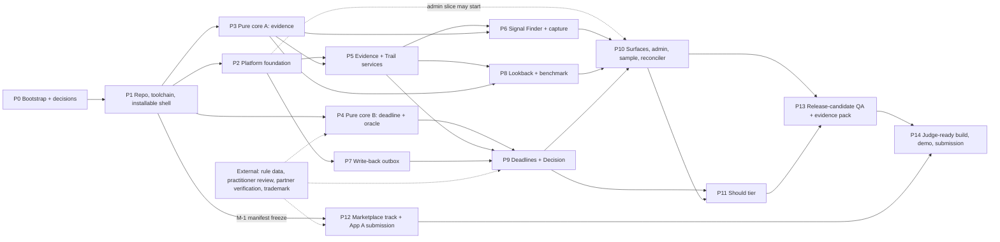

# KnewWhen — Implementation Plan

**Status:** Draft v0.1 for owner approval · **Date:** 23 Nov 2026 · canonical file 9 (AGENTS §2.1)
**What this file is:** the stable execution blueprint: phases, dependencies, parallel lanes, ownership, integration points, tests and acceptance gates. It is **not** a progress record (that is `TODO.md`) and **not** a scope source (tiers come from `idea.md`, ACs from `Scope.md`). It changes no requirement, tier or architecture decision. Where the plan needs such a change it is raised as a `PC-n` finding (§2.4) or a decision `DR-n` (§12).
**Precedence:** rank 8 in AGENTS §2.4. Everything here is **Proposed** until the owner approves it (AGENTS §3).
**Nothing is built.** No task, phase or check in this file is complete. `TODO.md` will record status; this file never will.

---

## 1. How to use this file

1. The orchestrator plans from this file. `TODO.md` is derived from it (§14): a full phase index plus a complete checklist for the active phase only.
2. **Start on contracts, close on acceptance.** A phase may start as soon as the interfaces it consumes are *accepted* (named in its "Start when"). It may not be *accepted* until every phase it depends on is accepted. No phase waits for a date. No gate is skipped to go faster.
3. **Verification A never receives this file** (AGENTS §6.3, §13.2). The orchestrator gives A only the requirement IDs and journey names listed under that phase's "Verification A scope". Builder claims, TODO state and this plan stay hidden from A.
4. Sizes (S/M/L/XL) are relative planning aids, **Inferred**, not calendar estimates.
5. IDs are stable: phases `P0`–`P14`; tasks `P<n>.<group><k>` (for example `P6.A2`); gate tasks `P<n>.VA`, `P<n>.VB`, `P<n>.FIX`, `P<n>.ACC`; decisions `DR-n`; risks `R-n`; milestones `M-n`; interfaces `IF-n`; plan findings `PC-n`.
6. Role abbreviations: **ORC** orchestrator · **PRQ** product/requirements · **FA** Forge architect · **DR** domain research (reads official text; makes no regulatory determination) · **BE-n** backend writer lane *n* · **FE** frontend/UX · **TE** test engineering · **TE-O** oracle author (a different context from the engine author) · **SP** security/privacy · **VA / VB** independent verifiers · **RD** release/demo · **OWN** the human owner. `BE-n` names a write lane, not a headcount.

---

## 2. Planning basis

### 2.1 Inputs read (all in full, to the last line, on 23 Nov 2026)

| File | State at reading | Use in this plan |
|---|---|---|
| `AGENTS.md` v0.1 | Operating constitution; owner-approved authority | Roles, gates, status words, invariants I-1…I-13, change control |
| `Idea.md` | Approved proposal | Tiers, demo, dates, risks |
| `Hackathon.md` | Verified 23 Nov 2026; rules can change | Official deadlines, distribution, judge path |
| `Winner_Benchmarks.md` | Informs only | Engineering bar; no requirement created |
| `Tools_and_technologies.md` v1.0 | **Locked** | Stack, modules, dev tooling, change control |
| `Architecture.md` Draft v0.1 | Awaiting owner approval | Components, data model, flows, limits |
| `Scope.md` Draft v0.1 | Awaiting owner approval; ACs **Proposed** (AGENTS B-6); CF-1…CF-7, OI-1…OI-10 open | Requirement IDs, ACs, proof |
| `Workflow and UI demo.md` Draft v0.1 | Awaiting owner approval; WF-1…WF-16 open | Journeys, surfaces, states, demo, judge path |

**Not available (reported, not substituted):** `Knewwhen.md`, `docs/02-spec.md`, `docs/03-domain-rules.md`, `docs/08-decisions.md`, `IMPLEMENTATION_PLAN.md` §2.11 (verified platform facts), `rules/*.json`, `TODO.md`.

### 2.2 Implementation state

**Verified (23 Nov 2026, by listing `/mnt/user-data`):** only the uploaded documents exist. No repository, `manifest.yml`, `package.json`, source, tests, evidence or harness config is visible. The authoring shell has no network and no Forge CLI (AGENTS Appendix A). **This plan therefore assumes a greenfield start.** Task `P0.A1` re-checks on the owner's machine. If a repository exists there, P0 reconciles this plan against it before any other task starts (AGENTS §6.1 step 5).

### 2.3 What the approval state allows (AGENTS §2.6)

Open conflicts and items block only what they name. Where a task rests on a `Scope.md` contract default, it is built to that default only if the owner approves `Scope.md` or that default (DR-1). Otherwise the pure parts are built behind a stable interface, the rest is marked **Blocked**, and the question goes to the owner.

### 2.4 Plan-level findings (logged, not smoothed over; AGENTS §7.3)

| ID | Finding | Effect | Handling |
|---|---|---|---|
| **PC-1** | **Listing submission (about 1 Dec) comes before Core (8 Dec).** `idea.md` §10 and `hackathon.md` §13.2 set both. `Scope.md` CF-5 says adding a module, scope or `llm` after submission is a major version needing admin re-consent. | Submission needs a **frozen manifest** and a build that "performs as described" a week before Core is due. | Milestone **M-1 Manifest freeze** precedes **M-2 App A submitted** (§3). Whether later *code-only* updates are allowed during and after review is an A-11 check (`P0.B4`). DR-2, DR-3, DR-14. |
| **PC-2** | The `jira:entityProperty` indexed values (aliases, types) are **declared in the manifest**, but WF-14 leaves the keys and aliases undefined, and C-07.1 names one "due date" while FDA may have more than one clock. | The manifest cannot be frozen until the property schema is fixed. | `P7.A0` fixes the schema; it is a **precondition of M-1**. DR-3. |
| **PC-3** | AGENTS §13.2 defines Verification A as run against "the running product". Phases P3 and P4 are pure code with no running surface. | A literal reading would block those phases. | Interface-level A for pure phases (§6.3): A writes its own scenarios from requirements and drives the public interface. **Needs owner confirmation** (DR-17). |
| **PC-4** | The signal lexicon needs a file location, but `rules/*.json` is locked (Arch §7.3, U-1). | The screener's real content cannot land without approval. | Screener built against a lexicon *schema*; test lexicon lives in `tests/fixtures/` and is never shipped as rule data (I-7). DR-9. |
| **PC-5** | Obligations named `T-03`, `T-04`, `T-05` (Tools §4, §6, §9) come from the missing `IMPLEMENTATION_PLAN.md`. The names `IMPLEMENTATION_PLAN.md` and `Implementation plan.md` are easy to confuse. | Task numbering from a file this plan has not seen. | Obligations are mapped to tasks: T-03 → `P1.A5`, T-04 and T-05 → `P1.A1`. Platform facts are written to `docs/platform-facts.md` (Type B choice) unless the owner supplies the old file (DR-17). |
| **PC-6** | Uploaded names differ from canonical names (`Idea.md` vs `idea.md`, `Tools_and_technologies.md` vs `tools and technologies.md`, and so on). | Duplicate or imagined copies. | `P0.A4` resolves names in the repository by search and records the mapping (AGENTS §2.3). No duplicate is created. |
| **PC-7** | The AI-path evidence in C-12 needs a live hosted-model call on a deployed app. AGENTS §10.2 requires owner approval for any live Forge LLM call. | A hidden cost and approval dependency inside P6 and P13. | Explicit approval task `DR-18`; the run records result tables only, never model input or output. |

---

## 3. Deadlines and milestones

External deadlines and internal targets are kept apart (AGENTS §11.4). Dates constrain delivery; they do not create daily task sequences.

| Kind | Item | Date | Source | Status on 23 Nov |
|---|---|---|---|---|
| **Official** | Registration and submission close | Tue 22 Dec 2026, 12:00 pm PST = **Wed 23 Dec, 01:30 IST** | Rules §1 via `hackathon.md` §13 | Re-read the rules before submitting (they can change) |
| **Official** | Judging 5 Jan – 3 Feb 2027; winners about 15 Feb | — | same | App B stays frozen through winner verification |
| Internal | Partner verification (business or tax ID) | 20 Nov | `idea.md` §10 | **Unknown** (no status supplied) → `P12.A1` |
| Internal | Practitioner review of rules; trademark search | 24 Nov | `idea.md` §10 | Due tomorrow → `P0.D2`, `P0.D3` |
| Internal | Judge copy tested from an outside org; listing submitted | ~1 Dec (hard 8 Dec for the review ticket) | `idea.md` §10 | Open; PC-1 |
| Internal | Core working end to end on a clean site | 8 Dec | `idea.md` §6 | Open |
| Internal | Should items | 15 Dec | `idea.md` §6 | Open |
| Internal | Devpost submission | 17 Dec | `idea.md` §10 | Open |
| External limits | Demo site expires 90 days after provisioning; API token must outlive 15 Feb 2027; LLM billing needs a payment method | — | Tools §7 | Checked in `P0.A3` |

**Milestones used as gates in this plan**

| ID | Milestone | Precondition | Tied to |
|---|---|---|---|
| **M-0** | Environment proven and decisions packet delivered | `P0` accepted | Everything |
| **M-1** | **Manifest freeze.** Modules, scopes, `llm`, `sql`, entity-property aliases, and the conditional modules (glance/issue context, gadget, Rovo) are final. Changing any of them afterwards needs an owner-approved major-version plan. | `P1` accepted; `P7.A0` done; DR-2, DR-3 answered | PC-1, CF-5 |
| **M-2** | App A submitted for listing; ECOHELP ticket URL captured | M-1; App A installed from an outside org *before* submission; `P12` entry met | Bonus evidence |
| **M-3** | Core end to end on a clean outside-org site | `P10` accepted; `P13` Verification A started | 8 Dec |
| **M-4** | Should items accepted or cut by decision | `P11` | 15 Dec |
| **M-5** | App B final, outside-org tested, frozen | `P13` accepted | `P14` |
| **M-6** | Devpost submitted by the owner | `P14` accepted | 17 Dec (official close above) |

---

## 4. Dependency graph and critical path

**Critical path:** `P0 → P1 → P2 → P5 → { P8 ∥ P9 } → P10 → P13 → P14`.
- **Co-critical:** P8 (lookback, protected first by `idea.md` §10) and P9 (decision) both follow P5 and both gate P10. P6 is **near-critical**: it also gates P10.
- **Feeders that must not slip:** P3 → P5; P4 → P9; P7 → P9.
- **Hidden critical path (external):** rule content, the decision-question set and the practitioner review (OI-1, OI-2) gate the *content* of P4 golden cases, P9 questions and P3's real lexicon. The code does not wait for them; Core acceptance does (R-1).
- **Parallel track off the engineering path:** P12 (Marketplace) starts at M-1 and must finish before P14, but does not gate P2–P11.

**Lanes after P5 (parallel, disjoint file sets):** BE-1 P6 · BE-2 P8 · BE-3 P9 · BE-4 P7 (earlier) · FE slices per tab · TE test design · SP/VB reviews.

---

## 5. Execution model

### 5.1 Single-writer assets (one agent at a time; AGENTS §9.2)
`manifest.template.yml` and rendered manifests · `migrations/` · shared types and contracts (`src/contracts/`) · `rules/*.json` (locked) · the lookback decision table · `package.json` and lockfile · `ui/shared/` and `ui/strings/` (the strings catalogue the wording scan reads) · the resolver **registry** and role matrix file · `handlers/scheduled.ts` (reconciler assembly) · `docs/08-decisions.md` and `TODO.md` (ORC only) · the evidence index.

**Hot files:** the resolver registry and the reconciler assembly are touched by many phases. Each branch adds its own handler module plus one registry line. The integrator resolves the registry line at merge, never the last merger by overwriting (AGENTS §9.4).

### 5.2 Proposed layout (confirmed or changed at `P1.A1`; AGENTS §12.1 forbids assuming it)
`core/` (normaliser, validator, screener, matcher, ranker, deadline engine, rule-set checks, tz converter, scenario generator, CSV writer) · `services/` (scan, evidence, trail, lookback, deadline, decision, write-back, authorisation, settings) · `adapters/` (jira, sql, kvs, llm, hash, clock — the **only** `@forge/*` importers) · `handlers/` (resolver, trigger, consumers, scheduled) · `ui/panel/tabs/*`, `ui/admin/*`, `ui/shared/`, `ui/strings/` · `rules/` (locked) · `migrations/` · `tests/`, `oracle/` (dev-only, never bundled) · `evidence/` · `scripts/` · `docs/`.

### 5.3 Isolation modes (decided at `P0.A2`)
- **Parallel mode** (worktrees proven): `git worktree add ../kw-<task-id> -b agent/<task-id>-<slug>` off the integration branch; one owner per task and per file (AGENTS §8.4).
- **Single-writer fallback** (worktrees or second contexts not proven): one code writer at a time; research, test design, reviews and verification still run in parallel read-only. The critical path then lengthens; the plan records that effect instead of hiding it.

### 5.4 Work-in-progress and review capacity (Proposed; tune after `P0.A2`)
- At most **4 concurrent code writers** and at most **3 branches awaiting merge**. If either limit is hit, no new task starts until the queue drains.
- Every task gets a read-only **task review** (AGENTS §13.4, §15.5) before merge. This is not Verification A or B.
- The orchestrator reserves integration time after each merge: re-run `npm run check` on the integrated result (AGENTS §9.4).
- Verifier contexts must exist **before** a phase closes. If only one context is available, acceptance is **Blocked** and goes to the owner (AGENTS §8.3, §13.5).

### 5.5 Delegation brief (every delegated task; AGENTS §8.2)
Task ID, owner, objective and user outcome · requirement IDs and the document sections to read · **owned files** (exclusive write set) and read-only context · interface or contract · ACs, tests that must pass, commands to run · constraints (invariants, no new dependency, no scope change) · out of scope · expected output (branch or diff, commands run with results, what was not verified, open questions).

### 5.6 Task lifecycle
1. **Outcome first** (AGENTS §5.1): two or three lines on user outcome, workflow touched, requirement IDs. Workflow impact check (§5.2) written down.
2. **Red first** (AGENTS §12.2): the failing test is written and run before the change; the failure message is read and its reason confirmed. Evidence includes the red run.
3. Smallest sound change → green → refactor.
4. Task review → pre-merge gate (AGENTS §15.4) → merge in dependency order → full `npm run check` on the integrated branch.

---

## 6. Quality gate protocol (every phase ends with A–E)

| Step | What | Who | Rule |
|---|---|---|---|
| **A** | Implementation and integration checks | Builder + TE | `npm run check` green on the integrated commit; phase tests green; integration checkpoint passed; red-first evidence present |
| **VA** | Blind product acceptance | Independent context (VA) | Reads AGENTS, the requirement documents and the journeys; **not** `TODO.md`, this plan, handoffs or builder reports. Writes its own scenario list **before** touching the product. Runs it against the running product (or the public interface for pure phases, §6.3). Reports pass/fail with evidence, defects with repro, AC IDs covered and not covered |
| **VB** | Adversarial engineering review | A different context (VB) | White-box: source, data flow, permissions, security/privacy, concurrency, retries, idempotency, test quality. **Completes and commits its initial findings before it is shown VA's findings** (the orchestrator withholds VA's report until VB's initial file is committed and its hash recorded). Only then may VB reconcile with VA |
| **FIX** | Corrections | The **builder** | Each fix has a regression test. A user-visible fix → re-run VA. A code, data-flow or design fix → re-run VB. Unsure → both |
| **ACC** | Orchestrator acceptance | ORC | Opens the evidence, re-runs the key commands itself, checks VA and VB passed on the **current** commit, no open Blocker or Major, requirement IDs covered, documents consistent (AGENTS §13.5) |

### 6.1 Why VA and VB are materially different
- **VA is black-box and behavioural:** roles, states, empty/error/degraded views, the judge's own text, the guide's steps, per-AC outcomes.
- **VB is white-box and destructive:** mutation of code to prove tests fail, replay and reorder of events, crash-between-steps, forged resolver payloads, canary strings through every sink, scope and write-path reachability, race conditions, test-quality audit. VB does not re-run VA's scenarios.
- Each phase below lists a different focus for each.

### 6.2 Evidence bundle (per phase)
`evidence/P<n>/` holds: `check.txt` (command, output, SHA), red-first logs, test reports with seeds, `VA/` (scenario list, results, screenshots with personal data blurred), `VB/initial.md` (committed first), `VB/final.md`, `fix/` (regression tests and re-runs), `ACC.md` (commands re-run, SHA, open items). No secrets, record text or model I/O (I-6).

### 6.3 Special forms
- **Pure phases (P3, P4):** VA drives the public interface with its own scenarios from requirements and journeys, never reading builder tests. Needs owner confirmation (PC-3, DR-17).
- **P0 and P12:** VA reproduces environment checks or reads listing/privacy material against the running App A and the requirement documents.
- **Batching:** independent phases that finish together (for example P3 and P4) may share verifier sessions but get **separate verdicts and separate evidence**, on the same commit.
- **Blocked is not passed:** if a clean install, a second Jira user, a second context or the Forge CLI is unavailable, the result is **Blocked** (AGENTS §13.2).

### 6.4 Severity
Blocker (breaks an invariant, a Core AC, security or privacy) · Major (an AC fails or a failure path is wrong) · Minor. No open Blocker or Major at acceptance.

---

## 7. Interface register (contract-first)

Names are **working names** (Arch §3.2 says the same of Forge identifiers). Each interface is pinned in `src/contracts/` by its **first task** (the "contract task") before parallel work begins. Exact Forge identifiers come from `docs/platform-facts.md` (`P0.B`). A signature change after pinning is a single-writer change announced to every consumer.

| ID | Interface | Producer → consumers | Pinned by |
|---|---|---|---|
| IF-1 | `extractSegments(adf, version)` → segments with position map; `normalise(text, version)` | P3 → P5, P6, P8 | `P3.A1` |
| IF-2 | `validateQuote(segmentText, quote, limits)` → accepted span or typed reject | P3 → P5, P6, P8 | `P3.A2` |
| IF-3 | `screen(normalisedText, lexicon)` → candidate spans (passed on to IF-2) | P3 → P6 | `P3.B1` |
| IF-4 | `computeClocks(awarenessISO, asOfISO, ruleSet, holidays)` → clocks (with trace) or typed error | P4 → P9, S-04/S-05 | `P4.A0` |
| IF-5 | `loadRuleSet(json)` → rule set + digest, or `RULE_SET_INVALID`. The oracle has its **own** loader | P4 → P9 | `P4.A1` |
| IF-6 | Jira client: `call(descriptor, identity, budgetClass, timeout)`; `JiraWriter` with exactly five operations | P2 → all services | `P2.D2` |
| IF-7 | Authorisation gate: `gate(ctx, action, resource)` → allow/deny + audit; handler registry equals role matrix | P2 → all resolvers | `P2.D2` |
| IF-8 | Evidence service: `capture`, `revalidate(asViewer)`, status transitions | P5 → P6, P8, P9 | `P5.0` |
| IF-9 | Trail service: `createCase`, entries, transitions, candidate-date computation | P5 → P6, P8, P9 | `P5.0` |
| IF-10 | Scan queue message `{issueId, eventType, entityId, trigger}` | P6 trigger → P6 consumer | `P6.0` |
| IF-11 | `runLookbackStep(caseId, cursor)` → `{candidates, nextCursor or done, capsHit, retryAfter?}` | P8 → UI | `P8.0` |
| IF-12 | Outbox task kinds `SIGNAL_FLAG`, `PROPERTY`, `SUMMARY_COMMENT`, `REMINDER`; unique `(case_id, kind, dedupe_key)` | P7 → P6, P9, P10 | `P7.0` |
| IF-13 | Property `knewwhen.case` schema v1 and indexed aliases | P7 → manifest, UI, guide JQL | `P7.A0` |
| IF-14 | Structured logger: ids, codes, counts, durations only | P2 → all | `P2.B2` |
| IF-15 | Resolver response envelope: data, role hint, correlation id, typed error codes | P2 → all UI slices | `P2.D2` |
| IF-16 | Rule-data schemas: rule set, holiday calendar, question set, lexicon | P4/P3 → P9 | `P4.A0`, `P3.B1` |

---

## 8. Test strategy and evidence (Arch §16, AGENTS §12.3)

**Rules for every phase:** expected values come from requirements, rule text or golden cases — never from running the code under test. Fake only at the boundary (Jira, model, SQL, queue). Property tests use `fast-check` with seeds logged. No sleeps, no real clock in the pure core, no network. Critical tests are spot-checked by deliberately breaking the code and seeing them fail. No test is skipped, weakened or bypassed with `--no-verify`.

| Layer (Arch §16.1) | Built in | Proof type | Runs in `npm run check`? |
|---|---|---|---|
| Verbatim validator + normaliser, frozen ADF corpus | P3 | PT, GT | Yes |
| Rule screener metrics | P3 | UT (labelled synthetic set) | Yes |
| Deadline engine vs oracle (≥ 10,000 cases, seed logged), golden cases, metamorphic properties | P4 | GT, OR, PT | Yes |
| Evidence lifecycle with fake Jira | P5 | FK | Yes |
| Idempotency, replay, reorder, crash-between-steps | P5–P10 | FK | Yes |
| Signal Finder with adversarial AI fake (SC-6) | P6 | FK | Yes (model never called) |
| Lookback benchmark (tuning vs held-out) | P8 | BM | Yes (offline corpus) |
| Authorisation matrix (every handler × role × browse allowed/denied) | P2, extended each phase | FK | Yes |
| Write-back with fake Jira | P7, P9 | FK | Yes |
| Privacy canary, migration column check, wording scan, import boundary, runtime-dependency allow-list, bundle contents | P1–P2, extended each phase | SC | Yes |
| Manifest snapshot, A/B parity, `forge lint`, `forge eligibility` | P1, re-run each phase | SC | Yes |
| Recorded AI-path results (hosted model) | P6, P13 | Recorded run (owner-approved spend) | **No** (results saved, model not called by `check`) |
| Clean-site end-to-end from an outside org (judge steps 1–9) | P13, P14 | E2E | No (manual script, log saved) |
| Accessibility and dark mode | P10, P13 | MR | No |

**Stated limits (carried into C-12.4):** oracle agreement shows the arithmetic is consistent, not that the legal reading is right (rule data is common to both, so a wrong holiday entry is common-mode). The offline lookback benchmark measures the **ranker**, not Jira's own text-search recall; that part is covered by E2E on a real site. Imported timestamps are Jira's claims. Edited or deleted wording cannot be recovered (CF-4).

---

## 9. Phase index

| ID | Name | Size | Start when (contracts or conditions) | Delivers (requirements) | Critical? |
|---|---|---|---|---|---|
| **P0** | Bootstrap, capability proof, decision packet | M | Plan approved | Enabler. Outputs: capability record, `docs/platform-facts.md`, decision packet, external-status record | Yes |
| **P1** | Repository, toolchain, installable Forge shell | M | `P0.A1`, `P0.A2`, `P0.A3` (Forge login, demo site), `P0.B2` (scope names) | N-06, N-03(a,g), N-08 parity, C-12 harness, shells for C-09/C-10 | Yes |
| **P2** | Platform foundation services | L | P1 shell deployed; `P0.B1` SQL/KVS facts | N-01(b,d), N-03(b–e,h), N-04(a–c), N-07, N-09 (logging), G-3…G-6, C-07.10 allow-list | Yes |
| **P3** | Pure core A: evidence core and scenario generator | L | P1 toolchain; IF-1/IF-2/IF-3 contract tasks | C-01.1–2, C-01.13 metrics, G-2, I-1, I-2; C-08.4, C-08.6 | Feeder |
| **P4** | Pure core B: deadline engine, rules loader, oracle | L | P1 toolchain; `P4.A0` rule-data contract | C-05 (engine side), C-11 typed errors, N-06, I-7 | Feeder |
| **P5** | Evidence and Trail services | L | P2 contracts (IF-6/7/14) and P3 IF-1/IF-2 accepted | C-04, C-03.8–9 (service side), B-3, CF-4 behaviour | Yes |
| **P6** | Signal Finder and capture | XL | P5 IF-8/IF-9; P3 accepted; P2 accepted | C-01, C-02, C-11 (AI switch), C-09.1 nudge | Near |
| **P7** | Write-back outbox | M | P2 IF-6/IF-7; `P7.A0` property schema | C-07 (flag and property; decision comment completes in P9) | Feeder |
| **P8** | Lookback and benchmark | XL | P5 accepted; P3 generator and normaliser | C-03, B-4, C-12 benchmark | Yes (co-critical) |
| **P9** | Deadlines, decision record, rule-status gating | XL | P4 + P5 + P7 accepted; question-set data or fixture state known | C-05 (service), C-06, C-11, C-07.3–8 | Yes (co-critical) |
| **P10** | Product surfaces, admin, sample, reconciler | L | Admin slice: P2 accepted. Rest: P6, P8, P9 | C-08, C-09, C-10, C-11.5, N-01(c), N-04(d), N-05 | Yes |
| **P11** | Should tier | L | P9 accepted and Core stable; M-1 decisions | S-01, S-04, S-05; S-02 and S-03 only if in the frozen manifest | No |
| **P12** | Marketplace track and App A submission | M | M-1; first end-to-end slice (P6 + P7) installable | Bonus evidence; N-08 listing text | Parallel |
| **P13** | Release-candidate QA, security, evidence pack | L | P10 accepted; P11 accepted or cut | C-12, N-01…N-09 final proof, whole-product A and B | Yes |
| **P14** | Judge-ready build, demo and submission | M | P13 accepted; P12 submitted | N-08, Hackathon §9 and §15 | Yes |

---

## 10. Phases

Each phase lists the thirteen items required by the brief. "Start when" names what must be *accepted or done* (not a date). "Verification A scope" lists the only things the orchestrator passes to VA.

---

### P0 — Bootstrap, capability proof, decision packet

- **Outcome.** A proven environment and an owner-ready decision packet, so that no later phase builds on assumption (AGENTS §0.1, §6, Appendix A.3).
- **Entry / upstream.** Plan approved. No upstream phase.
- **Scope delivered.** Enabler. Touches OI-1, OI-2, OI-8, OI-9; CF-1…CF-7; WF-1…WF-16; U-1…U-11; AGENTS B-1…B-6.
- **Deliverables / components.** Capability record (recovery note style, AGENTS §6.4) · `docs/platform-facts.md` (each fact Verified with URL and date) · `docs/08-decisions.md` opened · decision packet (§12) · external-status record (partner verification, practitioner review, trademark) · file-name mapping (PC-6) · test accounts on the demo site.
- **Tasks.**

| ID | Task | Req / ref | Depends | Owner | Acceptance / evidence |
|---|---|---|---|---|---|
| P0.A1 | Run the Appendix A.3 bootstrap checks on the **owner's** machine: git root, status, `git worktree list`, `node -v` (22.23.4+ or 24.22.1+), `npm -v`, `forge --version`, harness version, `.claude`/`.opencode`, `CLAUDE.md` containing `@AGENTS.md`, hook state, ECC inventory (ECC stays out unless approved, B-1) | AGENTS A.3, §19 | — | ORC + OWN | Command output saved with dates. Any existing repository reconciled with this plan |
| P0.A2 | Prove isolation and independence: create and remove a throwaway worktree; start a second independent context (different model family if available; otherwise a fresh session) | AGENTS §9.3, §13, B-2 | A1 | ORC | Output proves or disproves parallel mode and A/B independence. If independence fails, acceptance is **Blocked**; escalate (R-3) |
| P0.A3 | Forge and Atlassian access: `forge login` with an API token that outlives 15 Feb 2027; provision the demo site and record its expiry; second developer site on a second account (outsider); Developer Space; LLM billing method and alert (H-09). Create test users: admin, Reviewer, Qualified person, Viewer, and a user with narrow project access | Tools §7, Hackathon §14 | A1 | OWN | Screens or CLI output without secrets. Token secrets only in the owner's password manager (AGENTS §10.3) |
| P0.A4 | Resolve canonical file names by searching the repository; record the mapping; place canonical copies in `docs/` without creating duplicates | AGENTS §2.3, PC-6 | A1 | ORC | Decision-log entry |
| P0.B1 | **Platform facts (A-11), three or four parallel read-only agents:** Forge SQL semantics (affected rows, upsert, parameters, foreign keys, transactions); KVS and secret store; queue delay, retries, retry-after hint, event identifiers (comment edit and delete, link created); `llm` model identifiers and moderation; JSM internal-comment mechanism; entity-property visibility, index lag and JQL types; as-app visibility and restricted comments; group-membership lookup; personal-data reporting mechanics | Arch §18.2, OI-8 | A1 | DR (read-only) | `docs/platform-facts.md`: each fact Verified (URL, date) or Unresolved with the Arch §18.2 fallback named |
| P0.B2 | Map the six working scope names to exact Forge scope identifiers; assess granular scopes (U-11) read-only | Arch §13.2, N-03(a) | A1 | DR | Table in facts file. Scope changes remain owner decisions |
| P0.B3 | Verify UI Kit CSV download options (WF-5), importer event behaviour (WF-7), panel visibility and `jira:issueContext` (WF-1, WF-2) | Workflow §0 | A1 | DR | Facts file |
| P0.B4 | Verify Marketplace mechanics that drive PC-1: are code-only updates allowed during and after review; what a manifest change costs after submission; ticket and scan flow; partner-verification gating | Hackathon §11 | A1 | DR | Facts file. Feeds DR-2 and the M-1/M-2 strategy |
| P0.C1 | Compile the **decision packet** (§12): every DR with source IDs, the Scope default, the cost of each answer and what it blocks | AGENTS §7.4 | B1–B4 (partial is fine) | PRQ + ORC | Packet delivered to OWN |
| P0.C2 | Record each owner reply in `docs/08-decisions.md` with date and wording | AGENTS §7.4 | C1 | ORC | Log entries |
| P0.D1 | Obtain `docs/02-spec.md`, `docs/03-domain-rules.md`, `rules/*.json`, the lexicon location and the question set from the owner, or record that they do not exist | OI-1, U-1 | A1 | OWN | Files present, or OI-1 stays **Unresolved** with the build using fixtures only |
| P0.D2 | Record the practitioner-review outcome (24 Nov) and set the rule-set status (reviewed, preview or unreviewed) | OI-2, CF-3 | D1 | OWN | Dated record |
| P0.D3 | Record the trademark search result (24 Nov) and the partner-verification status (20 Nov) | OI-2, R-8, R-9 | — | OWN | Dated record |
| P0.D4 | Extract, with citations, the **public** FDA decision questions and the OPM federal-holiday list for 2026–2027 as a **draft for practitioner review**. Marked Proposed. Not rule data until the owner approves and locks it | I-7, DR role | D1 | DR | Cited extract. No regulatory determination |

- **Parallel and why.** B1–B4 are read-only research on disjoint topics. A3, D2, D3 are owner actions independent of agent work. D4 is research on public sources.
- **Sequential and why.** A1 → A2 (the isolation test needs the repository). C1 after enough B results to set honest defaults. C2 after each owner reply.
- **Ownership / boundaries.** No application code. Agents write only `docs/` files they own; `docs/08-decisions.md` is ORC-only.
- **Integration checkpoint.** The owner reviews the decision packet and capability record.
- **Tests required.** Not applicable to code. Negative case: any fact that cannot be verified is marked **Unresolved** with its fallback, never assumed.
- **Verification A scope.** Environment reproduction: a second context repeats the A.3 checks and the isolation test from AGENTS and `docs/` only. Result is pass or **Blocked**.
- **Verification B focus.** Audit of `docs/platform-facts.md` against the official URLs for every load-bearing fact; check that decision-packet defaults do not contradict the locked tools file or invariants.
- **Exit and evidence.** Capability record complete · isolation and independence proven or an owner decision recorded · facts covering everything P1–P3 need are Verified (others Unresolved with fallback) · decision packet delivered; each reply logged · external statuses recorded · `evidence/P0/` bundle.
- **Blockers and recovery.** No Forge access → all deploy-dependent work blocks; escalate immediately. Independence unavailable → owner decision (AGENTS §13.5). Rule data missing → proceed with fixtures; the shipped rule status stays UNREVIEWED (CF-3 default) and R-1 is raised. A fact that cannot be verified → use the Arch §18.2 fallback and mark **Unresolved**.

---

### P1 — Repository, toolchain, installable Forge shell

- **Outcome.** A real, empty Forge app installed on the demo site with the full Core module set declared, a working `npm run check`, a commit guard, and A/B manifest parity tooling.
- **Entry / upstream.** P0.A1, P0.A2, P0.A3, P0.B2. Decisions DR-1 and DR-2 give the baseline manifest (default: Arch §3.2, with no glance, gadget, Rovo or custom fields).
- **Scope delivered.** N-06, N-03(a,g), N-08 (parity), C-12 (harness), I-7 (locked-file guard), I-10; shells that C-09 and C-10 will fill.
- **Deliverables / components.** `package.json` (official `@forge/*` only, pinned; dev tools licences recorded) · strict `tsconfig` · ESLint with an import-boundary rule · Prettier · Vitest · fast-check · `npm run check` and `npm run setup` · `scripts/hooks/` pre-commit · `CLAUDE.md` · reviewer and judge agent definitions for both harnesses · manifest template, renderer, parity checker, scope/module snapshot test · evidence writer · Forge app (resolver, panel shell, admin shell, no-op trigger, two consumers, scheduled trigger, `jira:entityProperty`, `llm`, `sql`, empty migration) · deployed and installed.
- **Tasks.**

| ID | Task | Req / ref | Depends | Owner | Acceptance / evidence |
|---|---|---|---|---|---|
| P1.A1 | Inspect, then create the layout, `package.json`, `tsconfig`, ESLint, Prettier, Vitest, fast-check. Pin versions; record each version and licence in `docs/08-decisions.md` (maps T-04, T-05). Add one `PRODUCT_NAME` constant so a rename is cheap (R-9) | AGENTS §12.1, N-06, I-10 | P0 | BE-1 | `npm ci` works on a fresh clone; version log |
| P1.A2 | `npm run check` skeleton: lint, strict typecheck, tests, fast-check smoke, hook for `forge lint`; writes `evidence/` with SHA | N-06, C-12 | A1 | BE-1 | Green run saved |
| P1.A3 | Static checks: `core/` imports nothing from `@forge/*`; only `adapters/` may; runtime-dependency allow-list; tests and `oracle/` absent from the deployed bundle | N-06, N-03(h), C-12.5 | A1 | SP + BE-1 | Each check fails on an injected violation |
| P1.A4 | Git pre-commit hook (locked files without approval tag; failing `check`), installed by `npm run setup`; **tested** by a violating commit on a scratch branch | AGENTS §6.5, §7.2 | A1, A2 | BE-1 | Hook run output |
| P1.A5 | `CLAUDE.md` = `@AGENTS.md`; mirrored read-only reviewer/judge agents; confirm OpenCode config keys in official docs (maps T-03); record a harness support matrix | Tools §6, AGENTS §19 | A1 | ORC | Matrix with method and date |
| P1.B1 | Manifest template with all Core modules and the six scopes; render App A and App B manifests (differ only in `app.id`, plus a licensing declaration for A if the listing requires it); parity checker; scope/module snapshot test with approval marker | N-03(a), N-08 | A1, DR-2 | FA | Parity passes; fails on an injected diff and on an added scope |
| P1.B2 | Forge shell: create the app, deploy to development, install on the demo site; resolver stub that takes identity from platform context; panel and admin shells with "Loading KnewWhen…" and error states; no-op handlers; first empty migration run by the official runner | Arch §3.2, G-8 | A1, B1 | FA + BE-1 | Install log; app visible under Apps |
| P1.B3 | Run `forge lint` and `forge eligibility` and record the baseline | N-03(g), I-13 | B2 | FA | Output saved. A failure is a finding, not a claim |
| P1.B4 | Register the App A and App B IDs in the Developer Console | Arch §17.2, DR-14 | B1 | OWN | IDs recorded |

- **Parallel and why.** After A1: A2, A3, A5 and B1 touch different files (`scripts/`, lint config, `.claude/`, manifest). A4 follows A2 (it runs `check`). B2 follows B1.
- **Sequential and why.** A1 is first because it owns `package.json` and the lockfile (single writer). B1 before B2 because the manifest is single-writer and the shell must match it.
- **Ownership / boundaries.** BE-1 owns repo config and scripts. FA owns the manifest files. ORC owns `.claude/` and docs.
- **Integration checkpoint.** Fresh clone → `npm ci && npm run check` green · hook blocks a locked-file edit · shell installs on the demo site · parity and snapshot pass.
- **Tests required.** Negative: lint fails when `core/` imports `@forge/*`; parity fails on a diff; snapshot fails on a new scope; hook blocks a locked file. Failure: deploy failure surfaces in `check` output rather than being hidden.
- **Verification A scope.** N-06, N-08, N-03(g); journeys: clean install, app appears under Apps, admin page opens, panel shows a loading state.
- **Verification B focus.** Manifest scopes and modules against N-03; the runtime dependency list; whether the hook can be bypassed (`--no-verify`, uninstalled hook) and what backstops it; secrets in the repository; whether parity can be fooled by key ordering or comments.
- **Exit and evidence.** `evidence/P1/` with `check` output, parity report, snapshot, `forge lint` and `forge eligibility` output, version and licence log, hook test, install log. **Manifest candidate hash** recorded for M-1.
- **Blockers and recovery.** Forge CLI or network unavailable to the harness → owner runs the deploy and install commands; agents prepare. A module needs approval → DR-2. `forge eligibility` fails → record, identify the cause, do not claim the badge (I-13). Fallback for unavailable worktrees → single-writer mode (§5.3).

---

### P2 — Platform foundation services

- **Outcome.** The shared services every feature depends on exist, each table has one owning service, and the authority, privacy and Jira-access rules are enforced in code and tests.
- **Entry / upstream.** P1 shell deployed. `P0.B1` facts for SQL and KVS (or their fallbacks recorded). Contract task `P2.D2` first.
- **Scope delivered.** N-01(b,d), N-03(b–e,h), N-04(a–c), N-07, N-09 (logging), G-3, G-4, G-5, G-6, G-9, C-07.10, I-6, I-8; C-10.2 and C-10.4 (settings validation, audit).
- **Deliverables / components.** All Core tables in forward-only idempotent migrations (including `scan_lease` and `usage_counter`) · repositories · settings service (KVS `settings:v1`) · hash-key store and HMAC hasher · single `audit()` · structured logger and canary harness · Jira client (identity, budget classes, timeouts, retry classification, `Retry-After`, metering) with the five-operation `JiraWriter` · authorisation gate, role resolution, handler registry and role matrix · contracts and resolver envelope.
- **Schema-first rule.** All Core tables land here so that later parallel lanes never touch `migrations/`. A later migration is a single-writer, forward-only change.
- **Tasks.**

| ID | Task | Req / ref | Depends | Owner | Acceptance / evidence |
|---|---|---|---|---|---|
| P2.D2 | **Contract task:** pin IF-6, IF-7, IF-14, IF-15 and the resolver envelope in `src/contracts/` | Arch §12 | P1 | FA | Contracts reviewed and frozen |
| P2.A1 | Schema and migrations for every Core table with the UNIQUE constraints from Arch §5.3 (use `''` sentinel where noted); idempotent, forward-only; migration column test (no text-bearing column except rationale, follow-up description, entered note, same-event note) | N-04(a,e), N-07, B-9 | D2 | BE-1 (sole migration writer) | SC column check; runs twice without error |
| P2.A2 | Repositories (one owning service per table) and an in-memory SQL fake built **from the verified facts**, not from assumptions | Arch §12, §18.2 | A1, P0.B1 | BE-1 + TE | Fake validated against the real database on the demo site for the semantics the plan relies on |
| P2.B1 | Jira client: explicit identity, budget classes (`panel`, `lookback`, `scan`, `sweep`, `writeback`), per-call timeout, transient/permanent/auth classification, `Retry-After`, per-hour metering in `usage_counter`, bounded pagination, no body logging; `JiraWriter` exposes exactly five writes; fake Jira | N-01(b,d), N-03(c), C-07.10, G-3 | D2 | BE-2 | FK tests; allow-list test fails if another write endpoint is reachable |
| P2.B2 | Structured logger (ids, codes, counts, durations) and the canary-string harness covering log calls, SQL parameters, comment bodies and error text | N-04(a), N-09, I-6 | D2 | BE-2 + SP | Canary fails the build on a leak |
| P2.C1 | Settings service with unsafe-combination rejection, before/after audit, code ceilings; hash-key store (create-if-absent; a lost race adopts the winner; **never regenerates**; secret store or the weaker fallback per U-3) and the HMAC-SHA-256 hasher | Arch §6.2, C-10.4, N-04(b) | D2, A1 | BE-3 | Race test; missing key blocks capture |
| P2.C2 | `audit()` single function (append-only; details are codes and ids) | G-5, N-07 | A1 | BE-3 | FK test |
| P2.D1 | Authorisation gate: identity from platform context, browse check as the user, fresh role resolution (groups, or the account-id allow-list fallback), deny by default, audited denials; handler registry whose list **must equal** the role matrix | G-4, Arch §13.3 | D2, A1, B1, C1, C2 | BE-4 | Matrix FK: handler × role × browse allowed/denied; dependency failure → deny |

- **Parallel and why.** After D2: A1, B1, B2, C1 are different files and services. A2, C2, D1 follow the single-writer schema (A1).
- **Sequential and why.** D2 first (contracts). A1 before anything that writes SQL. D1 last: it needs settings, audit, Jira client and schema.
- **Ownership / boundaries.** BE-1 `migrations/`, `adapters/sql`, repositories. BE-2 `adapters/jira`, logger. BE-3 `services/settings`, `adapters/kvs`, `adapters/hash`, audit. BE-4 `services/authorisation`, registry. FA owns contracts.
- **Integration checkpoint.** On the demo site: the migration runs; the gate answers for each role state with real platform context; concurrent invocations create one hash key; the Jira client reads a real issue as user and as app.
- **Tests required.** Unit and FK as above; canary; allow-list; settings invalid combinations (for example write-back on with no visibility); 429 with `Retry-After`, 5xx, budget exhaustion with headroom for interactive classes; SQL parameters only; an injected exception in the gate must deny, not allow.
- **Verification A scope.** C-10.2, C-10.4, C-10.5, C-06.1 (denial behaviour), G-4, G-6; journeys: role states (Viewer, Reviewer, QP, admin-without-role, empty roles), unsafe settings, denied calls audited.
- **Verification B focus.** Concurrency on key creation and lease semantics under the **verified** SQL behaviour; SQL injection; as-user versus as-app confusion; fail-open paths in the gate; secrets and text in real `forge logs`; whether any code path can reach a Jira write other than the five.
- **Exit and evidence.** `evidence/P2/` with matrix report, canary report, allow-list test, migration check, concurrency tests, real-site checkpoint log.
- **Blockers and recovery.** SQL semantics differ → read-after-write instead of affected-row checks (Arch §18.2). KVS secret store absent → weaker key custody (U-3, DR-16 needs owner acceptance). Group lookup unavailable → explicit account-id allow-list. Gate cannot be proven fail-closed → phase blocked; no feature phase starts.

---

### P3 — Pure core A: evidence core and scenario generator

- **Outcome.** A frozen normaliser, a single verbatim validator, a rule screener, and a deterministic scenario generator with a CSV writer — all pure and exhaustively tested.
- **Entry / upstream.** P1 toolchain. Contract tasks `P3.A1`, `P3.A2`, `P3.B1`.
- **Scope delivered.** C-01.1–2, C-01.13 (screener metrics), G-2, I-1, I-2; C-04 hashing and golden corpus support; C-08.4 and C-08.6 (generator, labels).
- **Deliverables / components.** `core/normaliser` (normalisation v1) · `core/validator` · `core/screener` and lexicon schema · frozen ADF golden corpus · labelled screener corpus · hand-written CSV writer · seeded scenario generator with ground-truth labels · `evidence/` metrics.
- **Tasks.**

| ID | Task | Req / ref | Depends | Owner | Acceptance / evidence |
|---|---|---|---|---|---|
| P3.A1 | Normaliser v1: ADF flatten (`hardBreak`, block boundaries), placeholders for volatile nodes, NFC, whitespace collapse; case, punctuation and order preserved. Pins IF-1 | Arch §6.3, I-1 | P1 | BE-1 | GT corpus green |
| P3.A2 | Verbatim validator: substring after normalisation, min/max length (OI-4 value), no placeholder or boundary crossing, first-occurrence span. Pins IF-2 | C-01.1, G-2 | A1 | BE-1 | PT green |
| P3.A3 | Property tests written from C-01.2: every substring of the normalised text validates; any one-character change, case change, omitted word, reordered words or boundary crossing is rejected (0 accepted); NFC and whitespace cases | C-01.2 | A2 | TE | PT with seeds |
| P3.A4 | Frozen ADF golden corpus (mention, emoji, media, inline card, status, date, table, list, code block, Unicode, very long text) with expected normalised text and hashes under a test key, authored from the Architecture rules, then pinned with a version tag | Arch §16.1, I-1 | A1 | TE | Corpus digest recorded; **version freeze** tag |
| P3.B1 | Rule screener and lexicon schema/loader (a missing or invalid lexicon yields `DEGRADED`, never "no signal"); outputs pass through IF-2. Pins IF-3. Test lexicon in `tests/fixtures/` only | C-01.4, Arch §7.3, PC-4 | A2 | BE-2 | UT green |
| P3.B2 | Labelled synthetic screener corpus (injury, malfunction, feature request, benign) and the metrics runner; reports precision and recall as measured | C-01.13, C-12 | B1 | TE | Metrics table in `evidence/` |
| P3.C1 | Hand-written CSV writer: quote every field; one `Comment` column per comment as `date;accountId;body` | C-08.4, Tools §4 | P1 | BE-3 | Determinism UT: same seed → byte-identical file |
| P3.C2 | Seeded scenario generator (seed, anchor date, author id): H1–H5, A1–A2 per Workflow §10; SC-4 hard negatives; ground-truth labels; a larger, separate seed for the benchmark. Fictional names only | C-08.2, C-08.6, I-12 | C1 | BE-3 + TE | Fixtures pass the I-12 check |

- **Parallel and why.** A-chain (normaliser, validator), B-chain (screener) and C-chain (CSV, generator) share no files. A3 and A4 are test-only files written from requirements.
- **Sequential and why.** A1 → A2 (validator uses normaliser). B1 after A2 (screener output goes through the validator). C1 → C2.
- **Ownership / boundaries.** BE-1 normaliser and validator; BE-2 screener; BE-3 CSV and generator; TE tests and corpora. No `@forge/*` import anywhere in `core/`.
- **Integration checkpoint.** Public interfaces exercised from a throwaway script with no Forge runtime; same seed yields a byte-identical CSV.
- **Tests required.** PT for validator; GT for corpus; UT for screener metrics; boundary and failure: unknown ADF node → placeholder; unsupported version → UNVERIFIABLE; huge input is windowed, not dropped; empty lexicon → DEGRADED.
- **Verification A scope (interface-level, PC-3).** C-01.1, C-01.2, C-01.4, C-01.13, C-08.4, G-2; scenarios: SC-1 text, SC-3 text, a typed phrase, tampered quotes, determinism of the generator.
- **Verification B focus.** Mutation check (break the validator on purpose; the tests must fail); version-freeze discipline; Unicode and normalisation edge cases; ReDoS and time on huge input; confirm the validator is the only acceptance path.
- **Exit and evidence.** PT seeds and counts, corpus digest and freeze tag, screener metrics, generator determinism proof.
- **Blockers and recovery.** Real lexicon content unavailable (OI-1, PC-4) → ship the schema and the fixtures; the real lexicon stays **Blocked**. Screener recall poor on SC-1 wording → report honestly (C-01.13); the AI path and "Open a case…" cover it. Generator inputs (WF-6) unanswered → build to the proposed inputs and log it.

---

### P4 — Pure core B: deadline engine, rule loader, independent oracle

- **Outcome.** A pure FDA deadline engine that cannot read the clock or I/O, an independently built oracle that agrees with it over at least 10,000 generated cases per run, and a golden case set — with rule content kept as data.
- **Entry / upstream.** P1 toolchain. `P4.A0` (the rule-data contract) is the first task and gates both the engine and the oracle.
- **Scope delivered.** C-05 AC1–9 and AC11 (engine side), C-11 typed errors, N-06, I-7, G-1 (engine output wording), S-04 prerequisites (immutable versions, digest).
- **Deliverables / components.** `core/rules` (schema checks, loader, SHA-256 digest, rejection of unsupported parameters) · `core/deadline` (engine) · `core/tz` (edge converter using built-in `Intl.DateTimeFormat`) · `oracle/` (separate implementation) · golden cases · differential harness · metamorphic properties.
- **Tasks.**

| ID | Task | Req / ref | Depends | Owner | Acceptance / evidence |
|---|---|---|---|---|---|
| P4.A0 | **Rule-data contract:** the list of generic counting primitives (does the awareness day count, which days are non-working, holiday skipping, due-date-on-non-working-day behaviour) and the file schemas. These are *parameters*; their *values* are regulatory data. Pins IF-4, IF-5, IF-16. Reviewed by the owner because it sits next to regulatory content | Arch §10.2, I-7 | P1, DR-9 | FA + DR | Spec frozen. Marked Proposed until the owner reviews |
| P4.A1 | Rule loader and validator: digest, status (`REVIEWED`/`PREVIEW`/`UNREVIEWED`), citations, `RULE_SET_INVALID` on any unsupported parameter. Test rule sets in `tests/fixtures/`, labelled non-regulatory | C-05.3, C-05.9 | A0 | BE-1 (engine author) | UT; fails closed |
| P4.A2 | Engine: integer day-number arithmetic, generic parameterised primitives, trace of every skipped day with its reason, states `OPEN`/`DUE_TODAY`/`OVERDUE`, typed errors `RULE_SET_INVALID`, `RULE_SET_UNREVIEWED`, `HOLIDAY_DATA_MISSING(year)`, `DATE_INVALID`. No `Date.now()`, no I/O | C-05.1, C-05.2, C-05.4 | A1 | BE-1 | SC import and clock check |
| P4.A3 | Edge converter: timestamp → calendar date under the time-zone rule (rule data) and the as-of date; missing rule → date withheld | Arch §10.1, C-04.4 | A0 | BE-1 | UT near midnight in several zones |
| P4.B1 | **Oracle**, by a different author in a different context, written from the rule text, golden cases and Arch §10.6 only: day-by-day stepping with an explicit qualifying-day counter and weekday lookup from the built-in UTC `Date`; its own rule parsing; **no shared code, date helper or loader** | C-05.6, Arch §10.6 | A0 | TE-O | Independence evidence: separate worktree or session, commit history, no import from engine paths |
| P4.B2 | Golden cases authored from rule text and the practitioner (not from engine output): window starting on a weekend; holiday inside the window; holiday on the due date; leap year; year boundary; timestamps near midnight in several zones; DUE_TODAY and OVERDUE; missing holiday year; preview set flagged; **FX-1** (19 days before → 11 left on a 30-calendar-day clock) | C-05.5, C-05.7, FX-1 | A0; real values need D1/D2 | DR + TE | Golden results. Until real rule data exists the suite runs on fixture sets plus FX-1; the real golden set is **Blocked** |
| P4.B3 | Differential harness: ≥ 10,000 generated cases per run, seed logged; compare `dueDate`, remaining days and the full trace; metamorphic properties (work-day due date never on a non-working day; adding a holiday never moves a due date earlier; due date never decreases as awareness date increases) | C-05.6 | A2, B1 | TE-O | Seed and count saved; reproducible |
| P4.C1 | Wording scan over engine output (no "compliant", "late filing", "reportable") and the import-boundary check | C-05.11, G-1 | A2 | SP | SC green |

- **Parallel and why.** A1/A2/A3 (engine author) and B1/B2 (oracle and golden author) are deliberately independent: B1 uses only the A0 contract and the rule text, so it can run from the start. That independence *is* the control.
- **Sequential and why.** A0 first (both depend on it). A1 → A2. B3 needs both A2 and B1.
- **Ownership / boundaries.** BE-1 owns `core/rules`, `core/deadline`, `core/tz`. TE-O owns `oracle/` and may **not** read `core/deadline` or `core/rules`. TE owns the golden file. `rules/*.json` is locked (owner approval tag).
- **Integration checkpoint.** Engine and oracle agree on every generated case and every golden case; FX-1 reproduces from rule data or the mismatch is raised as a conflict (Scope §6.4), never patched in code.
- **Tests required.** GT, OR, PT (metamorphic), SC (import boundary, no clock). Negative: an unsupported parameter is rejected at load; a missing holiday year returns the typed error with **no number**; an unreviewed set returns `RULE_SET_UNREVIEWED`.
- **Verification A scope (interface-level, PC-3).** C-05.1–9, C-05.11, FX-1; scenarios VA writes from the rule text: weekend start, holiday on due date, leap day, year boundary, near-midnight timestamps, missing year, preview.
- **Verification B focus.** Independence audit (history and imports); an injected off-by-one in the engine must be caught by the oracle and by golden cases (mutation); common-mode risk in shared rule data; reading of Daylight Saving behaviour in `Intl`; hunt for any hidden constant such as "30".
- **Exit and evidence.** Seed, case count ≥ 10,000, golden results, metamorphic results, independence evidence, draft of the C-12.4 limits statement.
- **Blockers and recovery.** Rule content or the time-zone rule missing (OI-1) → structural acceptance only; the real golden set and real deadlines are Blocked; the shipped status is UNREVIEWED (no numbers, CF-3 default) until the practitioner review lands. FX-1 mismatch → conflict record, not a code change. Oracle and engine disagree → fix the defect, never the oracle to match.

---

### P5 — Evidence and Trail services

- **Outcome.** Evidence can be captured, re-validated as the viewing user and shown with an honest state; cases and the awareness trail follow an append-only state machine; time kinds are never merged.
- **Entry / upstream.** P2 contracts (IF-6, IF-7, IF-14) accepted. P3 IF-1 and IF-2 accepted. `P5.0` pins IF-8 and IF-9. DR-5 (CF-4 default) answered.
- **Scope delivered.** C-04 (all), C-03.8–9 (service side of "same event"), C-06.8 (snapshot source), G-2, G-5, I-3, I-8, B-2, B-3, CF-4 behaviour, N-07.
- **Deliverables / components.** `services/evidence` · `services/trail` · resolvers for trail and evidence · FE slice **Awareness & deadlines (trail part)** with receipt, confirm, reject, correct and re-confirm modals · SC-5 and SC-7 fixtures.
- **Tasks.**

| ID | Task | Req / ref | Depends | Owner | Acceptance / evidence |
|---|---|---|---|---|---|
| P5.0 | **Contract task:** pin IF-8 and IF-9 and the evidence-state vocabulary | Arch §12 | P2.D2 | FA | Frozen |
| P5.A1 | Evidence capture: pointers and keyed hashes only; `captured_by` provenance (`LLM_VALIDATED`, `RULE_MATCH`, `HUMAN_PHRASE`, `HUMAN_SEGMENT`); upsert on same pointer, offsets and span hash; refuse when the hash key is missing | C-04.1, N-04 | P5.0 | BE-1 | FK; canary: no text in SQL |
| P5.A2 | Validation lifecycle as the **viewing user**: live fetch, normalise with the stored version, recompute the span hash, `VALID`, `RELOCATED` (capped window, else `UNVERIFIABLE`), `MODIFIED`, `UNAVAILABLE` (comment 404 while the issue is readable); an issue-level 403/404 is ambiguous and changes nothing; audit on degrade; short cache and per-case rate limit | C-04.8–10, Arch §6.4 | A1 | BE-1 | FK for all five states and the ambiguous case |
| P5.A3 | Strength labelling (`SYSTEM_UNEDITED`, `SYSTEM_EDITED`, `HISTORY_UNVERIFIED`); one changelog call at capture for description and summary; imported-record disclosure | C-04.1, Arch §6.4 | A1 | BE-1 | FK |
| P5.B1 | Trail service: case creation insert-if-absent; entries `RECORD` and `ENTERED`; `PROPOSED` → `CONFIRMED` / `REJECTED` with reason; supersession; no edit-in-place path; receipt date not in the future; `IN_REVIEW` on the first Reviewer or QP case action (WF-10 if approved) | C-04.2, C-04.5, C-04.7, C-04.11 | P5.0 | BE-2 | FK; append-only enforced |
| P5.B2 | Candidate awareness dates per basis (`JIRA_RECORD_TIMESTAMP`, `ENTERED_RECEIPT_DATE`) via the tz converter (IF per P4.A3); when rule data does not say which entry types count, list all confirmed entries and pre-select none | C-04.4, C-04.6 | B1, P4.A3 | BE-2 | UT; no preselection |
| P5.C1 | Evidence lifecycle test suite with fake Jira: unchanged, edited elsewhere, moved, removed, deleted, denied, key missing, key rotation re-keyed on successful validation; SC-5 corpus | Arch §16.1 | P5.0 | TE | FK reports |
| P5.C2 | Idempotency tests: duplicate capture, concurrent case creation, replay, reorder | G-7 | P5.0 | TE | FK reports |
| P5.D1 | Resolvers (through the gate): trail list, add receipt, confirm, reject, correct, re-confirm, revalidate | G-4 | A2, B1 | BE-2 | Matrix updated |
| P5.D2 | FE slice: trail table, candidate-dates block, modals; states per Workflow §7.1; copy through the strings catalogue | C-04.1–3, C-09.2–3 | D1 contract | FE | Visible on the demo site |

- **Parallel and why.** Evidence (A) and Trail (B) are separate services owning separate tables. C1/C2 are test-only. D2 builds against the resolver contract with mocked data.
- **Sequential and why.** A1 → A2 → A3 within the evidence service. B1 → B2. D1 needs A2 and B1.
- **Ownership / boundaries.** BE-1 `services/evidence`; BE-2 `services/trail` and trail handlers; FE `ui/panel/tabs/awareness.*`; the registry and shared UI stay single-writer.
- **Integration checkpoint.** Real demo site: capture evidence from a real issue, edit the comment, and watch the states change as a Reviewer and as a restricted user; verify no text in SQL with the canary.
- **Tests required.** FK (five states, ambiguous 403/404, key missing); GT corpus hashes; role matrix for each new handler; idempotency; SC canary and migration check; failure: SQL unavailable → error with correlation id and no partial state.
- **Verification A scope.** C-04 (all), B-3, CF-4 wording; journeys: A steps 6–7, E (modified, unavailable), D3 (not accessible), SC-7 entered receipt.
- **Verification B focus.** Hash binding (issue and segment in the HMAC input), RELOCATED window cost and cap, as-user versus as-app, ambiguity handling, append-only enforcement at the repository level, concurrent confirm and reject, personal-data columns.
- **Exit and evidence.** `evidence/P5/` with FK reports, canary report, demo-site log.
- **Blockers and recovery.** Hash-key custody not accepted (U-3) → capture blocked; escalate. Comment-edit events unavailable → re-validation at display time and the daily job detect edits (Arch §14.1). WF-8/WF-9 unanswered → build the proposed behaviour behind the service interface and mark it Proposed.

---

### P6 — Signal Finder and capture

- **Outcome.** A possible complaint in a watched project is found, shown as verbatim quotes, flagged and routable — and "no signal" is a stored, honest result.
- **Entry / upstream.** P5 IF-8/IF-9 and P3 accepted; P2 accepted. `P6.0` pins IF-10. The outbox consumer (P7) is **not** required: P6 writes `SIGNAL_FLAG` task rows; P7 delivers them.
- **Scope delivered.** C-01 (AC1–13), C-02 (AC1–7), C-11.1 and the AI switch, C-09.1 (Viewer nudge), N-01(a,c,e), G-7, G-9 (SC-6), WF-4, WF-7, WF-11 (routing label), WF-12 (manual open, if approved).
- **Deliverables / components.** `handlers/trigger` · scan consumer (`services/scan`) · LLM adapter and client · scan-status, scan-now, route and open-case resolvers · FE slice **This issue** tab (nudge, coverage, route, scan now, scan history) · recorded AI-path results.
- **Tasks.**

| ID | Task | Req / ref | Depends | Owner | Acceptance / evidence |
|---|---|---|---|---|---|
| P6.0 | **Contract task:** pin IF-10 and the scan reason codes | Arch §7 | P5.0 | FA | Frozen |
| P6.A1 | Trigger: filter by watched project and issue type, enqueue with debounce (≤ 900 s); **no Jira call and no SQL call**; ignore payload text; own comments skipped by the marker | C-01.10, C-01.8, N-01(e) | P6.0, P2 | BE-1 | SC: import check and no-call test |
| P6.A2 | Scan consumer: per-issue lease; read the **current** issue as app, paged and budgeted; segment diff by keyed body hash; windows for long text; rules always, AI when allowed; one validator; persistence; `NO_SIGNAL` vs `SIGNAL`; stop new work at about 80% of timeout and re-enqueue; skip reasons (`SKIPPED_SCOPE`, `SKIPPED_SELF`, `SKIPPED_NOACCESS`, `UNCHANGED`, `LLM_DEFERRED`) | C-01.1, 4–7, N-01(a) | A1 (message contract only), B1 interface | BE-1 | FK |
| P6.A3 | Case creation (insert-if-absent), `SIGNAL_FLAG` outbox row, proposed anchor entry; a new validated quote on a decided case becomes a `PROPOSED` entry (WF-9, if approved) | C-01, Arch §7.8 | A2 | BE-1 | FK |
| P6.B1 | LLM client: prompt contract v1 (record text as delimited, untrusted data), hand-written strict schema parser, one repair retry, then rules; circuit breaker (KVS); per-issue and per-site caps bounded by a code ceiling; kill switch checked at enqueue, at consumer start and before every call; `LLM_BLOCKED` handling; **model input and output never stored or logged** | C-01.3, C-01.9, Arch §7.4–7.5 | P6.0 | BE-2 | FK |
| P6.B2 | Adversarial AI fake and SC-6 tests: invented, paraphrased, trimmed, cross-segment and non-JSON output; extra fields; unknown segment IDs; planted instructions; timeouts; moderation blocks. All must store **zero** evidence and fall back with a reason code | C-01.3, SC-6, G-9 | B1 | TE | FK reports |
| P6.B3 | Recorded AI-path run: SC-1 text through the hosted model on the demo site, including block → fallback. **Needs DR-18 approval.** Records result tables only | PC-7, C-12.1 | B1, A2 | TE + OWN | `evidence/P6/ai-path.md` |
| P6.C1 | Resolvers through the gate: scan status (polled), scan now (Reviewer/QP; skips debounce and unchanged check but **not** kill switch, caps or breaker; per-user per-issue limit; AI never inside the 25 s resolver), route (adds the configured label as the clicking user; `ROUTED` audit), this-issue view (quotes re-fetched as the viewer; unreadable segments left out; restricted-comment coverage note per WF-4), open case | C-02.1–7, C-01.11–12 | A2, P2.D1 | BE-1 | FK + matrix |
| P6.D1 | FE slice: **This issue** tab and every scan state in Workflow §6 and §7.4 (waiting, queued, running, no signal, skipped, failed, stalled, degraded) | C-09.1–2, C-01.5 | C1 contract | FE | Visible states |
| P6.E1 | Replay, duplicate, out-of-order and crash-between-steps tests; concurrent consumers; manual versus trigger scan collapse | C-01.7, G-7, N-01 | A2, A3 | TE | FK reports |

- **Parallel and why.** A-chain (trigger, consumer) and B-chain (LLM client) meet only at an interface; D1 builds against the resolver contract with mocks; E1 is test-only.
- **Sequential and why.** A2 needs the B1 interface (a stub is enough) but not its code. C1 needs A2.
- **Ownership / boundaries.** BE-1 trigger, scan service, scan handlers. BE-2 `adapters/llm`, `services/scan/llm*`. FE `ui/panel/tabs/this-issue.*`.
- **Integration checkpoint.** Real site: create an issue with the judge's own text, run "Scan this issue now", see verbatim quotes; create a feature request, see "No signal found by … in N of M segments"; confirm `SIGNAL_FLAG` rows exist. The imported-issue behaviour (WF-7) is observed once the P0.B3 fact is known.
- **Tests required.** FK (adversarial fake, replay, crash), GT (frozen ADF), PT (validator, already in P3), SC (trigger purity), screener metrics carried forward, E2E steps 4 and 8, recorded AI run. Failure: AI timeout, breaker open, hash key missing, comment deleted between event and scan.
- **Verification A scope.** C-01, C-02, C-11.1, C-09.1; journeys A steps 1–3, B, D1, D5; judge steps 4 and 8a, 8b; also Viewer, Reviewer and admin-without-role views; AI off by default.
- **Verification B focus.** Trigger purity; lease races; event-order independence; coverage of every adversarial AI case; prompt injection through ADF; kill-switch timing at all three checkpoints; cap bypass through the manual path; breaker state races; as-app results never shown without an as-user re-fetch; text or model I/O in `forge logs`.
- **Exit and evidence.** `evidence/P6/` with FK, GT, PT references, screener metrics, E2E log, AI-path record.
- **Blockers and recovery.** Lexicon content missing → rules path runs on fixtures only; use AI and "Open a case…" for the demo, and say so. Hosted model blocks injury narratives → rules fallback, recorded. Jira event delay up to 3 minutes → manual scan and the "Waiting for background scan" state. Comment edit and delete event IDs unavailable → sweep and display-time validation. As-app cannot read restricted comments → coverage note (WF-4).

---

### P7 — Write-back outbox

- **Outcome.** Results reach Jira as an indexed property, JQL-searchable, plus an idempotent summary comment, with fail-closed visibility and recoverable failures.
- **Entry / upstream.** P2 IF-6 and IF-7. **`P7.A0` property schema** (DR-3). The decision comment itself completes in P9.
- **Scope delivered.** C-07 (AC1–11; the decision-comment ACs are accepted at P9), CF-6 behaviour, N-01(b), I-8, G-7.
- **Deliverables / components.** `services/writeback` and the write-back consumer · property writer with version guard · summary-comment builder · retry resolver · repair and daily-retry functions (wired in P10).
- **Tasks.**

| ID | Task | Req / ref | Depends | Owner | Acceptance / evidence |
|---|---|---|---|---|---|
| P7.A0 | **Property schema v1:** keys, types, `searchAlias` names for `knewwhen.case`, and how multiple FDA clocks are represented (WF-14, C-07.1). Pins IF-13. **Precondition of M-1** | C-07.1, PC-2 | DR-3, P0.B1 | FA + OWN | Schema and aliases frozen; manifest updated by FA |
| P7.0 | **Contract task:** pin IF-12 and task statuses (`PENDING`, `DONE`, `FAILED`) | Arch §11.3 | P2.D2 | FA | Frozen |
| P7.A1 | Outbox service and consumer: unique `(case_id, kind, dedupe_key)`; attempts with backoff; **look up the body marker before posting on retry**; store `comment_id`; `knewwhen.generated` comment property; property never moves to a lower decision version | C-07.4, 6, 8 | P7.0 | BE-4 | FK |
| P7.A2 | Visibility fail-closed: JSM internal (mechanism verified in P0.B1), other projects admin-chosen visibility, otherwise tasks wait as `PENDING` with a reason; EU preview not written unless enabled | C-07.5, C-07.11, CF-6 | A1 | BE-4 | FK |
| P7.A3 | Property writer: signal flag, state, decision status and version, awareness date and basis, rule-set `id@version`, due date, `daysLeft` with its as-of date. **Codes, dates and ids only** | C-07.1–2 | A0, A1 | BE-4 | Canary: no text |
| P7.A4 | Summary-comment builder: fixed notice line, mention, panel link, marker; rationale excluded by default; wording scan | C-07.3, G-1 | A1 | BE-4 | UT + SC |
| P7.A5 | Retry resolver (Reviewer/QP), SQL-wins repair, deleted-comment reporting (no silent repost), failed-state surfacing | C-07.7, C-07.9 | A1 | BE-4 | FK |
| P7.B1 | FK suite: duplicate delivery; crash after posting before saving the comment id → exactly one comment; JSM versus plain Jira; visibility unchosen; user-edited property; deleted comment; 429/5xx → `FAILED`; allow-list reachability | C-07.4–10 | A1–A5 | TE | FK reports |

- **Parallel and why.** P7 is independent of P5 and P6 (different services, tables and handlers); it needs only P2. B1 is test-only.
- **Sequential and why.** A0 before A3 (schema) and before M-1. A1 before A2–A5.
- **Ownership / boundaries.** BE-4 `services/writeback`, `handlers/consumer-writeback`. FA owns the manifest alias entries.
- **Integration checkpoint.** Real site: a `SIGNAL_FLAG` task sets the property; the guide JQL finds the issue after index lag; the property holds no text.
- **Tests required.** FK as above; SC (five-write allow-list, canary, wording); failure: Jira 429/5xx, decision and property version races.
- **Verification A scope.** C-07.1–2 (signal flag and JQL), C-07.10; journey: flagged issue appears in "possible complaints not yet decided"; routing label queue. **Full C-07 acceptance (AC3–9) is completed at P9.**
- **Verification B focus.** Marker race and double-post windows; SQL-wins repair loops; property content injection; mention leakage; visibility fail-open paths; retry storms against the Jira budget; any reachable sixth write.
- **Exit and evidence.** FK reports, SC reports, real-site JQL log.
- **Blockers and recovery.** Entity-property index lag or visibility differs from assumption → record and adjust the guide and CF-6 disclosure. JSM internal-comment mechanism unverified → write-back held for JSM until verified (Arch §18.2). Alias change needed after M-1 → major version; avoid by finishing `P7.A0` before the freeze.

---

### P8 — Lookback and benchmark ("found, not entered")

- **Outcome.** A Reviewer or QP can search earlier records **as themselves**, step by step, see each candidate with plain-language reasons and an ordinal label, and a QP can answer "same event?"; precision is measured honestly.
- **Entry / upstream.** P5 accepted. P3 normaliser and generator accepted. `P8.0` pins IF-11. DR-11 (lookback caps and depth) and DR-12 (benchmark bars) answered or defaulted.
- **Scope delivered.** C-03 (AC1–13), the C-12 benchmark, B-4, G-3, N-01(a,b,d), WF-8, WF-16.
- **Deliverables / components.** `core/matcher`, `core/ranker` and the **lookback decision table** (single-writer, versioned `profile_version`) · `services/lookback` · lookback and candidate resolvers · FE slice **Earlier records** · labelled benchmark corpus with tuning and held-out splits · benchmark report.
- **Tasks.**

| ID | Task | Req / ref | Depends | Owner | Acceptance / evidence |
|---|---|---|---|---|---|
| P8.0 | **Contract task:** pin IF-11 and reason codes (`LINKED`, `LINKED_2`, `SAME_REPORTER`, `SAME_ORG`, `SAME_PRODUCT`, `TEXT_OVERLAP`) | Arch §8 | P5.0 | FA | Frozen |
| P8.A1 | Pure matcher and ranker: tokenise, stop-word and boilerplate suppression, distinctive-token overlap, minimum distinctive tokens; decision table (HIGH needs two independent families; text-only capped at MEDIUM; relationship-only never above LOW; no label reads "confirmed"); reason strings in plain words | C-03.4–5, C-03.13 | P8.0 | BE-2 | UT over the table |
| P8.A2 | Lookback service: JQL builders (links with depth cap, reporter, organisation on JSM, product only if mapped, text from the anchor's **validated quotes**); strictly earlier than the anchor record time; watched projects only; **as the viewing user**; budgeted and capped; resumable cursor in `lookback_run`; 429 → partial with `retryAfter`; one bad candidate never fails the run | C-03.1–3, 10–11, N-01 | A1 interface | BE-2 | FK |
| P8.A3 | Candidate decision flow: yes / no / unsure / reopen (QP only); "yes" re-fetches live, validates, writes evidence, a `PROPOSED` entry and an audit event, and sets **no** date; issue-level candidate → segment picker with phrase validation or whole segment; "search earlier than this record" to a bounded depth | C-03.6–9, 12 | A2, P5 | BE-2 | FK |
| P8.A4 | Resolvers through the gate: run step, list, decide, show matching text (live), reopen. Run status names the searcher (WF-16) | C-03, G-4 | A2, A3 | BE-2 | Matrix updated |
| P8.B1 | Benchmark corpus builder from the generator's larger seed: positives in different phrasing and different records; hard negatives (same reporter/different event, same product/different problem, text-similar feature request, boilerplate-heavy); tuning and held-out splits | C-03.12, C-12.1 | P3.C2 | TE | Labels reproducible |
| P8.B2 | Tune thresholds on the **tuning split only**; evaluate on the **held-out split once**; report precision, recall and false-match rate among HIGH per tier and per label; HIGH must show higher precision than MEDIUM, else change the label definitions (not the claims) and re-measure | C-03.12, OI-5 | A1, B1 | TE + BE-2 | `evidence/benchmarks/` |
| P8.B3 | FK suite: restricted user never sees a hidden candidate; strictly-earlier and watched-project filters; reviewer cannot answer; unsure keeps visibility; no persists; caps → "search incomplete"; resumable run; 429 partial; deleted or moved candidate; JSM absent; text never in SQL | C-03.1–2, 6–7, 10–11, 13 | A2–A4 | TE | FK reports |
| P8.C1 | FE slice **Earlier records**: run bar and coverage note, candidates grouped by state, reasons, label tooltip, equal-weight answer buttons, segment-picker modal, "Search again as me" | C-09.2–3, Workflow §7.5 | A4 contract | FE | Visible on the demo site |

- **Parallel and why.** A1 (pure) and B1 (corpus) are independent of each other and of the service. C1 builds against the contract. B3 is test-only.
- **Sequential and why.** A1 → B2 → final A1 table → one held-out run. This order prevents tuning on the held-out split. A2 needs A1's interface; A3 and A4 follow A2.
- **Ownership / boundaries.** BE-2 `core/matcher`, `core/ranker`, `services/lookback`. TE `tests/benchmarks/`. FE `ui/panel/tabs/earlier.*`. The decision table is single-writer.
- **Integration checkpoint.** Real site using the generated CSV import (H1 created T−19): H1 is proposed with reasons; H2 and H3 rank below it; a restricted second user never sees a hidden candidate. After P6, the anchor comes from a real scan.
- **Tests required.** BM, FK, UT (decision table), SC (canary); failure: Jira 429/5xx mid-run, closed tab then resume, cap reached.
- **Verification A scope.** C-03 (all), B-4; journeys A steps 4–5, C (similar but different event), D2, D4, D7; judge steps 5 and 8c.
- **Verification B focus.** JQL injection through quote terms; cache keyed by user (no cross-user leak); candidate text surviving in memory, SQL or logs; cap bypass; run collapse across users (WF-16); benchmark leakage between splits; any display of a number as a probability; unbounded loops.
- **Exit and evidence.** Benchmark tables per tier and label with the held-out result, FK reports, real-site log, the stated limit that Jira search recall is not covered offline.
- **Blockers and recovery.** HIGH precision not clearly above MEDIUM → redefine labels, re-measure, report as measured. False matches too frequent → raise thresholds and prefer fewer HIGH labels. Jira search budget pressure → tighten per-run caps and show "search incomplete". No JSM or no product mapping → tier R degrades with a visible "not checked" note.

---

### P9 — Deadlines, decision record, rule-status gating

- **Outcome.** A QP can see the cost of each candidate awareness date, record an owned, consistent decision, and have it written to Jira — with no suggested answer and no reportability wording.
- **Entry / upstream.** P4, P5 and P7 accepted. The question set is rule data (OI-1) or its absence is a known state (WF-15). DR-10 (OI-3) answered.
- **Scope delivered.** C-05 (service, AC7–8, AC10), C-06 (all), C-11 (all), C-07.3–8 completion, G-1, B-1, B-5, I-4, I-5, I-9, C-06.10 (feature store for S-01).
- **Deliverables / components.** `services/deadline` · `services/decision` · question-set loader · follow-ups and reminders · resolvers · FE slices **Deadlines section** and **Decision tab** · integrated write-back of FINAL decisions.
- **Tasks.**

| ID | Task | Req / ref | Depends | Owner | Acceptance / evidence |
|---|---|---|---|---|---|
| P9.A1 | Deadline service: compose inputs, convert dates, as-of date, append-only `deadline_calc` with rule-set id, version, digest, status, engine version and tz rule id; sensitivity for **every** candidate date ("If this was the first knowledge: N days left", always computed); "Out of date" when the trail changes; **UNREVIEWED → engine not called**; PREVIEW → banner and no write-back by default | C-05.7–8, 10, C-11.2–5 | P4, P5 | BE-3 | FK; FX-1 reproduced |
| P9.A2 | Question-set loader from rule data (schema checked); a missing set shows "Decision questions are not available (rule data missing)" and keeps Finalise disabled. **No defaults, no pre-fill, no ranking** | C-06.3, WF-15, I-5 | P4.A0 | BE-3 | UT + string scan |
| P9.A3 | Decision service: `DRAFT` → `FINAL` by conditional update (`WHERE state='DRAFT'`); second finalise returns the existing record; supersede with a mandatory reason; evidence check-state snapshot at finalise; `features_json` (structured, no text); "not a complaint" as a decision with rationale; a flagged case cannot be deleted or hidden; finalise without an awareness date per DR-10 | C-06.1–2, 4–6, 8–12 | A1, A2, P2.D1 | BE-3 | FK + role matrix |
| P9.A4 | Follow-ups and reminders: owner, due date, status; at most one reminder per case, threshold and due date (`dedupe_key = threshold:dueDate`); thresholds per DR-11 | C-06.7 | A3, P7 | BE-3 | FK |
| P9.A5 | Finalise → outbox: `PROPERTY` and `SUMMARY_COMMENT`; a new version posts a new comment referring to the earlier one; earlier comments untouched | C-07.3, 8 | A3, P7 | BE-3 + BE-4 | FK; JQL on real site |
| P9.B1 | FK: matrix for **every** decision handler × role × browse; role lookup down → deny; double submit; degraded evidence blocks finalise until re-confirmed; out-of-date calculation; unreviewed mode; no-awareness-date finalise | C-06.1, 5, 8, 12 | A3 | TE | FK reports |
| P9.B2 | Wording scan (G-1) across the strings catalogue, comments, errors and logs against the banned-phrase list ("reportable", "not reportable", "compliant", "late filing", "approved", "confirmed match") | G-1, C-05.11, C-06.3 | A1–A3 | SP | SC green |
| P9.C1 | FE: **Deadlines section** (banners, sensitivity sentences, clocks table, counting details, applicability line, EU single line) and **Decision tab** (form, finalise modal, final view, version history, write-back rows, JQL code block) | C-05.8, C-06, Workflow §7.6–7.7 | A1–A3 contracts | FE | Visible on the demo site |
| P9.D1 | Manual end-to-end run of journey A on the demo site (builder smoke, before gates), including the guide JQL | C-07.2, E2E 7 | A5, C1 | ORC | Log |

- **Parallel and why.** A1 (deadlines) and A2 (questions) are separate files; B1/B2 are test and scan files; C1 builds against contracts. P9 does **not** need P8: a QP can use manual receipts to create confirmable entries, so the decision flow is testable without lookback.
- **Sequential and why.** A3 cites a calculation (A1) and questions (A2). A5 needs A3 and the P7 outbox. D1 needs a complete slice.
- **Ownership / boundaries.** BE-3 `services/deadline`, `services/decision`. BE-4 supports `P9.A5` write-back wiring. FE `ui/panel/tabs/awareness.*` (deadlines section) and `decision.*`.
- **Integration checkpoint.** Real site: confirm two entries, calculate (FX-1 shows 11 versus 30 when rule data reproduces it), finalise, see "Saved to Jira", find the issue by the guide JQL.
- **Tests required.** GT/OR already in P4; FK, UT, SC (wording, canary); failure: role lookup down, typed deadline error → no number shown, write-back `FAILED` leaves the decision intact.
- **Verification A scope.** C-05.7–8, C-06 (all), C-11 (all), C-07 (all); journeys A steps 6–11, E, D5, D6; judge steps 6, 7, 8e, 8f; verify no answer is pre-selected and no forbidden wording appears.
- **Verification B focus.** Authorisation: forge a resolver payload that claims a role; conditional-update and supersede races; double-finalise concurrency; snapshot integrity; `features_json` and comment text leakage; reminder duplication; SQL-wins behaviour; deadline cache versus out-of-date logic.
- **Exit and evidence.** FK, SC, real-site journey log, JQL result, FX-1 result.
- **Blockers and recovery.** **Question set not supplied (OI-1) → the form builds, Finalise stays disabled, Core cannot be fully accepted.** Agents must not invent regulatory content (I-7). Route: `P0.D4` provides a cited extract of the public questions for practitioner review and owner approval. OI-3 unanswered → build the contract default (finalise allowed with "not calculated") only if the owner approves it. Rule set UNREVIEWED → decision still works; deadline numbers are withheld.

---

### P10 — Product surfaces: admin, sample, case header, reconciler, polish

- **Outcome.** A first-time admin can set up safely, load the sample, see health; every role sees its own view with honest states; the daily reconciler recovers drift; the whole Core path runs on a fresh site.
- **Entry / upstream.** **Admin slice (A-tasks) may start when P2 is accepted.** The rest needs P6, P8 and P9 accepted. Conditional tasks need their DR answered.
- **Scope delivered.** C-08 (loader, CSV delivery, defined behaviour), C-09 (header, states, accessibility, dark mode, role views, glance per CF-1), C-10 (all), C-11.5, N-01(c), N-04(d), N-05, N-09, WF-2, 5, 6, 7, 10, 11, 12, 16.
- **Deliverables / components.** Admin page (Get started, Settings, Health) · sample loader and CSV delivery · case header with next-step rules and chips · daily reconciler assembly (`handlers/scheduled.ts`) · personal-data cycle · strings catalogue completion · accessibility and dark-mode pass.
- **Tasks.**

| ID | Task | Req / ref | Depends | Owner | Acceptance / evidence |
|---|---|---|---|---|---|
| P10.A1 | Admin **Get started** checklist (watched projects, roles, comment visibility, routing label, rule-set status, AI mode, product identity, the manual "Show for all work items" step) and **Settings** form with all fields; defaults AI off, roles empty, write-back blocked until a visibility is chosen; unsafe combinations rejected; caps cannot exceed the code ceiling; AI disclosure modal; kill switch outside Save; every change audited | C-10.1–5, 7, WF-2, WF-11 | P2 | FE + BE-3 | FK (AC2, 4, 5); SC (caps versus ceiling) |
| P10.A2 | Admin **Health** view: scans by status and result (7 days), stalled scans, AI use versus caps and breaker, deferred count, evidence-state counts, pending and failed write-backs, last reconciler run and caps hit, rule-set version and status, hash-key status; honest empty states | C-10.8, N-09 | P6, P7 | FE + BE-3 | Visible; bounded queries |
| P10.A3 | Sample loader (A1 and A2 into a chosen watched project, labelled `knewwhen-sample`, as the admin; same scan path as any issue; reports what was created; defined second-load behaviour per PA-4) and CSV delivery per the WF-5 decision (download, or copy block, or pre-generated); generator inputs per WF-6; import column mapping for the guide | C-08.1–9, WF-5, WF-6 | P3.C2, P6, DR-13 | BE-3 + FE | UT (determinism), E2E steps 3 and 9 |
| P10.A4 | **Conditional:** PA-1 historical backfill (dry-run count first, AI off by default) and PA-2 audited "add me to both roles" — built only if approved (DR-15) | C-10.9 | A1, DR-15 | BE-3 | If not approved: absent, and judge step 2b stays manual |
| P10.B1 | Case header and next-step table (first match wins), chips (AI screening; rule set), banners ("New information since final decision", "Evidence changed", "AI screening unavailable", "Search incomplete"), role views per Workflow §7.2 | C-09.1–6, WF-9, WF-10 | P6, P8, P9 | FE | Visible states |
| P10.B2 | Reconciler assembly: sweep (JQL on `updated >= cursor`, capped, cursor in KVS), stalled scans, revalidate open cases, create missing outbox tasks for FINAL decisions, retry write-backs, repair property drift, refresh `daysLeft`, reminders, retry `LLM_DEFERRED`, personal-data cycle, counter pruning. Bounded, resumable, **safe to run twice** | N-01(c), Arch §15.2 | P6, P7, P9 | BE-1 | FK (run-twice, bounded) |
| P10.B3 | Personal-data reporting cycle and tombstone erasure that keeps timestamps, roles and content | N-04(d), U-5 | B2, P0.B1 | BE-1 | FK |
| P10.C1 | Strings catalogue completion, dark mode through design tokens, keyboard reach, plain-language glosses for domain terms, accessibility checklist at the proposed level WCAG 2.2 AA (OI-6) | N-05, G-8 | A1, B1 | FE | MR |
| P10.C2 | **Conditional:** `jira:issueContext` (only if in the frozen manifest). If not approved, close C-09.7 by the CF-1 decision record, not by omission | C-09.7, WF-1 | DR-2 | FE | Decision record or built surface |
| P10.D1 | Builder smoke of judge steps 1–9 on a fresh project in the demo site | E2E | all above | ORC | Log |

- **Parallel and why.** A1/A2/A3 touch distinct admin files and services; B2/B3 are the scheduled handler and its steps; C1 is the shared FE owner. B1 and A-tasks are separate UI surfaces.
- **Sequential and why.** B2 needs the services it calls (P6, P7, P9). C1 follows the surfaces it polishes. D1 is last.
- **Ownership / boundaries.** FE owns `ui/admin/*` and shared UI; BE-3 admin services; BE-1 `handlers/scheduled.ts` (single-writer).
- **Integration checkpoint.** Fresh project: judge steps 1–9 run in order; the reconciler run twice changes nothing the second time.
- **Tests required.** FK (settings, role gating, reconciler idempotency, loader behaviour), UT (CSV determinism), SC (strings and wording scan, caps versus ceiling, canary), MR (accessibility, dark mode). Failure: SQL or KVS unavailable → error with correlation id; hash key missing → admin banner and disabled evidence actions.
- **Verification A scope.** C-08, C-09, C-10, C-11.5; **all journeys A–E**, the exception table in Workflow §9.6, and judge steps 1–9 on a fresh project.
- **Verification B focus.** Admin gate denial and audit; unsafe settings; kill-switch race; sample loader privileges and the allow-list (create issue); CSV formula injection in generated data; reconciler budget use and double-run safety; personal-data erasure effects; health-query bounds.
- **Exit and evidence.** `evidence/P10/` with FK, SC, MR checklists, full-journey log and screenshots (personal data blurred).
- **Blockers and recovery.** UI Kit cannot download the CSV (WF-5) → copy block or pre-generated file; the guide states the date effect. Panel not visible to non-editors (WF-2) → manual pinning step and Jira filters. Imported issues not scanned in the background (WF-7) → "Scan this issue now" in the guide.

---

### P11 — Should tier (Core must be stable first)

- **Outcome.** Optional value shipped **only if every AC passes**; a half-built item is cut, not shipped (Scope §4.3).
- **Entry / upstream.** P9 accepted and the Core path demonstrably stable (P10 in progress or done). M-1 has fixed which modules exist.
- **Scope delivered.** S-01, S-04, S-05; S-02 and S-03 **only if** their modules are in the frozen manifest and approved (CF-1, CF-5).
- **Build order (reverse of the cut order; Scope §4 and PA-5).** S-01 → S-04 → S-05 → S-02 → S-03.
- **Tasks.**

| ID | Task | Req / ref | Depends | Owner | Acceptance / evidence |
|---|---|---|---|---|---|
| P11.A1 | **S-01 precedents:** match on `features_json` only (never text); QP only; shown beside the draft with no pre-fill; empty state; "restricted precedent" when the viewer cannot browse the issue (PA-3); current version only for superseded decisions | S-01.1–6 | P9 (C-06.10) | BE-3 + FE | FK; E2E step 7 |
| P11.B1 | **S-04 versioned rule sets:** several immutable versions bundled; admin selects the version for **new** calculations; "Recalculate under version X" adds a row; history keeps its version; upgrade never alters history | S-04.1–5, CF-7 | P4, P9 | BE-1 + FE | UT, FK upgrade test; GT/OR per shipped version |
| P11.B2 | **S-05 EU preview:** a `PREVIEW` rule set with persistent banner; not written back unless the admin enables preview write-back; the clock applicability is rule data; the same oracle and golden tests cover every shipped set; FDA unchanged if EU is absent | S-05.1–5 | B1, P4, OI-1 | BE-1 + TE-O | GT, OR, FK |
| P11.C1 | **S-02 gadget** (only if declared in the frozen manifest): reads `knewwhen.case` via JQL; Reviewer/QP only; empty state; no rationale or text | S-02 | M-1, DR-2 | BE-4 + FE | FK, E2E |
| P11.C2 | **S-03 Rovo agent** (only if declared and approved): exactly two read-only actions through the same gate; viewer-level answers if the invoker's identity cannot be verified (OI-8); absence of Rovo leaves the app unaffected | S-03 | M-1, DR-2, P0.B1 | BE-4 | FK, E2E on a Rovo site |

- **Parallel and why.** A1 (decision tab and `features_json`) and B1 (rule selection) touch different services; C1 and C2 only read existing services.
- **Sequential and why.** B2 after B1 (needs multi-version support). C-items depend on manifest membership.
- **Ownership / boundaries.** As listed; the manifest is untouched after M-1.
- **Integration checkpoint.** Each item runs on the demo site with the Core data set; Core regression via `npm run check` and the journey smoke.
- **Tests required.** Per item (FK, UT, GT, OR); negative: a SC-4 decoy never appears as a precedent; EU values never written without the toggle; Rovo action list equals two read-only actions.
- **Verification A scope.** Only the item's own ACs and its journey beat (journey A step 9 for S-01; counting details for S-04; EU block for S-05); plus **Core regression journeys**.
- **Verification B focus.** Regression risk to Core (changes in `services/decision`, `services/deadline`, engine); precedent leakage across restricted issues; upgrade immutability; common-mode risk in an unreviewed EU rule set; Rovo invoker identity.
- **Exit and evidence.** Per-item AC evidence **or a cut record** with the disclosure text for the listing and guide.
- **Blockers and recovery.** Time short → cut in this order: Rovo, S-02, S-05, S-04, S-01; Stretch (X-01…X-05) is never started until Core and Should are done and each item has an approved definition (Scope §9). The impact of every cut is stated in the cut record; Core is never cut or thinned.

---

### P12 — Marketplace track and App A submission (parallel track)

- **Outcome.** App A is installed from an outside organisation, then submitted for listing, with the review-ticket URL captured and a listing that matches the shipped behaviour.
- **Entry / upstream.** **M-1** (frozen manifest). A first end-to-end slice (P6 and P7) installable. Partner verification and Developer Space status known (`P12.A1`). Runs in parallel with P8–P11; it does not gate them.
- **Scope delivered.** N-08 (listing content, Jira-only, no `app.compatibility`, privacy disclosures), Hackathon §8 and §11.
- **Tasks.**

| ID | Task | Req / ref | Depends | Owner | Acceptance / evidence |
|---|---|---|---|---|---|
| P12.A1 | Name the Developer Space admin and the primary partner contact; publish the Developer Space; confirm partner verification (identity, security questionnaire within 14 days, business ID); billing consent; partner agreement; register the Developer Community contact | Hackathon §11.1, §11.4 | P0.D3 | OWN | Status record. **Without verification the bonus is lost (R-8)** |
| P12.A2 | Listing name in the form "KnewWhen for Jira" and the trademark outcome | Hackathon §11.2, R-9 | P0.D3 | OWN + RD | Final name logged |
| P12.A3 | Public privacy and support pages (separate public repository on GitHub Pages): Forge-hosted AI disclosure, egress "none", intended use and non-use, limits (CF-4, U-5, CF-6 visibility, no export before uninstall), synthetic-data statement | N-04(f), N-08, Tools §2 | A2 | RD | Reviewed text; no unverified statistics (AGENTS §3.3) |
| P12.A4 | Privacy & Security tab inputs: each scope justified from Arch §13.2; remote hostnames "none"; the Forge security questionnaire; `forge eligibility` result | Hackathon §11.1 | M-1, P1.B3 | SP + RD | Draft answers consistent with the manifest and code |
| P12.A5 | Listing assets: description with "decision support, not a regulatory determination or legal advice", EU described as preview, documentation link, screenshots from the real app with synthetic data and personal data blurred, validation notes limited to evidence that exists | N-08, CF-2, I-13 | A3 | RD | Text matches the running app |
| P12.A6 | App A: deploy to production from the frozen manifest, set distribution to **Sharing**, run the judge steps from a second organisation **before** submitting, then submit; capture the ECOHELP ticket URL; watch the automated scan; if rejected, fix and resubmit and cite the **active** ticket | Hackathon §8, §11.1 | A1–A5, M-1 | OWN + RD | Ticket URL; outside-org log |
| P12.A7 | Record the post-submission update path (from `P0.B4`) and the rule that no manifest, scope or module change happens after M-1 without an approved major-version plan | CF-5 | P0.B4 | ORC | Decision-log entry |

- **Parallel and why.** It depends on the frozen manifest and an installable slice, not on later features. A1–A3 are owner and writing tasks independent of code.
- **Sequential and why.** A6 needs A1–A5. Submission follows the outside-org install because an app submitted for listing cannot be shared by link afterwards.
- **Ownership / boundaries.** OWN presses submit (AGENTS §18.4). RD drafts. No code files are changed here.
- **Integration checkpoint.** Outside-org install of App A succeeds; the manifest parity report passes.
- **Tests required.** `forge eligibility` and parity re-run on the submission commit; consistency check of listing text against the shipped behaviour.
- **Verification A scope.** The listing text, privacy pages and the installed App A against the requirement documents (intended use and non-use, decision-support wording, EU as preview, Jira-only).
- **Verification B focus.** Each scope justification against actual code use; privacy statements against the data flows; hidden claims (compliance, statistics, "Runs on Atlassian" as a prize); secrets in the public repository; parity.
- **Exit and evidence.** Ticket URL, outside-org install log, listing text, privacy pages, parity and eligibility output.
- **Blockers and recovery.** Partner verification incomplete → submission auto-rejects; escalate immediately. Vulnerability scan rejects the ticket → fix and resubmit (new ticket). The 1 Dec target is missed → the **8 Dec ticket-creation backstop** (Hackathon §11.3); a later ticket still counts as "submitted" but leaves no room to fix scan findings. Manifest must change after M-1 → owner decision on a major version.
