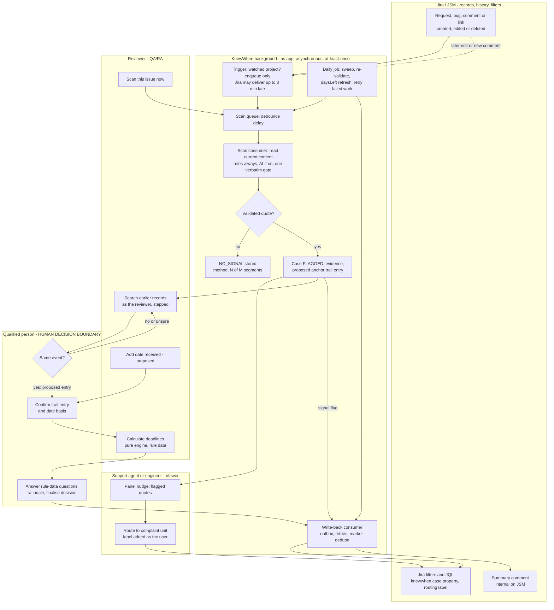
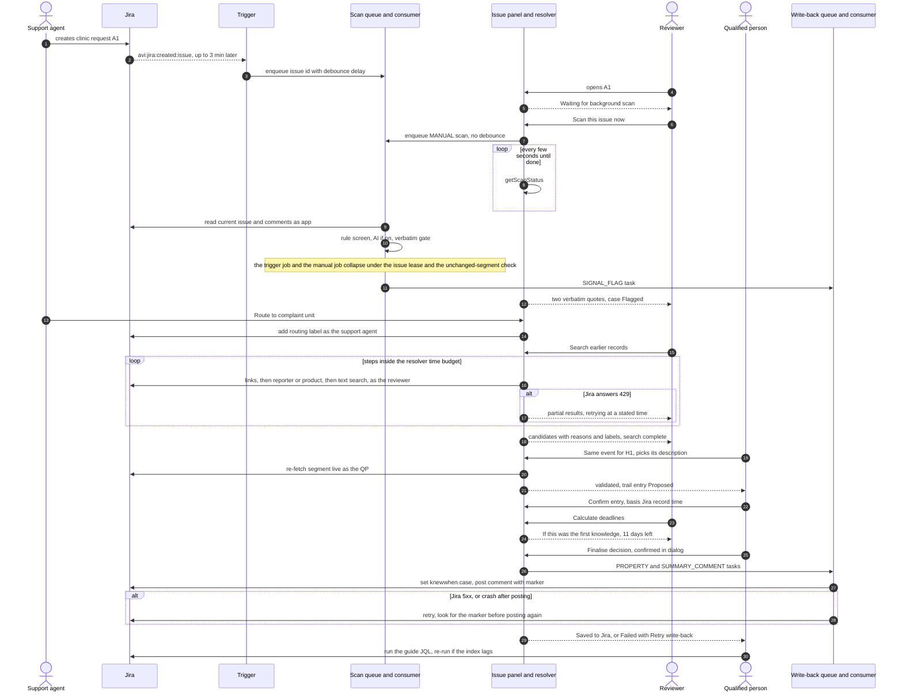

# KnewWhen — Workflow and UI demo

**Status:** Draft v0.1 for owner approval · **Date:** 23 Nov 2026 · canonical file 8 (AGENTS §2.1)
**What this file is:** the operational workflow, the surfaces, states and actions, and the Codegeist demo and judge path for the Core outcome in `Scope.md` §4 (*signal → lookback → trail → deadlines → decision → write-back*). It specifies behaviour. It does not claim that anything is built. It changes no requirement, tier or architecture decision. Where the workflow needs such a change, §0 records it.
**Precedence:** below `Architecture.md` (AGENTS §2.4). Where a higher document disagrees with this file, the higher document wins and §0 lists the difference.

**Status words (AGENTS §3).** Everything in this file is **Proposed** until the owner approves it. Further marks:
- **[V]** Verified on 23 Nov 2026 against the official page linked in §1.
- **[SD]** Source-defined (the file and section are named).
- **[Inf]** Inferred (the reasoning is given).
- **[U]** Unresolved.
- **[C]** A Type C change (AGENTS §5.3). It needs its own approval even after this file is approved, and it is not part of the build until then.

**Inputs read in full:** `idea.md`, `hackathon.md`, `winner-benchmarks.md`, `tools and technologies.md`, `Architecture.md` (Draft v0.1), `Scope.md` (Draft v0.1, so its ACs are still Proposed, AGENTS B-6), `AGENTS.md` (v0.1).
**Not available:** `Knewwhen.md` and the research files, `docs/03-domain-rules.md`, `rules/*.json`, `IMPLEMENTATION_PLAN.md` §2.11, and any repository, manifest or UI. No code was inspected because none exists in this environment. Regulatory content (counting conventions, the time-zone rule, which entry types count as awareness, the decision questions) appears here only as "from rule data" (OI-1).

---

## 0. Read first — conflicts and decisions this workflow surfaces

`WF-n` numbers are local references for this file only. They are not requirement IDs. Copy them into `docs/08-decisions.md` (AGENTS §7.3–7.4).

| ID | Finding and evidence | Effect on the workflow | How this file handles it | Needs |
|---|---|---|---|---|
| **WF-1** | **The glance module is deprecated.** `idea.md` §6 (Core) lists "Issue panel + glance", and §7 names `jira:issueGlance`. Atlassian marks `jira:issueGlance` as "being deprecated and replaced by Jira issue context module". If both modules are declared, `jira:issueContext` is shown [V]. Architecture §1.3 and U-2 keep any glance out of the baseline, and Scope CF-1 asks the owner to decide. | A glance cannot be built as it is named in the proposal. | The baseline is the issue panel, which carries the nudge (Arch §3.2). §8.4 specifies what `jira:issueContext` would show if it is approved, with no new data path (C-09.7). This file does not choose. | Owner: either close C-09.7 with a CF-1 decision record, or approve `jira:issueContext` [C] before the manifest freeze (CF-5). |
| **WF-2** | **The issue panel is hidden until someone opens it.** The panel is added "when a configured button is clicked". Only users who can edit the issue see that button. Jira admins can choose "Show for all work items" [V]. | A support agent who can browse an issue but not edit it cannot open the panel, so the Viewer nudge (C-01.11) never reaches them unless an admin pins the panel. Everyone else sees nothing until they open it. | Admin checklist item 8 (§8.1) makes pinning a named manual step for each watched project, done in Jira's own panel menu with no app write. Jira filters (§8.3) also list flagged and routed issues. | Owner: accept this. Pinning by the app through Jira's admin-only bulk-pin endpoint [V] would be a sixth Jira write operation outside the C-07.10 allow-list [C], so it is not adopted. The issue-context option in WF-1 would also help. |
| **WF-3** | **The approved model has no event-occurrence date.** The brief asks the UI to show event occurrence separately. Scope B-3 and C-04.3 and Arch §9.2 define exactly three times (Jira record time, date received (entered), app observation time) plus the derived candidate awareness date. | The UI has no occurrence field to show. | The trail states that KnewWhen records when the company's records show knowledge, not when the event happened. A QP who needs the occurrence date writes it in the rationale. A verbatim quote may mention it (for example "yesterday"). | Owner: accept this, or approve a QP-entered "event date (if known)" [C]. |
| **WF-4** | **Background scanning cannot see restricted comments.** Comments restricted to a group or role are not delivered to the app unless it has a restricted-comment scope [V], and N-03(b) forbids those scopes. | Background scans skip these comments without saying so, so a "no signal" result could be over-read. | The panel compares the comments the viewer can see with the set that was scanned, and lists "K comments you can see were not scanned by KnewWhen" (§7.4). A person can still bring such a comment into a case (lookback segment pick, "Open a case…"). The validation runs as that person. | Confirm this as a necessary implication of C-01.5 and G-6 (AGENTS §5.3 kind A). As-app read behaviour stays an A-11 check (Arch §18.2). |
| **WF-5** | **A UI Kit page may not be able to hand the CSV to the browser.** C-08 and Tools §3 put the CSV generator on the admin page. No official UI Kit download mechanism was found. Community answers show blob downloads from Custom UI, which Scope §3 excludes. | Judge step 3 may have no "Download" button. | §8.1 specifies, in order of preference: (a) a download, if one is verified (A-11); (b) the CSV shown in a Code block for the admin to copy into a `.csv` file; (c) a pre-generated file in the guide. Option (c) fixes the dates, so the numbers on a judge's site will differ from the video. They are still computed (C-05.7). | Owner: choose before the guide is frozen. |
| **WF-6** | **Sample identities and dates.** On a judge's site, only the judge's own account is certain to exist. FX-1 needs the earlier record 19 days before the as-of date. | Every sample issue has the same reporter, so "same reporter" appears on every sample candidate and separates nothing. A byte-identical CSV (C-08.4) holds only for the same seed **and** the same anchor date. | The sample relies on product labels and issue links for relationship reasons, and the guide says so. Proposed generator inputs: seed, anchor date (today in the rule's time zone) and author (the admin's own account id). | Confirm the generator inputs. If needed, amend the wording of C-08.4 through the Scope change record. |
| **WF-7** | **Background processing may never scan imported records.** Whether Jira's CSV importer emits product events is an A-11 check. The daily sweep selects `updated >= cursor` (Arch §14.6), so backdated imports fall behind the cursor. | Lookback still finds imported records, because the as-user search needs no scan. An imported anchor (SC-2) is scanned only when someone asks. | Judge step 8c uses "Scan this issue now" on the imported anchor. | Verify importer events (A-11). |
| **WF-8** | **An earlier record can have its own case.** If an earlier record was flagged by its own scan, it is a separate case. No approved structure links two cases, and I-9 says each flagged case ends only in a decision record. | Confirming the record as "same event" in another case does not close its own case. | The candidate row shows "Has its own KnewWhen case (Flagged)" with a link. Each case is decided separately, and the QP cross-references the other case in the rationale. | [U]. Linking or merging cases is [C]. |
| **WF-9** | **Where new evidence on a decided case goes is undefined.** Arch §5.3 allows one open case per anchor issue, but does not say where a newly validated quote goes when the issue's only case is DECIDED. | This affects journey E. | Proposed: attach the quote to that case as a PROPOSED trail entry and change no case or decision state. The header shows "New information since final decision vN". The QP starts a new version (C-06.4). A new version with an unchanged outcome and a reason is the way to record "reviewed, no change". | [U]. |
| **WF-10** | **Nothing defines the move from FLAGGED to IN_REVIEW.** Arch §7.8 says only "by human action". | This affects the header state and Jira filters. | Proposed: the first recorded Reviewer or QP case action (a lookback run, a receipt entry, a same-event answer, a trail confirmation or a decision draft) sets IN_REVIEW and writes an audit event. Viewing, routing and manual scans do not. There is no "Start review" button. | [U]. |
| **WF-11** | **The routing label setting and the routed state are missing.** C-01.12 needs an "admin-configured label", but the settings list in C-10.1 has none. Arch §7.8 says `knewwhen.case` reflects the routed state, but the property contents in C-07.1 omit it. | The Route button would have no label to add. | Settings gets a "Routing label" field, a necessary implication of C-01.12. The complaint-unit queue is a Jira filter on that label, so no property field is needed. | Confirm this, and align Arch §7.8 with C-07.1. |
| **WF-12** | **Manual case opening has no AC.** Arch §5.3 and §13.1 let Reviewers open cases (origin MANUAL_OPEN), but the §13.3 matrix and Scope have no row for it. | The workflow needs it in two places. First, when the rule screener misses a real report (recall is "measured, not promised", C-01.13). Second, when a QP rejects a signal-backed entry as a different event; otherwise that evidence never reaches a decision (I-9). | "Open a case for this issue…" is specified (§7.8). "Open a separate case…", with a case switcher, is specified as conditional. | Owner: add a matrix row and ACs. Alternatively, cut the different-event path; the Reject dialog must then not offer "different event". |
| **WF-13** | **The headline number depends on the 24 Nov review.** Under the CF-3 contract default, an UNREVIEWED rule set withholds all deadline numbers (C-11.4). | "11 days left — not 30" cannot appear as a number. | The demo script has a branch for this (§11.3), and the judge path says which mode the site is in. | Owner (CF-3, OI-2). |
| **WF-14** | **The JQL a judge must run is not defined yet.** C-07.2 makes the guide's JQL an acceptance check, but no document fixes the property's JSON keys or `searchAlias` names. C-07.1 also names a single "due date", although the FDA rule set may hold more than one clock. Indexed entity properties are searchable in JQL [V] but are not shown on the issue view [Inf]. | A judge looking for "fields" on the issue will find none. | §8.3 uses placeholder aliases. The visible proofs are the panel header, the summary comment and the JQL result list. | Fix the keys and aliases with the property schema before the guide is frozen. |
| **WF-15** | **The decision questions are rule data that has not been supplied** (OI-1). Finalising without an awareness date, or under UNREVIEWED rules, is still open (OI-3). | The Decision tab cannot be completed. | The Decision tab shows "Decision questions are not available (rule data missing)" and keeps "Finalise" disabled. The "No awareness date" option appears only if OI-3 is approved. | Blocked on OI-1 and OI-3 for the content, not for building the form. |
| **WF-16** | **How complete a lookback run is depends on who ran it.** Arch §8.8 collapses runs for the same anchor and profile. A run made by a user with narrow Jira access can then look complete to a QP with wider access. | The search could look more complete than it is. | The run status names the person who searched and when. Anyone who did not run it gets "Search again as me" (§7.5). Candidates are always re-fetched as the viewer, so nobody sees a record they cannot open. | Confirm. Alternatively, key runs by the searcher (Type B inside Arch §8). |

**Existing open items that shape the UI**

| Item | UI consequence specified here |
|---|---|
| CF-1 | "Write-back fields" are the indexed property `knewwhen.case` (WF-1, WF-14). |
| CF-2 | UI text says "FDA deadlines". EU appears only as a PREVIEW block (S-05) or as the one-line note in §7.6. |
| CF-3 | Two separate chips: "AI screening: off/on" and "Rule set: Reviewed / Preview / Not reviewed". |
| CF-4 | MODIFIED and UNAVAILABLE evidence shows the pointer, the timestamps and "The original wording cannot be shown: KnewWhen does not store record text." |
| CF-5 | The conditional surfaces in §8.4 must be decided before the manifest freeze, or they stay absent. |
| CF-6 | The comment-visibility setting and the write-back section carry this disclosure: "Anyone who can browse this issue may see these values in Jira searches." |
| CF-7 | Every calculation and decision shows the rule set as id@version. A version-choice UI appears only with S-04. |
| OI-4 | Every limit shown in the UI is read from settings or the code ceiling. This file fixes no number. |
| PA-1, PA-2 | Absent unless approved. Without PA-2, judges add their own account in Settings (§12, step 2b). |
| PA-4 | §8.2 specifies a "load twice" warning, which applies only if PA-4 is approved. Until then the second load must still report what it created (C-08.9). |

---

## 1. Platform facts this workflow relies on [V 23 Nov 2026]

| Fact | What the workflow does with it |
|---|---|
| Events for `trigger` modules "may take up to 3 minutes" to reach the app ([trigger](https://developer.atlassian.com/platform/forge/manifest-reference/modules/trigger/)). Filters include `ignoreSelf` and `expression`. | Background scans are never shown as instant. The panel shows "Waiting for background scan" and offers "Scan this issue now" to Reviewers and QPs. `ignoreSelf` is an optional first filter for the app's own writes. The comment marker (C-01.8) stays the authoritative skip. |
| Jira events: `avi:jira:created:issue`, `avi:jira:updated:issue`, `avi:jira:deleted:issue`, `avi:jira:commented:issue` (sent on comment create **and** edit), `avi:jira:deleted:comment`, `avi:jira:created:issuelink`, `avi:jira:deleted:issuelink`. Restricted comments need a restricted-comment scope ([events](https://developer.atlassian.com/platform/forge/events-reference/jira/)). | Edits and deletes do have events, so the C-01 trigger list can be met. Restricted comments: WF-4. |
| Async events are delivered at least once within 24 h (up to 96 h). No ordering is documented. `delayInSeconds` is at most 900. Retries use exponential backoff up to about 15 min. The consumer timeout is 55 s by default and 900 s at most. Job stats are available ([async events](https://developer.atlassian.com/platform/forge/runtime-reference/async-events-api/)). | The debounce is at most 15 min. Duplicate and late runs are expected and collapse (G-7). The ≥ 300 s AI consumer timeout fits. The panel polls job status. |
| A UI resolver may run for at most 25 s ([invocation limits](https://developer.atlassian.com/platform/forge/limits-invocation/)). | Lookback and long reads are stepped with a cursor (C-03.11, N-01a). |
| `jira:issuePanel` is added by a button click. Only users who can edit the issue see the button. Admins have "Show for all work items". It works in Jira and JSM, in the new issue view only ([issue panel](https://developer.atlassian.com/platform/forge/manifest-reference/modules/jira-issue-panel/)). | WF-2. |
| `jira:issueGlance` is deprecated and replaced by `jira:issueContext`. If both are declared, issue context is shown ([glance](https://developer.atlassian.com/platform/forge/manifest-reference/modules/jira-issue-glance/), [migration](https://developer.atlassian.com/cloud/jira/platform/future-proof-issue-glance-implementation/)). `jira:issueContext` is a collapsible right-sidebar panel for Jira and JSM in the new issue view. It shows a status lozenge or badge through `dynamicProperties`, loads nothing while collapsed, and is shown on mobile by default ([issue context](https://developer.atlassian.com/platform/forge/manifest-reference/modules/jira-issue-context/)). | WF-1, §8.4. |
| `jira:entityProperty` values are typed `number`, `text`, `string`, `user` or `date`. JQL finds them by `searchAlias` or by `issue.property[...]`. All modules together can declare at most 100 indexed values. Visibility and index delay are not documented ([entity property](https://developer.atlassian.com/platform/forge/manifest-reference/modules/jira-entity-property/)). | §8.3. CF-6 and index lag remain A-11 checks. |
| UI Kit includes Tabs, Dynamic table, Section message, Lozenge, Badge, Modal, Empty state, Form, Radio group, Checkbox, Select, Date picker, User picker, Text field, Text area, Toggle, Spinner, Tooltip, Code block and Link. Popup, Inline edit, Pagination and List are Preview ([components](https://developer.atlassian.com/platform/forge/ui-kit/components/)). | This file uses only components that are not in Preview. "Expand" behaviour is a Button that shows or hides a Stack. |

---

## 2. People and the job each one does

| Role (Scope §6.1) | Typical person | Job in KnewWhen | Main surface | Cannot |
|---|---|---|---|---|
| **Viewer** | Support agent, engineer, anyone who can browse the issue | Notice that a record may be a possible complaint, and route it | Panel: the nudge only | See the case, trail, deadlines or decisions; scan; answer anything |
| **Reviewer** | QA/RA or complaint-unit staff | Prepare the case: scan, search earlier records, propose receipt dates, calculate deadlines, retry the write-back | Panel: all tabs. QP actions are visible but disabled, with the reason | Answer "same event?", confirm trail entries or a basis, record a decision |
| **Qualified person (QP)** | QA/RA lead, complaint-unit lead, PRRC | Decide what counts: same event, which entry and basis, the decision record | Panel: all tabs | Edit history, delete or hide a case, or receive a suggested answer |
| **Site admin** | Jira administrator (a judge) | Set up, load the sample, watch health | Admin page | Any case action, unless the admin is also placed in a role (audited) |

A judge is a site admin. Adding their own account to both role settings (§12 step 2b) gives them the Reviewer and QP views. Removing QP shows the Reviewer view without needing a second account.

---

## 3. Information architecture

### 3.1 Surface map

| Surface (module) | Tier, status | User job | Who | Why it has its own place | Holds | Relationship to the issue and the stored record |
|---|---|---|---|---|---|---|
| **KnewWhen issue panel** (`jira:issuePanel`) | Core [SD] | "Is this record a possible complaint, and when did we first know?" | Everyone who can browse; content depends on role | Evidence must sit next to its source record, and the panel is the only Core surface inside the issue | Nudge, scan status, case header, four tabs (§3.2) | Reads Jira live as the viewer. Reads and writes SQL only through the resolver. Never stores record text. It is the only place case work happens |
| **KnewWhen admin page** (`jira:adminPage`) | Core [SD] | "Is KnewWhen safe to use here, and is it working?" | Site admin | Configuration and health are site-wide, not per issue | Get started, Settings, Health (§8.1) | KVS settings and SQL counters. Creates sample issues as the admin. Holds no case data |
| **Jira itself: property `knewwhen.case` and JQL filters** | Core [SD] (C-07) | "Which issues are flagged, routed, undecided or due soon?" | Complaint unit, QA/RA, anyone who can browse | Cross-issue lists are Jira's job. A KnewWhen list page would duplicate filters and needs a module the Tools file excludes (`jira:globalPage`) | Codes and dates only | Written by the app, read by Jira. Replaces a "cases" tab, a home page and, in Core, the gadget |
| **Jira itself: summary comment** | Core [SD] | "What was recorded, by whom, and under which rules?" | QA/RA, auditors | The record must be readable in Jira without the app (Idea §5) | A structured summary and a marker | Written by the app after FINAL. Replaces a "report" screen |
| **Jira itself: routing label** | Core [SD] (C-01.12) | "Send this to the complaint unit" | Viewer and above | Routing is a Jira state other teams already use | One label | Written as the clicking user. The complaint-unit queue is a filter on it |
| **Issue context** (`jira:issueContext`) | Conditional [C] (WF-1) | "Is there anything here?" at a glance | Everyone | Shown in the sidebar of every issue | A state lozenge and a short summary | No new data path. Built only if approved |
| **Rovo agent "KnewWhen Analyst"** | Should (S-03), needs approval | "Explain this case's status in words" | Reviewer, QP | Conversational and read-only | Status, dates, pointers | Same gate as the panel. Not needed for Core; absent unless it ships |
| **"Deadlines at risk" gadget** | Should (S-02), needs approval | Open clocks across issues | Reviewer, QP | — | — | Absent. Jira's native filter-results gadget on the §8.3 JQL shows the same list [SD Tools §3] |

### 3.2 Inside the issue panel: one header, four tabs

The **case header** is the only place where case-level status appears. Tabs show details and never repeat the header lines.

| Tab | User job | Why it is a separate tab | Holds | Why it does not duplicate another tab |
|---|---|---|---|---|
| **This issue** | "What in this record may be a possible complaint, and was all of it checked?" | It is all a Viewer sees and the entry point for every role. Scan coverage belongs to the record, not the case | Flagged quotes from this issue, scan result and coverage, Route, Scan now, Open a case | The trail lists *time* entries across records. This tab lists *signals* in this one record |
| **Earlier records (N)** | "Did anyone write about this before?" | Search results are proposals: they can be wrong, partial or long. Keeping them apart from the trail enforces B-4, because nothing joins the trail without a QP answer | Search progress and coverage, candidates with reasons and labels, same-event answers | Only candidates answered "Same event" move on, and they arrive in the trail as proposed entries |
| **Awareness & deadlines** | "Which records show when we knew, and what does each date cost?" | Deadlines are computed directly from confirmed trail entries. Showing both together makes the sensitivity visible in one place | Trail, candidate awareness dates, FDA clocks with counting details | The decision cites one entry and one calculation. It does not repeat this table |
| **Decision** | "Record what the qualified person decided, and get it into Jira" | A different job (recording, irreversible), a different role (QP) and a different state machine | Draft and final form, versions, follow-ups, write-back status | The header shows the status only. The details live here |

Tab labels describe the work. A Viewer sees no tabs. The default tab is the one holding the next step (§7.3).

### 3.3 Deliberately not built

- **No home page, global page or overview dashboard.** `jira:globalPage` is excluded (Tools §3), and the panel plus Jira filters cover every Core job.
- **No cases list, reports tab or analytics.** Use JQL filters and summary comments instead. Usage analytics are startup scope.
- **No separate settings area.** Settings live on the admin page.
- **No onboarding funnel, sign-up, pricing or tenant setup.** There are no external accounts, and the listing is free.
- **No customer-portal view.** JSM customers never see KnewWhen, and the comment is internal (C-07.5).
- **No placeholders for Should or Stretch items.** There are no disabled teaser buttons and no empty gadget. The single exception is the one-line EU note in §7.6, because the product text mentions EU (CF-2).
- **No historical backfill (PA-1) and no "add me to both roles" (PA-2)** unless they are approved.

### 3.4 How quickly each Core task can be reached

| Task | Starting from | Actions |
|---|---|---|
| See whether this issue has a possible signal | Issue view, panel pinned | 0 (1 if not pinned: open the panel) |
| Route to complaint unit | Panel | 1 |
| Scan this issue now | Panel | 1 |
| Search earlier records | Panel | 2 (tab, button) |
| Answer "same event?" | Earlier records | 1 (plus a segment pick for issue-level matches) |
| Confirm an entry and its basis | Awareness & deadlines | 2 ("Confirm entry…", then "Confirm" in the dialog) |
| Calculate deadlines | Awareness & deadlines | 1 |
| Finalise a decision | Decision, with the form complete | 2 ("Finalise decision…", then confirm) |
| Find decided or due issues | Jira issue search | 1 (a saved filter) |

---

## 4. End-to-end operational workflow

### 4.1 Workflow diagram (actors, asynchronous processing, human decision boundary)



Everything inside the QP box is a human answer recorded with actor and time. Nothing outside it can set an awareness date, mark records as the same event or create a decision (I-4, I-5).

### 4.2 Step-by-step choreography

Each step lists actor and trigger, input, processing, output and persistence, visible state, next step and exceptions. Requirement and architecture references are given once per step.

**Step 1 — A source appears in Jira/JSM** · W1 · C-01, C-02, N-01(e) · Arch §14.1, §7.7
- **Actor / trigger:** anyone writes in a watched project: an issue or request created or updated, a comment created or edited, a comment deleted, or a link created [V]. Other entry routes are the daily sweep and "Scan this issue now" (Reviewer or QP).
- **Processing:** the trigger checks the cached watched-project list and issue-type exclusions, then enqueues `issueId, eventType, entityId` with the debounce delay (value OI-4, at most 900 s [V]). It makes no Jira or SQL call (C-01.10) and ignores any text in the event payload.
- **Output / persistence:** a queue message only.
- **Visible state:** when the panel opens, it compares the segments the viewer can see with the last scanned fingerprints. If they differ, it shows **"Waiting for background scan — Jira can take a few minutes to notify KnewWhen."** Reviewers and QPs also get "Scan this issue now". Viewers see the same line with no action.
- **Next:** Step 2.
- **Exceptions:**
  - Unwatched project: no job is created. A manual scan returns SKIPPED_SCOPE with "KnewWhen does not check this project."
  - Trigger cannot read settings: the event is dropped and the sweep recovers it. The panel comparison still shows "Waiting".
  - KnewWhen's own comment: skipped by the marker.
  - Imported, backdated issues: see WF-7.

**Step 2 — Signal Finder evaluates the record** · W1 · C-01, C-11, G-2, B-2, B-10 · Arch §6.3, §7
- **Actor:** scan consumer, running as the app.
- **Input:** the *current* summary, description and comments, read at scan time.
- **Processing:**
  - The consumer takes the per-issue lease, then extracts and normalises the segments.
  - Unchanged segments are skipped, except on a manual scan.
  - The rule screener always runs. The AI runs only if it is on, not killed, under its caps and the breaker is closed.
  - Every proposal, from rules or AI, passes the one verbatim validator. Rejects are counted and never stored.
- **Output / persistence:** a `scan` row (method, versions, segments seen and scanned, reason codes). The two outcomes:
  - **SIGNAL:** evidence items; a case in FLAGGED (insert-if-absent); a PROPOSED anchor trail entry [Inf: only a QP confirms, C-04.5]; a SIGNAL_FLAG write-back task.
  - **NO_SIGNAL:** the scan row only, with no case.
- **Visible state:** either the nudge with quotes re-fetched live as the viewer, or "No signal found by <method> in N of M segments". Deferred and skipped segments are listed separately (C-01.5).
- **Next:** SIGNAL → Step 3. NO_SIGNAL → the flow ends until the record changes.
- **Exceptions:**
  - AI timeout, block, malformed output, open breaker, cap or kill switch: the rules result is shown with "AI screening unavailable — rule-based screening used", or with "Not yet scanned by AI" for deferred segments (C-09.2).
  - An invented or paraphrased quote is rejected and never shown.
  - A comment deleted between the event and the scan is skipped with a reason code.
  - Hash key missing: capture is blocked and the panel says "Evidence cannot be recorded on this site right now. A Jira admin can see why on the KnewWhen admin page."
  - Duplicate or out-of-order deliveries produce one result (C-01.7).
  - A new quote on a DECIDED case: see WF-9.

**Step 3 — The possible event is put in context** · W1 · C-01.11–12, C-09 · Arch §5.3, §7.8
- **Actor:** Viewer (route), Reviewer or QP (open a case).
- **Representation:**
  - One case per anchor issue (`case_seq`), in FLAGGED. The validated quotes in this issue form the anchor trail entry.
  - Related records are **never merged**. A related issue appears only as a lookback candidate (Step 4) or as its own case (WF-8). Similar text never joins two events.
- **Processing:** "Route to complaint unit" adds the configured routing label as the clicking user and writes a ROUTED audit event. No one is notified. The complaint unit works from the Jira filter on that label (§8.3).
- **Persistence:** the label in Jira, the audit event in SQL, and the signal flag in `knewwhen.case` (through Step 8's consumer).
- **Visible state:** the Reviewer/QP header reads "Case 1 · Flagged · Next: search earlier records". The Viewer sees "Routed by <user> on <date>".
- **Next:** Step 4.
- **Exceptions:**
  - The clicker has no edit permission: the button is disabled with the reason.
  - No routing label is set: "Routing is not set up. A Jira admin can set the routing label on the KnewWhen admin page."
  - A Reviewer believes an issue with no signal is a real report: "Open a case for this issue…" (WF-12).

**Step 4 — Historical lookback searches earlier records** · W2 · C-03, B-4, G-3 · Arch §8
- **Actor:** a Reviewer or QP starts the search. Only a QP answers.
- **Input:** the case, the anchor entry and the cursor.
- **Processing:**
  - Runs **as the viewing user**, over records created strictly before the anchor's record time, in watched projects only.
  - Order: links (depth-capped) → same reporter, same organisation (JSM only), same product (only if mapped) → text from the anchor's *validated quotes*.
  - Scoring is local and the text is discarded afterwards. The label comes from the decision table.
  - The search runs in resumable steps inside the soft time budget.
- **Output / persistence:** `candidate_match` rows (pointers, reason codes, numeric overlap, label, state) and `lookback_run` (cursor, caps hit, searcher).
- **Visible state:** candidates appear step by step, with coverage notes and either "Search complete" or "Search incomplete".
- **Human step:** the QP answers **Same event / Not the same event / Unsure** for each candidate. "Same event" re-fetches the segment live as the QP, validates it, and writes an evidence item, a PROPOSED RECORD trail entry and an audit event. It sets no date (C-03.8).
- **Next:** Step 5. Optionally "Search earlier than this record" (bounded depth).
- **Exceptions:**
  - Records the searcher cannot open, and unwatched projects, never appear. The panel says what was not searched, without counts.
  - 429: partial results with a retry time.
  - Cap reached: "Search incomplete".
  - A deleted or moved candidate stays as a pointer marked "record not accessible to you".
  - The cited text changed between the search and the answer: "Same event" fails with a message.
  - No JSM or no product mapping: "not checked" notes.
  - A Reviewer sees the answer buttons disabled, with the reason.
  - The search was run by another user: WF-16.

**Step 5 — Awareness Trail reconstructs observations** · W2 · C-04, B-3, CF-4 · Arch §6.4, §9
- **Actor:** a QP confirms. A Reviewer proposes receipt dates.
- **Input:** trail entries, evidence check states, and the time-zone rule (rule data).
- **Processing:**
  - Each entry shows its times separately: Jira record time (created, updated and a strength label), "First observed by KnewWhen" (app time, never used as awareness), and date received (entered).
  - The effective calendar date for each basis comes from the time-zone rule.
  - The earliest *confirmed* date for each basis is listed first, then the later ones. If rule data is silent, nothing is pre-selected (C-04.6).
  - Event occurrence is not recorded (WF-3).
  - Evidence is re-validated as the viewer when shown (short cache, rate-limited).
- **Output / persistence:** append-only `trail_entry` rows (confirmed, rejected or superseding) and audit events.
- **Visible state:** the trail table and the "Candidate awareness dates" block.
- **Next:** Step 6.
- **Exceptions:**
  - Evidence states RELOCATED, MODIFIED, UNAVAILABLE or UNVERIFIABLE, or "Not accessible to you".
  - An issue-level 403/404 is ambiguous and changes no stored state (C-04.9).
  - Time-zone rule missing: effective dates are withheld.
  - An entered date in the future is rejected [Inf].
  - An entered date later than the record time is allowed, and both are shown.

**Step 6 — Deadline Engine calculates the clocks** · W3 · C-05, C-11, B-6, B-7, FX-1, CF-7 · Arch §10
- **Actor:** a Reviewer or QP clicks "Calculate deadlines".
- **Input:** each candidate awareness date (ISO), the as-of date (today under the time-zone rule), the FDA rule set and its holiday calendar.
- **Processing:** the pure engine runs for each candidate date and each clock. Rule-set status decides what happens:
  - REVIEWED: results shown normally.
  - PREVIEW: results shown with a banner, and not written back unless the admin enables it.
  - UNREVIEWED: the engine is not called.
- **Output / persistence:** append-only `deadline_calc` rows: inputs, rule set id@version, digest and status, engine version, time-zone rule id, as-of date and result.
- **Visible state:**
  - The sensitivity table, with a computed sentence for each candidate: "If this was the first knowledge: N days left".
  - Counting details for each clock: rule, version, inputs, start basis, counting method from rule data, skipped weekends and holidays, due date, days left, and the state in words.
  - The line "KnewWhen does not decide which clock applies."
- **Next:** Step 7.
- **Exceptions:**
  - A typed error (`RULE_SET_UNREVIEWED`, `RULE_SET_INVALID`, `HOLIDAY_DATA_MISSING(year)`, `DATE_INVALID`) means no number is shown, only the reason.
  - The trail changed after the calculation: "Out of date — Recalculate deadlines".
  - A new day: days left are labelled with their as-of date.
  - EU: absent or PREVIEW (§7.6).

**Step 7 — A qualified person reviews and records a decision** · W4 · C-06, B-1, B-5, G-1, G-4 · Arch §11.1, §13.3
- **Actor:** QP.
- **Guards:** the role is resolved on the server fresh for each request, and the browse check runs. Access is denied by default and every denial is audited.
- **Content:**
  - The awareness entry and basis, chosen by the QP with no pre-selection.
  - The cited calculation.
  - Answers to the rule-data questions, with no defaults.
  - Rationale, follow-ups and the evidence check-state snapshot.
- **Persistence:**
  - `decision_record` moves from DRAFT to FINAL by conditional update.
  - Follow-ups and audit events are written.
  - Outbox tasks are created.
- **Visible state:** the Decision tab form and the finalise dialog.
- **Never:** a suggested answer, "reportable / not reportable" wording, or an ambiguous "Approve".
- **Exceptions:**
  - Role lookup failure: "Cannot verify your role right now. Nothing was changed."
  - A Reviewer sees the record read-only.
  - A double submit returns the same FINAL record.
  - Degraded cited evidence must be re-confirmed first.
  - An out-of-date calculation must be recalculated first.
  - Rule data missing: see WF-15.

**Step 8 — The result is written back to Jira** · W5 · C-07, CF-6, N-03(c) · Arch §11.3
- **Actor:** the write-back consumer, running as the app.
- **Triggers:** a FINAL decision (PROPERTY and SUMMARY_COMMENT), a signal (SIGNAL_FLAG), the daily `daysLeft` refresh, and the reconciler.
- **Processing:**
  - The property holds codes, dates and ids, guarded by version.
  - The comment carries a body marker and the `knewwhen.generated` property. It is internal on JSM and uses the admin-chosen visibility elsewhere. The rationale is excluded by default.
  - Writes are idempotent and retried, and end as FAILED after the attempt limit.
- **Persistence:** the `writeback_task` status and the comment id. In Jira: the property and the comment.
- **Visible state:**
  - The Decision tab rows "Jira property: Saved to Jira" and "Summary comment: Saved — Open comment".
  - The summary comment in the issue Activity.
  - The JQL in §8.3, which may lag while Jira indexes.
- **Exceptions:**
  - No visibility chosen: "Waiting for comment visibility setting (admin)".
  - 429 or 5xx: retried with backoff.
  - FAILED: "Retry write-back".
  - A user deleted the comment: reported, not reposted (C-07.9).
  - A user edited the property: repaired from SQL.
  - EU preview values are not written unless enabled.

**Step 9 — New information arrives later** · W2/W4 · C-01.6, C-04.8, C-06.8, C-07.8 · Arch §6.4–6.5, §15.2 · WF-9
- **Triggers:** a new or edited comment, a deleted comment, a new link, a corrected receipt date, an earlier record found by a re-run, or re-validation (on display or daily).
- **Behaviour:**
  - An edited segment is rescanned and its cited evidence re-validated. The result is VALID (with an "other text edited" note), RELOCATED, MODIFIED or UNAVAILABLE.
  - A newly validated quote becomes a PROPOSED entry (WF-9).
  - A newly found record becomes a candidate.
  - A corrected date becomes a new entry that supersedes the old one.
- **Never:** change a FINAL decision, drop evidence silently, or replace a cited calculation.
- **Visible state:**
  - The header shows "New information since final decision v1: 1 cited record modified · 1 new proposed entry".
  - The decision shows the flags (C-06.8).
  - The Jira property and comment stay as they are.
- **Next:** the QP uses "Start new version…" with a reason (journey E).

**Step 10 — Administration and read-only intelligence** · W0, W6 · C-08, C-10, C-11, C-12 · Arch §17.3
- **Admin:** the checklist, settings, sample data and health (§8.1–8.2). Every setting change is audited. Changing a switch never alters past calculations or decisions (C-11.5).
- **Rovo Analyst (S-03):** read-only, Should tier, first to be cut. It is not part of the Core workflow, and nothing in Steps 1–9 depends on it.

---

## 5. Positive path: Jira to write-back, with waiting and recovery



The case moves to IN_REVIEW at the reviewer's first recorded case action (the lookback run, WF-10). If the panel is closed during the search, the run stays resumable from its cursor ("Continue search").

---

## 6. States and transitions

UI words are exactly what the panel shows. Only the listed actors cause transitions.

| Object | State (UI words) | Entered when | Leaves to | Who / guard | Recovery |
|---|---|---|---|---|---|
| **Issue scan** | Not scanned yet | Watched issue with no scan row | Queued | — | Scan now; sweep |
| | Waiting for background scan | Live segments differ from the last scanned fingerprints | Queued, Running | Computed as the viewer when the panel opens | Scan now (Reviewer/QP) |
| | Queued · Running | Job enqueued · consumer holds the lease | Done, Failed, Stalled | At-least-once; lease | Duplicates collapse |
| | Done — possible complaint signal | At least one validated quote | Waiting (on the next change) | — | — |
| | Done — no signal found (N of M) | Nothing validated | Waiting (on the next change) | Skipped and deferred segments are listed separately | — |
| | Done — AI not finished (K segments) | Cap or breaker | Done, after the daily retry | — | Daily job |
| | Skipped — <reason> | Not watched, excluded type, KnewWhen's own comment, or no app access | — | — | Admin settings |
| | Failed (ref) | Attempt limit reached | Queued | — | Scan now; daily job |
| | Stalled | Running past the threshold | Queued | Detected when the panel opens and daily | Continuation job |
| **Case** | Flagged | Validated signal, or "Open a case…" | In review | — | — |
| | In review | First recorded case action (WF-10) | Decided | Reviewer/QP | — |
| | Decided | First FINAL decision | Stays Decided; new versions are made by the QP | QP | No delete or hide (C-06.6) |
| **Candidate** | Awaiting an answer | Lookback | Same event, Not the same event, Unsure | QP | — |
| | Unsure | QP | Same event, Not the same event | QP | — |
| | Not the same event | QP | Awaiting an answer ("Reopen") | QP | Does not resurface on re-runs |
| | Same event | QP, and the validator accepts | Creates a proposed trail entry | QP | — |
| **Trail entry** | Proposed | Signal, Same event, receipt entry, "Add date received" | Confirmed, Rejected | QP | — |
| | Confirmed · <basis> | QP | Superseded ("Correct…"), Rejected | QP | "Re-confirm…" when evidence degrades |
| | Rejected (reason) | QP | — (a new entry if needed) | QP | — |
| **Evidence check** | Valid · Valid — other text edited · Relocated · Modified · Unavailable · Unverifiable · Not accessible to you | Re-validated as the viewer (on display) or as the app (daily) | Any | — | QP re-confirms or rejects the entry |
| **Lookback run** | Not run · Searching · Paused — Jira rate limit (retry at hh:mm) · Incomplete — limit reached · Complete (searched by <user>, <date>) | Reviewer/QP | — | Per-case limits (OI-4) | "Continue search", "Search again as me" |
| **Deadline calculation** | Not calculated · Current (as of <date>) · Out of date · Withheld — <reason> | Reviewer/QP | — | Rule-set status gate | "Recalculate deadlines" |
| **Decision** | Draft vN · Final vN · Superseded by vN+1 | QP | — | QP; conditional update | "Start new version…" |
| **Write-back** | Pending · Waiting for comment visibility setting · Saved to Jira · Failed | App; retry by Reviewer/QP | — | Allow-list of five writes | Daily job, "Retry write-back" |

---

## 7. Issue panel specification

### 7.1 Rules for every section

- **Authority.** The panel holds no authority (C-09). Every action calls a resolver function through the one gate (G-4). The resolver returns a role hint so the UI can disable controls, but the server decides. A stale hint ends in a denial message, never a silent failure.
- **Standard states (G-8):**

| State | Component | Pattern (fixed wording in quotes) |
|---|---|---|
| Loading | Spinner + Text | "Loading KnewWhen…". The panel is never blank. |
| Queued / processing | Spinner + Text | "Scan queued" → "Scanning (rule-based screening)…" or "Scanning (AI and rule-based screening)…" |
| Empty | Empty state | Says what would fill the section and gives the next action |
| No signal | Section message (information) | "No signal found by <method> in N of M segments · checked <time>. This is a completed check that found no matching text. It does not decide what the record is." |
| Partial | Section message (warning) | Names what is missing and what happens next |
| Stale | Lozenge "Out of date" | Placed next to the action that refreshes it |
| Degraded | Section message (warning) | For example "AI screening unavailable — rule-based screening used" (C-09.2) |
| Role not permitted | Section message (information) | "This is for Reviewers and Qualified persons. A Jira admin sets these roles on the KnewWhen admin page." Never names the members. |
| Action not allowed | Helper text under the disabled control | Says which role can act, for example "Only a Qualified person can answer this." |
| Not accessible to you | Text | "Record not accessible to you", with the pointer and timestamps and no text (C-04.9) |
| Error | Section message (error) | "KnewWhen could not <action>. Nothing was changed. Ref: <correlation id>." plus "Try again" |
| Success | Section message (success) or inline status | States the result and the next step |

- **Formats:**
  - Timestamps: "4 Nov 2026, 09:12 IST (UTC+05:30)", in the viewer's Jira time zone, read from the product context [Inf].
  - Dates: "4 Nov 2026", with the month as a word. ISO `2026-11-04` appears only in counting details.
  - Relative times sit next to absolute ones, for example "19 days before this issue".
  - When the rule's time zone gives a different calendar date: "Counts as 4 Nov 2026 under time-zone rule <id> (rule data)."
- **Meaning never by colour alone.** Every Lozenge carries words (C-09.3). Design tokens give dark mode.
- **Keyboard and focus.** Every action is a Button or Link. Multi-field actions open a Modal. Domain terms ("segment", "verbatim", "awareness date", "basis", "work day", "match label") are explained once per tab in helper text or a Tooltip.
- **Wording (G-1).** The app never shows "reportable", "not reportable", "compliant", "late filing", "approved" or "confirmed match". It does not write "not a complaint" in its own text; that can appear only as a question or answer taken from rule data. Fixed phrases: "possible complaint signal", "candidate awareness date", "decision-support record, not a regulatory determination".
- **Privacy (N-04).** Nothing goes into browser storage. Live slices exist in UI state only while shown. Every free-text field carries: "Your own words. Do not paste text from Jira records: KnewWhen stores what you type here."

### 7.2 What each role sees

| Area | Viewer | Reviewer | QP | Site admin without a role |
|---|---|---|---|---|
| Case header | — | ✔ | ✔ | — |
| This issue: quotes, coverage, Route | ✔ (only quotes the viewer can read) | ✔ | ✔ | ✔, plus "You are a Jira admin. Case work needs the Reviewer or Qualified person role (KnewWhen admin page → Settings)." |
| "Scan this issue now", "Open a case…" | — | ✔ | ✔ | — |
| Earlier records | — | View, run | View, run, answer | — |
| Awareness & deadlines | — | View, propose receipt dates, calculate | All Reviewer actions, plus confirm, reject, correct, re-confirm | — |
| Decision | — | Read-only; "Retry write-back" | Full | — |

First run, with both roles empty: every user is a Viewer. An admin also sees "No Reviewers or Qualified persons are set yet. Set them on the KnewWhen admin page." (C-10.2).

### 7.3 Case header (Reviewer and QP)

1. **Case line:** a Lozenge with the state ("Flagged", "In review", "Decided"), then "Case 1", then the origin ("from a rule-based signal", "from an AI-assisted signal" or "opened by <user>").
2. **Earliest confirmed candidate:** "Earliest confirmed candidate awareness date: 4 Nov 2026 · Jira record time · H1". Otherwise "No confirmed entries yet".
3. **Clocks:** one line for each FDA clock in the rule set, at most two. For example "30-calendar-day clock: due 4 Dec 2026 · 11 days left as of 23 Nov 2026".
   - After FINAL, the line shows the decision's cited calculation.
   - Before FINAL, it shows the latest current calculation for the earliest candidate, followed by "(candidate — no decision recorded)".
   - Otherwise "Deadlines not calculated", or "Withheld: <reason>".
4. **Decision and Jira:** "No decision recorded", "Draft v1 — not final" or "Final v1 · <User> · 23 Nov 2026". Then "Jira: Saved", "Pending", "Waiting for comment visibility setting" or "Failed".
5. **Chips:** "AI screening: off" · "Rule set: <id> v<version> · Reviewed / Preview / Not reviewed".
6. **Banners, shown only when true:**
   - "New information since final decision vN" (WF-9).
   - "Evidence changed in N cited records".
   - "AI screening unavailable".
   - "Earlier-record search incomplete".
7. **Next step:** one line, with a Link that opens the right tab. The line never names an outcome. Rules, first match wins:

| Condition | Next step text | Tab opened |
|---|---|---|
| No case; waiting or not scanned | "Wait for the background scan or scan now" | This issue |
| Flagged; lookback not run | "Search earlier records" | Earlier records |
| Candidates awaiting an answer | "A qualified person answers 'Same event?' for N records" | Earlier records |
| Proposed trail entries | "A qualified person confirms or rejects N trail entries" | Awareness & deadlines |
| Confirmed entries; no current calculation | "Calculate deadlines" | Awareness & deadlines |
| Current calculation; no decision | "Record the decision" | Decision |
| Draft exists | "Finish and finalise the draft" | Decision |
| Final; write-back pending or failed | "Check the Jira write-back" | Decision |
| Final; new information | "Review the new information" | Awareness & deadlines |
| Final; saved; nothing new | (no line) | — |

The panel opens on the tab named by the matching rule. If no rule matches, it opens on "This issue".

### 7.4 Tab "This issue"

- **Signal**, shown when the result is SIGNAL. Each validated quote shows:
  - the live slice in a bordered Box;
  - "Verbatim from the Jira record (whitespace normalised)";
  - its location ("Description", or "Comment by <User> · 4 Nov 2026, 09:12 IST");
  - its method ("Found by rule-based screening", "Found by AI screening, checked word for word", or both);
  - its check state, if it is not Valid.

  Quotes in segments the viewer cannot read are left out. If none is readable, the tab shows only "KnewWhen flagged this issue for the complaint unit." [Inf: the flag is already JQL-visible to anyone who can browse, CF-6].
- **Routing:** the primary button "Route to complaint unit" (a Viewer's only action), or "Routed by <user> on <date> · label <label>".
- **Scan coverage:**
  - "Last check: <time> · <method> · N of M segments · lexicon <version>", plus the prompt and model versions if AI ran.
  - Then, only when not empty: "Not yet checked by AI: K segments (daily limit; checked after it resets)"; "Not scanned: comment by <User> at <time> — <reason in words>"; "K comments you can see were not scanned by KnewWhen (restricted visibility)" (WF-4).
  - Reviewers and QPs also get "Show scan history", which lists time, trigger, method and result for recent scans.
- **Reviewer/QP actions:** "Scan this issue now" is primary when there is no current result or the panel shows "Waiting". "Open a case for this issue…" is secondary and appears only when there is no case.
- **States:** Not scanned yet · Waiting for background scan · Queued/Running · No signal · Skipped — not watched ("KnewWhen does not check this project. A Jira admin can add it on the KnewWhen admin page.") · Failed (ref) · Stalled ("This scan stopped responding. KnewWhen will retry; you can scan now.").

### 7.5 Tab "Earlier records (N)"

- **Run bar:** a status line taken from the lookback-run state (§6). The primary action changes with the state:
  - Not run: "Search earlier records".
  - Incomplete, or Paused after its retry time: "Continue search".
  - Last run by someone else: "Search again as me" (WF-16).
  - Complete, run by the viewer: "Search again" (new data may exist).
- **Coverage note**, always shown after a run. Example: "Searched: linked issues (depth 2) · same reporter · same product (label prefix `product-`) · shared terms from 2 validated quotes. Not checked: same organisation — this is not a JSM request. Only watched projects, records created before 23 Nov 2026, 14:05, and records you can open in Jira were searched. Searched by <user> on <time>."
- **Candidates** (Dynamic table), in groups: Awaiting an answer · Unsure · Same event · Not the same event (collapsed behind "Show N not the same event").

| Column | Content |
|---|---|
| Record | Key as a Link ("Open H1", new tab); the summary, fetched live as the viewer; the tag "Has its own KnewWhen case (Flagged)" when WF-8 applies |
| Written | Jira record time, its strength in words, and "19 days before this issue" |
| Why it was found | Reasons in words: "Linked as *relates to*", "Same reporter", "Same product (label `product-alpha`)", "7 shared distinctive terms" (C-03.4) |
| Match label | A Lozenge "High match", "Medium match" or "Low match". Tooltip: "A label from fixed match rules. It is not a probability and not a confirmation. Only a qualified person decides whether two records concern the same event." |
| Same event? | For a QP, three buttons of equal weight: "Same event", "Not the same event", "Unsure". None is primary, so no answer is suggested. Other roles see the current state as text |

- **Row toggle:** "Show matching text" displays the live segment slice and lists the shared terms. It shows "Record not accessible to you" if access has been lost. Sorting follows Arch §8.6 (best match first, then earliest), with a Select to switch to "Earliest first".
- **"Same event" on an issue-level candidate** opens a Modal: "Which part of H1 shows the earlier knowledge?"
  - A Radio group lists the parts: "Description · created <time> · <author>", "Comment by <User> · <time>". Each shows the start of its live text.
  - Then a choice: "Use this whole part as evidence", or "Use a short phrase from it", with a Text field.
  - The primary button is "Add to trail as proposed".
  - If the phrase fails validation: "This phrase is not word for word in the selected part. Copy it exactly, or use the whole part."
- **After a successful "Same event":** a success message, "H1 was added to the awareness trail as a proposed entry. A qualified person confirms its date basis in Awareness & deadlines.", with the Link "Go to Awareness & deadlines". The row then shows "Same event · <QP> · <time>" and offers "Search earlier than this record".
- **Complete with no candidates:** Empty state: "No earlier records matched in the watched projects you can open." Then the coverage note, and "This does not show that no earlier record exists."

### 7.6 Tab "Awareness & deadlines"

**A. Awareness trail** (Dynamic table, earliest effective date first). Helper text: "Each row is a record that may show when the company knew. *Jira record time* comes from Jira. *Date received (entered)* is typed by a person. *First observed* is when KnewWhen saw the record; it is never used as an awareness date. KnewWhen does not record when the event itself happened."

| Column | Content |
|---|---|
| When | Jira record time (created, plus "edited <time>" if edited), and/or "Date received (entered): 2 Nov 2026 — entered by <User> on <time>, not system-recorded". Shows the effective-date line when the rule's time zone gives a different date. Tooltip on Jira times: "Jira's recorded time. KnewWhen cannot tell whether an import set it." (C-12.4) |
| Kind | "Jira record" or "Entered — no Jira record" |
| Where / who | Key, then "Description" or "Comment by <User>", as a Link. For an entered row: "Note by <User>" |
| Evidence | Check state in words (§6). Strength in words: "Unedited since created", "Edited since created — the quote may have been added any time up to <updated time>", or "Edit history not checked" |
| Status | "Proposed", "Confirmed · <basis> · by <QP>", "Re-confirmed · <note>", "Rejected · <reason>", or "Superseded by row N" |
| Actions | By role (§7.8) |

- **Row toggle "Show quote":** the live slice, its label, and "First observed by KnewWhen: <time>".
- **Degraded evidence:** a MODIFIED or UNAVAILABLE row stays in the table, flagged, with "The original wording cannot be shown: KnewWhen does not store record text." (CF-4).
- **Below the table:** "Add a receipt with no Jira record…" (Reviewer/QP).

**B. Candidate awareness dates.** Two lists: "By Jira record time" and "By date received (entered)". Each is earliest first and shows the date, the entry and "N days before this issue".
- If rule data says which entry types count, the list says so. Otherwise: "The rule data does not say which records count as awareness. All confirmed entries are listed and none is pre-selected." (C-04.6)
- If the lookback is incomplete or has not run: "Earliest confirmed so far. The earlier-record search is <incomplete / not run>, so an earlier record may exist."
- Empty: "No confirmed entries yet. A qualified person confirms entries above before deadlines can be calculated."

**C. FDA deadlines**
- **Status banner:**
  - Reviewed: no banner.
  - Preview: warning, "Preview: this rule set has not been reviewed by a qualified practitioner. Values are not written to Jira unless an admin enables preview write-back."
  - Not reviewed: information, "Deadline numbers are withheld because the FDA rule set has not been reviewed. Evidence and the trail work as normal." (C-11.4). The calculate button is absent.
- **Action:** "Calculate deadlines" (primary). It becomes "Recalculate deadlines" when the calculation is Out of date.
- **Sensitivity sentences** (C-05.8), all computed, earliest candidate first. Example: "If the first knowledge was H1 (4 Nov 2026, Jira record time): 11 days left on the 30-calendar-day clock — due 4 Dec 2026." Then: "If it was this issue (23 Nov 2026): 30 days left — due 23 Dec 2026." Clock names come from rule data.
- **Table:** rows are the clocks in the rule set. Columns are candidate dates, earliest first; three are visible and the rest sit behind "Show all". Each cell shows the due date, the days left (calendar days, plus work days for work-day clocks) and the state in words ("Open", "Due today", "Overdue by N days").
- **"Show counting details"** for each column:
  - Inputs: awareness date, basis and source entry; as-of date; time-zone rule id.
  - Rule set: id@version, status, the first 12 characters of the digest, and citation links from rule data.
  - The counting method, written out from the rule parameters: whether the awareness day counts, which days are non-working, and which holiday calendar applies with the years it covers.
  - Every skipped day with its reason, as a list.
  - Engine version, and who calculated it and when.
- **Applicability line:** "Which clock applies to this case is a qualified person's judgement. KnewWhen shows every FDA clock in the rule set and does not choose."
- **EU:** without S-05, one line: "EU vigilance clocks are not included in this build." With S-05, a separate EU block under a persistent PREVIEW banner (S-05.1).
- **Withheld:** "Not calculated: <reason in words>". For example "the bundled holiday calendar does not cover 2027", "the rule set failed its checks", or "this date could not be read".

### 7.7 Tab "Decision"

- **No decision yet:** Empty state: "No decision recorded for this case. A qualified person records one after reviewing the trail and deadlines. A flagged case can end only in a decision record." The primary button "Start decision record" is shown to QPs only. Reviewers get the role message.
- **Draft form (Form):**
  1. *Awareness entry used for this decision.* A Radio group of the confirmed entries, each with its basis and date, and no default. The option "No awareness date for this decision" appears only if OI-3 is approved (WF-15). Its helper text comes from rule data, not from the app.
  2. *Cited deadline calculation.* Read-only: the current calculation for the chosen entry and basis. If there is none, or it is out of date, an inline "Calculate for this date" button runs the same engine. If the calculation is withheld, the reason is shown and recorded.
  3. *Questions.* Taken from rule data (question set id@version, with citations). Each is a Radio group with no default and shows "Not answered" until answered (C-06.3).
  4. *Rationale.* A Text area, required to finalise [Inf], carrying the privacy helper text from §7.1.
  5. *Follow-ups.* A list, plus "Add follow-up…".
  6. *Evidence check.* Each cited entry with its check state. A degraded entry shows "Re-confirm in Awareness & deadlines before finalising", with a link.
- **Footer:** "Save draft" (secondary) and "Finalise decision…" (primary). While the draft is incomplete, "Finalise decision…" is disabled with a list of what is missing.
- **Finalise dialog (Modal):**
  - Title: "Finalise decision v1?"
  - Body:
    - The summary to be recorded: entry, basis, date, cited due dates, number of answered questions and number of follow-ups.
    - The earlier-record search status.
    - "Will be written to Jira: the `knewwhen.case` property, which anyone who can browse this issue may see in searches, and a summary comment visible to <visibility>. The rationale is not included."
    - "A final decision cannot be edited. A correction creates a new version and keeps this one."
  - Buttons: "Finalise and write to Jira" (primary) and "Cancel".
- **Final view:** a read-only card with:
  - version, QP (User) and time;
  - entry, basis and date; the cited calculation;
  - the answers, the rationale and the follow-ups;
  - the evidence snapshot;
  - the rule set id@version and question set id@version;
  - the fixed line "Decision-support record, not a regulatory determination."
- **Write-back rows:**
  - "Jira property: Saved to Jira <time>".
  - Summary comment: "Saved — Open comment", "Waiting for comment visibility setting (a Jira admin sets it on the KnewWhen admin page)", or "Failed (ref) — Retry write-back".
  - The JQL that finds this issue, shown in a Code block (§8.3).
- **Version history:** each version with its state and supersede reason. QPs get "Start new version…".
- **S-01 precedents,** only if S-01 ships: "Similar earlier decisions", shown beside the draft to QPs only, with no pre-fill (S-01.3).

### 7.8 Action catalogue (issue panel)

"Mode" says whether the user waits for the result (sync) or the panel polls a background job (async). Every denial is audited (G-4). Every free-text field carries the privacy helper.

| Label | Who | Preconditions | Operation and effect | Mode | Feedback / result | Disabled or failure | Confirm? |
|---|---|---|---|---|---|---|---|
| **Route to complaint unit** | Viewer, Reviewer, QP; needs Jira edit permission | Case exists; routing label set; label not yet on the issue | Adds the label as the user; writes a ROUTED audit event (C-01.12) | sync | "Routed by you just now · label <label>" | No edit permission: "You need permission to edit this issue to route it. Anyone who can edit it can route it." · Not set up · Jira error with ref | No: the label can be removed in Jira, and no KnewWhen state depends on it |
| **Scan this issue now** | Reviewer, QP | Can browse; watched project; under the manual-scan limit (OI-4) | Enqueues a MANUAL scan. It skips the debounce and the unchanged check, but not the kill switch, caps or breaker (C-02.2) | async (polls) | "Scan queued" → "Scanning (<method>)…" → result, with a notice if AI was deferred | Over the limit: "You can scan this issue again at hh:mm" · Unwatched: SKIPPED_SCOPE message (C-02.7) | No |
| **Open a case for this issue…** | Reviewer, QP | No open case; watched project; hash key present | Modal segment picker, then validation (G-2). Creates a MANUAL_OPEN case, HUMAN_* evidence, a PROPOSED entry and an audit event | sync | Header appears with its next step | Phrase not verbatim: inline error | Modal submit "Open case" (WF-12) |
| **Show scan history** | Reviewer, QP | At least one scan | View only | sync | List of scans | — | No |
| **Search earlier records** | Reviewer, QP | Case with an anchor entry; per-case limit | Repeats `runLookbackStep` with the cursor until done, a cap or a 429 (C-03.11) | stepped | "Searching… N issues examined", with rows appearing | Limit: "Try again after hh:mm" · 429: Paused · Error with ref | No |
| **Continue search** | Reviewer, QP | Run Incomplete, or Paused past its retry time | Same operation, from the stored cursor | stepped | As above | As above | No |
| **Search again as me** | Reviewer, QP | Last run by another user, or a fresh run wanted | New run as the viewer. Rejected candidates stay rejected (C-03.7) | stepped | The status line names the viewer | As above | No |
| **Same event** | QP | Candidate awaiting an answer or Unsure; the viewer can read it | Re-fetches live, validates, writes evidence, a PROPOSED RECORD entry and an audit event. An issue-level candidate opens the segment Modal first (C-03.8–9) | sync | Success message linking to Awareness & deadlines | Reviewer: disabled, "Only a Qualified person can answer this." · Text changed: "The cited text is no longer in this record. Choose another part or answer later." | No (append-only; the entry can be rejected later) |
| **Not the same event** | QP | Awaiting or Unsure | Records the answer, with an optional note | sync | Row moves to "Not the same event" | As above | No ("Reopen") |
| **Unsure** | QP | Awaiting | Records the answer, with no effect on the trail | sync | Row stays visible, labelled Unsure | As above | No |
| **Reopen** | QP | Not the same event | Back to awaiting an answer | sync | Row returns to its group | — | No |
| **Search earlier than this record** | Reviewer, QP | Candidate answered Same event; under the depth cap | New run anchored at that entry | stepped | As for search | "Search depth limit reached" | No |
| **Show matching text / Show quote** | Anyone who can see the tab | — | Live fetch as the viewer | sync | Live slice | "Record not accessible to you" | No |
| **Confirm entry…** | QP | Entry Proposed; evidence Valid or Relocated | Modal: a Radio group of the bases available for this entry, each with its effective date, and no default. Then confirms the trail entry (C-04.5) | sync | "Confirmed · <basis>". Candidate dates update; an existing calculation becomes Out of date | "Cannot convert this time to a date: the time-zone rule is missing from rule data" | Yes (Modal "Confirm") |
| **Reject entry…** | QP | Entry Proposed or Confirmed | Modal with a required reason. For signal evidence it adds: "This evidence will not count in this case. If it may describe a different event, open a separate case." (WF-12) | sync | "Rejected · <reason>". Dependent calculations become Out of date. A final decision citing the entry shows the change | — | Yes |
| **Correct entry…** | QP | Entry Confirmed | Modal: new basis or date. Creates a new entry that supersedes the old one (C-04.7) | sync | Old row shows "Superseded" | — | Yes |
| **Re-confirm…** | QP | Confirmed entry with Modified, Unavailable or Unverifiable evidence | Modal with a required note saying why the record still counts or why it no longer exists. Writes a confirmation event and an audit event (C-04.8) | sync | "Re-confirmed by <QP> · <note>" | — | Yes |
| **Add date received…** | Reviewer, QP | RECORD entry | Modal with a Date picker (no default, not later than today) and an optional note. Creates a new PROPOSED RECORD entry carrying the entered date; it supersedes the old entry when confirmed (C-04.3, C-04.11) | sync | A new Proposed row | Invalid date: inline error | Modal submit |
| **Add a receipt with no Jira record…** | Reviewer, QP | Case exists | Modal: date received (required) and a note (optional). Creates an ENTERED PROPOSED entry (C-04.2) | sync | A new row, "Entered — no Jira record" | Invalid date | Modal submit |
| **Calculate deadlines** | Reviewer, QP | At least one confirmed entry; rule set Reviewed or Preview | Runs the pure engine for every candidate date and appends `deadline_calc` rows (C-05.10) | sync | Sensitivity table, "Current (as of <date>)" | Typed error: "Withheld — <reason>" · Not reviewed: the button is absent | No |
| **Recalculate deadlines** | Reviewer, QP | Calculation Out of date, or as-of date not today | Same operation; old rows are kept | sync | As above | As above | No |
| **Show counting details** | Reviewer, QP | A calculation exists | View only | sync | §7.6 C | — | No |
| **Start decision record** | QP | Case exists; no draft | Creates DRAFT v(n) | sync | Form | Reviewer: read-only message | No |
| **Save draft** | QP | Draft | Saves the draft | sync | "Draft saved at hh:mm" | Error with ref | No |
| **Finalise decision…** | QP | Draft complete: entry and basis (or the OI-3 option); cited calculation current or withheld; required questions answered; rationale written; no cited entry needing re-confirmation | Modal, then "Finalise and write to Jira". Conditional update to FINAL; outbox tasks; enqueue (C-06.4–5, C-07) | decision sync; write-back async | "Final vN"; write-back rows go from Pending to Saved | Disabled with the list of what is missing · Role lookup failure: denied, nothing changed | **Yes** (irreversible) |
| **Retry write-back** | Reviewer, QP | Write-back task Failed | Re-enqueues the task (C-07.7) | async | Pending → Saved or Failed | — | No |
| **Start new version…** | QP | A final version exists | Modal with a required reason. Creates DRAFT v(n+1) with empty answers, and shows the previous version read-only beside it. When v(n+1) is finalised, vN becomes Superseded and the new comment refers to vN (C-06.4, C-07.8) | sync | New draft | — | Yes |
| **Add follow-up…** | QP | Draft or Final | Modal: description, owner (User picker), due date (C-06.7) | sync | New row in the list | — | Modal submit |
| **Mark follow-up done** | QP | Follow-up open | Appends a status event. A FINAL decision record is not changed [Inf] | sync | Row shows "Done" | — | No |
| **Open issue / Open comment** | Anyone | — | Navigation only | — | — | — | No |

**Never offered, to any role:** Delete case, Dismiss, Close as feedback, Mark reportable, Approve, Resolve, Merge cases, Accept AI suggestion (I-5, I-9, C-06.3).

---

## 8. Admin page, Jira-side outputs and conditional surfaces

### 8.1 Admin page (`jira:adminPage`, Site admin only, C-10)

Three tabs: **Get started** (the first screen, C-10.7), **Settings** and **Health**. A non-admin cannot open the page, and any call is denied and audited (C-10.5).

**Get started — checklist.** Each row shows its state in words and a "Change" link to the Settings section that fixes it.

| # | Item | States shown | Fixed in |
|---|---|---|---|
| 1 | Watched projects | "Done (2 projects)" / "Not set — KnewWhen checks nothing" | Settings → Projects |
| 2 | Reviewers and Qualified persons | "Done" / "Not set — case work is blocked" | Settings → Roles |
| 3 | Summary-comment visibility | "JSM projects: internal comment" · "Other projects: <role or group>" / "Not chosen — Jira write-back waits (C-07.5, C-10.2)" | Settings → Jira write-back |
| 4 | Routing label | "Set: `complaint-unit`" / "Not set — Route is unavailable" (WF-11) | Settings → Routing |
| 5 | Rule-set status | "FDA rule set <id> v<version>: Reviewed / Preview / Not reviewed", followed by one line on what that means for deadlines | Display only |
| 6 | AI screening | "Off (rule-based screening only)" / "On · caps <n>/<n>" / "Stopped (kill switch)" | Settings → AI screening |
| 7 | Product identity (optional) | "Label prefix `product-`" / "Not set — lookback does not check 'same product'" | Settings → Lookback |
| 8 | KnewWhen panel on every issue | "Manual step — not checked by KnewWhen". Instruction: "In each watched project, open any issue, open the KnewWhen panel, then choose ⋯ → Show for all work items." (WF-2) | Jira |

A missing hash key shows a blocking banner above the checklist (Arch §15.1).

**Get started — sample data (C-08)**
1. **Project:** a Select listing watched projects only. If none is watched: "Add a project to Watched projects first."
2. **Historical CSV, imported first:**
   - Explanation: "Creates 5 backdated issues through Jira's own importer, so the earlier records carry Jira timestamps, not typed dates. Dates are counted back from <today> in the rule's time zone · seed <n>." (WF-6)
   - Action, per WF-5: "Download historical CSV" (option a) or "Show CSV to copy" (option b, a Code block).
   - Then: "Import it into <project> with Jira's CSV importer. The testing guide lists the column mapping."
3. **"Load sample scenario"** (primary): creates A1 and A2 now, as the admin, labelled `knewwhen-sample`. They take the normal scan path (G-10). The result lists the created keys as links.
4. **Cleanup:** "To remove the sample, search Jira for `labels = knewwhen-sample` and use Jira's bulk change to delete the issues. KnewWhen cannot delete issues." (C-08.7)

**Settings.** One Form with sections, saved by "Save settings" (primary). Every change is validated and audited with before/after codes (C-10.4).

| Section | Fields |
|---|---|
| Projects | Watched projects (multi Select); issue types not checked (multi Select) |
| Roles | Reviewers: groups and accounts (User picker). Qualified persons: the same. Helper: "Qualified persons also get Reviewer rights. A Jira admin gets no case rights unless added here; additions are audited." The group lookup is an A-11 check (Arch §18.2) |
| Lookback | Product identity: None / Component / Label prefix (Text field) / one named field (Select) (C-10.1) |
| Routing | Routing label (Text field, validated as a Jira label) (WF-11) |
| Jira write-back | Summary-comment visibility for non-JSM projects: a project role or group (Select). JSM: "Internal comment (fixed)". Disclosure: "Anyone who can browse an issue may see KnewWhen's property values in Jira searches." (CF-6). A preview write-back Toggle appears only with S-05 |
| AI screening | Toggle "Use AI screening". Switching it on opens a disclosure Modal: "When this is on, the text of new or changed issues in watched projects is sent to the Atlassian-hosted model, which proposes quotes. Only quotes found word for word in the record are kept. Model input and output are not stored." (C-10.3). Fields for the per-issue cap and the per-site daily cap, each showing its code ceiling |
| Rule set | Display only: id, version, status, digest and citations |

The kill switch sits outside Save: "Stop all AI calls now" (with confirmation) takes effect immediately for new calls (C-01.9). The page then shows "AI calls stopped by <admin> at <time>" and "Allow AI calls again".

**Health (C-10.8).** Read-only sections, each with an honest empty state (for example "No scans in the last 7 days"):
- scans by status and result over 7 days;
- stalled scans, with issue links;
- AI use against caps, breaker state and deferred count;
- evidence check-state counts;
- pending and failed write-backs, with issue links (retry happens in the panel, by a Reviewer or QP);
- the last daily run and the caps it hit;
- rule-set version and status;
- hash-key status.

### 8.2 Admin actions

| Label | Preconditions | Operation | Mode | Feedback | Failure / disabled | Confirm? |
|---|---|---|---|---|---|---|
| **Save settings** | A valid combination | Validate, store and audit | sync | "Settings saved" | Field errors (for example "Choose a comment visibility before write-back can run") | No |
| **Use AI screening** (Toggle on) | — | Disclosure Modal, then "Turn on" | sync; applies to new scans | Chip "AI screening: on" | A cap above its ceiling is rejected | Yes (disclosure) |
| **Stop all AI calls now** / **Allow AI calls again** | AI on / stopped | Kill switch, checked at enqueue, at consumer start and before each call | sync; immediate for new calls | State line with time | — | Yes |
| **Load sample scenario** | Watched project chosen; the admin can create issues in it | Create A1 and A2 as the admin, labelled `knewwhen-sample` | sync | "Created A1, A2 in <project>", as links | Failure for each issue, with the reason. Already loaded: with PA-4, the warning "This project already has N sample issues. Load another set?"; without PA-4, the result reports the extra set | Only with PA-4 |
| **Download historical CSV** / **Show CSV to copy** | — | Generator(seed, anchor date, author = admin) | sync | A file, or a Code block | — | No |

### 8.3 What KnewWhen writes into Jira, and how to find it

- **Issue property `knewwhen.case`** (C-07.1) holds codes, dates and ids only. Illustrative shape; the keys are placeholders (WF-14):

```json
{ "v": 1, "caseId": "…", "state": "DECIDED", "signal": "yes",
  "decisionStatus": "FINAL", "decisionVersion": 1,
  "awarenessDate": "2026-11-04", "awarenessBasis": "JIRA_RECORD_TIMESTAMP",
  "ruleSet": "<id>@1.0", "dueDate": "2026-12-04", "daysLeft": 11, "asOf": "2026-11-23" }
```

  Entity-property values are typed `number`, `text`, `string`, `user` or `date` [V], so the signal flag is a string or a number. C-07.1 names a single "due date". With more than one FDA clock, the schema needs either one value per clock or a rule saying which clock is carried [U], and this is part of WF-14.

- **JQL for the guide and for saved filters** (aliases are placeholders, WF-14):

| Purpose | JQL |
|---|---|
| Possible complaints not yet decided | `kwSignal = "yes" AND kwDecisionStatus != "FINAL"` |
| Complaint-unit queue (routed) | `labels = "complaint-unit" ORDER BY created ASC` |
| Final decisions due by a date | `kwDecisionStatus = "FINAL" AND kwDueDate <= "2026-12-31"` |
| Sample issues (cleanup) | `labels = knewwhen-sample` |

  Jira's native "Filter results" dashboard gadget on these filters gives the cross-issue view without a KnewWhen module (Tools §3).

- **Summary comment** (C-07.3), written after FINAL. It is internal on JSM and uses the chosen visibility elsewhere. The rationale is excluded by default.

```
KnewWhen decision v1 — decision-support record, not a regulatory determination
Awareness date: 4 Nov 2026 · basis: Jira record time · evidence: H1 description (unedited since created)
Rule set: <id>@1.0 (Reviewed)
Due dates: <clock name> 4 Dec 2026 · <second clock, if any>
Recorded by: @<Qualified person> · 23 Nov 2026, 14:20 IST
Open the KnewWhen panel on this issue for the trail and the calculation.
knewwhen:decision:<id>:v1
```

  A superseding comment adds "Supersedes decision v1 (comment of <date>)". Earlier comments are never edited (C-07.8).
- **Routing label:** added as the clicking user.
- **Never written to Jira:** the rationale (by default), record text, quotes, trail detail, candidate lists and model output.

### 8.4 Conditional surfaces, and what stays absent

| Surface | Condition | Behaviour if built | If not built |
|---|---|---|---|
| `jira:issueContext` [C] | Approved under CF-1 / WF-1 before the manifest freeze (CF-5) | Sidebar label "KnewWhen". The status lozenge comes from `dynamicProperties` and shows only what the viewer's role may see (C-09.7). If the handler cannot tell the viewer's role [A-11], it shows only the signal state, which JQL already exposes. Expanded, it shows the same content as the "This issue" tab; case work stays in the panel. No new data path | Absent. C-09.7 is closed by the CF-1 decision record |
| S-01 Similar-case precedents | All S-01 ACs pass | Decision tab, QP only, beside the draft, no pre-fill (§7.7) | Absent; no placeholder |
| S-02 Gadget | Approved and passing | Reads `knewwhen.case` through JQL only (S-02) | Absent; native filter gadget on §8.3 |
| S-03 Rovo Analyst | Approved and passing; first to cut | Two read-only actions with status, dates and pointers. Any quote is a live validated slice. Viewer-level answers if the invoker cannot be verified (S-03.4). It never writes | Absent. Nothing in Core refers to it |
| S-04 Versioned rule sets | Passing | Admin Select "Rule set for new calculations"; "Recalculate under version X" in counting details | Absent; the single bundled version is shown everywhere |
| S-05 EU deadlines (preview) | Passing | A separate EU block under a persistent "Preview, not reviewed" banner; write-back only if the admin enables it | The single line "EU vigilance clocks are not included in this build." |
| X-01 to X-05 (Stretch) | Defined and approved first (Scope §9) | — | Absent. No text claims tamper-evidence (X-02) |

---

## 9. Journeys

Each journey names the fixture records from §10 (A1, H1, …).

### A. Positive discovery — "found, not entered" (SC-1, FX-1)

- **Preconditions:**
  - Setup checklist items 1–4, 7 and 8 done.
  - The historical CSV imported on day T (H1 created at T−19).
  - The sample loaded on day T (A1 created at T).
  - Rule set Reviewed or Preview (see §11.3 otherwise).
- **Actors:** a support agent (Viewer), a Reviewer and a QP. One judge account can play all three.
- **Steps and expected behaviour:**
  1. Support agent opens A1. If Jira has not delivered the event yet, the panel shows "Waiting for background scan".
  2. Reviewer clicks **Scan this issue now**. The panel shows "Scan queued", then "Scanning (rule-based screening)…", then two quotes: "app froze during dose calculation" and "patient went to the ER". Each is labelled verbatim, with its location and method.
  3. Support agent clicks **Route to complaint unit**. The routing label appears on A1, and A1 appears in the complaint-unit filter.
  4. Reviewer opens **Earlier records** and clicks **Search earlier records**. Rows appear step by step:
     - **H1**: "19 days before this issue", with reasons "Same product (label `product-alpha`)" and "N shared distinctive terms", and a label as computed. Without a product mapping, H1 is text-only and capped at Medium (C-03.5).
     - **H2** and **H3**, with weaker reasons.
     - The status ends with "Search complete (searched by <Reviewer>, <time>)".
     - The case moves to In review (WF-10).
  5. QP clicks **Same event** on H1. Because the match is segment-level, no Modal opens. The text is validated and the panel shows "H1 was added to the awareness trail as a proposed entry".
  6. QP opens **Awareness & deadlines**. The trail has two Jira-record rows (H1 description, A1 description), each with its Jira record time, strength, "First observed" time and status Proposed. The QP uses **Confirm entry…** on each, with the basis Jira record time.
  7. Candidate dates "By Jira record time" show T−19 (H1) and then T (A1).
  8. Reviewer clicks **Calculate deadlines**. The panel shows "If the first knowledge was H1 (T−19): 11 days left … due T+11" and "If it was this issue (T): 30 days left", provided the rule data reproduces FX-1. If it does not, that mismatch is raised as a conflict (Scope §6.4). **Show counting details** lists the rule set, inputs and skipped days.
  9. QP opens **Decision**, clicks **Start decision record**, chooses the H1 entry with Jira record time, sees the cited calculation, answers each question, writes a rationale and adds a follow-up. Then **Finalise decision…** → the dialog → **Finalise and write to Jira**.
  10. The write-back rows go from Pending to "Saved to Jira". The summary comment appears in A1's Activity (internal on JSM).
  11. The guide's JQL lists A1. If the index lags, re-run it.
- **Visible outcome:** Final v1, a Jira comment and a JQL hit. The header shows the cited clock and "Jira: Saved".
- **Proves:** C-01 to C-07, FX-1, B-3, B-4.

### B. No-signal result (SC-3)

- **Preconditions:** A2, a feature request, is in a watched project.
- **Steps:**
  1. Reviewer opens A2 and clicks **Scan this issue now** (or waits for the background scan).
  2. The panel shows "No signal found by rule-based screening in 2 of 2 segments · checked <time>. This is a completed check that found no matching text. It does not decide what the record is."
- **Expected:** no case, no tabs, no Jira write. A2 is absent from the "not yet decided" filter.
- **Why this is a success and not an error:** the scan row records the method, versions, coverage and time (C-01.5). Every other outcome uses different words:

| Outcome | Panel text |
|---|---|
| Still running | "Scan queued" / "Scanning…" |
| Not yet started | "Waiting for background scan" / "Not scanned yet" |
| Failed | "The last scan did not finish. Ref: …" |
| Partial | "AI has not checked K segments yet" |
| Out of scope | "KnewWhen does not check this project" |
| Restricted comments not seen | "K comments you can see were not scanned" |

  None of these says "No signal".
- **Proves:** C-01.5, C-02, B-10, G-6.

### C. Similar but different event (SC-4)

- **Preconditions:** journey A, step 4. H2 ("Alpha app froze on the login screen", 40 days earlier, same reporter and same product) is listed.
- **Steps:**
  1. QP uses **Show matching text** on H2 and reads "froze on the login screen… No patient was involved".
  2. QP clicks **Not the same event** and may add a note.
  3. H2 moves to the "Not the same event" group.
- **Expected:** the trail, candidate dates and deadlines are unchanged. Re-running the search does not resurface H2 (C-03.7). The QP can **Reopen** it. No records are merged or linked.
- **Variant — wrong answer caught early:** the QP clicked "Same event" by mistake.
  - The resulting Proposed entry is rejected with **Reject entry…** and a reason, so no date ever used it.
  - If the entry was already confirmed and used in a calculation, rejecting it makes the calculation Out of date, and **Recalculate deadlines** follows.
  - If a FINAL decision cited it, the decision shows the change and only **Start new version…** can correct it.
- **Variant — H2 has its own case (WF-8):** the row shows "Has its own KnewWhen case (Flagged)". That case still needs its own decision.
- **Proves:** C-03.5–7, B-4, I-8.

### D. Incomplete evidence or access

| Situation | Steps | Visible outcome | What is prevented |
|---|---|---|---|
| D1 Still queued | Judge creates a new issue and opens it at once | "Waiting for background scan". A Viewer has no action; a Reviewer has **Scan this issue now** | Showing "No signal" for an unscanned record |
| D2 Earlier record the searcher cannot open | Reviewer with narrow access runs the search | The record never appears. The coverage note says "Only … records you can open in Jira were searched". A QP with wider access sees "Search again as me" (WF-16) | A narrow search looking complete; leaking that a hidden record exists |
| D3 Cited record no longer readable by the viewer | Permission change after confirmation | Trail row: "Record not accessible to you", with pointer and timestamps and no text. Stored status is unchanged (C-04.9) | Treating an ambiguous 403/404 as deletion |
| D4 Search stopped by a cap or Jira's rate limit | A large project | "Search incomplete — limit reached. Earlier records may exist." or "Paused — Jira asked KnewWhen to slow down. Results so far are shown. Retrying at hh:mm." The candidate-dates block says "Earliest confirmed so far…". The finalise dialog shows the search status | An incomplete search reading as conclusive |
| D5 No authority | Reviewer opens a candidate; an admin without a role opens the panel | Answer, confirm and finalise are disabled, with "Only a Qualified person can …". The admin sees the role message | A decision by the wrong role (C-06.1) |
| D6 Role lookup or settings unavailable | Dependency failure | "Cannot verify your role right now. Nothing was changed." | Fail-open authority (G-6) |
| D7 Relationship not checkable | No JSM, no product mapping | Coverage note: "Not checked: same organisation (not a JSM request) · same product (no mapping set)" | Implying that relationships were checked |

### E. Changed evidence after a final decision (SC-5, SC-7)

- **Preconditions:** journey A is complete. Decision v1 is FINAL and cites the H1 entry and A1's quote "patient went to the ER".
- **Steps:**
  1. Someone edits A1's description and removes "patient went to the ER".
     - The `updated:issue` event (or the next display re-validation) re-checks the evidence.
     - That quote's evidence becomes **Modified**.
     - The other quote stays **Valid — other text edited**.
  2. A Reviewer learns of an earlier phone call. They use **Add a receipt with no Jira record…** with date T−21 and a note, which creates a Proposed row "Entered — no Jira record".
  3. The header shows "New information since final decision v1: 1 cited record modified · 1 new proposed entry".
     - Decision v1 shows "Cited evidence now: Modified" (C-06.8).
     - The Jira property and comment are **unchanged**.
  4. The QP acts on the trail:
     - **Re-confirm…** the modified A1 row, with a note (or rejects it).
     - **Confirm entry…** on the entered row, with the basis date received (entered).
     - The candidate dates now list T−19 by Jira record time and T−21 by date received, in separate lists.
  5. **Recalculate deadlines** adds new calculation rows. Old rows are kept.
  6. The QP clicks **Start new version…** with the reason "Earlier phone receipt entered; A1 description edited". Draft v2 starts empty, with v1 shown beside it. The QP finalises v2.
- **Expected:**
  - v1 becomes Superseded and stays readable.
  - A new summary comment refers to v1, and the v1 comment is untouched.
  - The property moves to v2 and never back (C-07.8).
- **Variant — comment deleted:** the evidence becomes **Unavailable**: "The comment was deleted in Jira. KnewWhen keeps the pointer and timestamps; the original wording cannot be shown." (CF-4)
- **Proves:** C-04.7–8, C-06.4, C-06.8, C-07.8, I-8.

### 9.6 Other exceptions, in the surface where they occur

| Situation | Where it shows | What the user sees | Recovery |
|---|---|---|---|
| Duplicate or out-of-order events, queue redelivery | Nowhere | One result (C-01.7) | — |
| Late delivery (trigger up to 3 min; queue retries up to 24–96 h [V]) | Scan status | "Waiting for background scan" / "Scanning…" / "Stalled" | Scan now; daily sweep |
| Jira 429 or 5xx during write-back | Decision write-back rows | "Saving to Jira — retrying", then "Failed (ref)" | Retry write-back; daily job |
| Resolver near its 25 s limit | Any stepped section | Partial results with a cursor | Continue |
| AI unavailable, blocked, capped, killed or breaker open | This issue; header chip | "AI screening unavailable — rule-based screening used" / "AI has not checked K segments yet" | Automatic; admin Health |
| Quote moved inside its segment | Trail | "Relocated" (audit event written) | None needed |
| Issue moved (key changed) | Everywhere | The current key, fetched live; "captured as <old key>" in details | — |
| Missing reporter or product identity | Earlier records | "Not checked: …" coverage note | Admin sets a product mapping |
| Edited comment (uncertain when the quote was written) | Trail | "Edited since created — the quote may have been added any time up to <time>", with both times | QP judgement; basis choice |
| Time-zone boundary | Trail; counting details | "Recorded 23:40 on 3 Nov in your time zone; counts as 4 Nov under time-zone rule <id>" | — |
| Holiday year missing | Deadlines | "Not calculated: the bundled holiday calendar does not cover 2027" | New rule data release |
| Rule set Preview or Not reviewed | Deadlines; chips | The banners in §7.6 | Practitioner review (OI-2) |
| Applicability of a work-day clock | Deadlines | The applicability line in §7.6 | QP judgement |
| Comment visibility not chosen | Decision; header | "Waiting for comment visibility setting" | Admin Settings |
| Forge SQL unavailable | Any section | Error with ref, and no partial state (Arch §15.1) | Try again |
| Hash key missing | Admin banner; panel | "Evidence cannot be recorded on this site right now…" | Admin; no new key is generated |
| First run, empty roles | Panel | Role message (§7.2) | Admin Settings |

---

## 10. Demo dataset (the smallest set that serves C-08.2 and the journeys)

- **T** is the anchor date: the day the CSV is generated and the sample is loaded, in the rule's time zone (WF-6). Record times sit well away from midnight in that zone.
- All names are fictional placeholders. They must pass the I-12 check and the trademark search before use.
- Every record carries `knewwhen-sample`. The product labels use the prefix `product-`, which the admin maps in checklist item 7.

| Ref | Fixture | Delivered by | Jira created | Summary | Text that matters | Labels / links | Used in |
|---|---|---|---|---|---|---|---|
| **H1** | SC-1 earlier mention | CSV import | T−19, 09:12 | "Field call: Alpha dose app hung at Clinic North" | "Phone note from Clinic North: the Alpha app froze during dose calculation yesterday and the nurse finished the calculation by hand. They said the patient was sent to the emergency room as a precaution. Passing to engineering." | `product-alpha` | A, E, video |
| **A1** | SC-1 anchor (the clinic request) | Sample loader | T (now) | "Clinic North: app froze during dose calculation" | "Our nurse reports the app froze during dose calculation on Tuesday. The patient went to the ER for observation." Expected quotes: "app froze during dose calculation" and "patient went to the ER" | `product-alpha` | A, E, video |
| **H2** | SC-4 similar but different event | CSV import | T−40 | "Clinic North: Alpha app froze on the login screen" | "The Alpha app froze on the login screen after the update. No patient was involved; restarting the tablet fixed it." | `product-alpha` | C, video |
| **H3** | SC-4 text-similar feature request | CSV import | T−30 | "Feature request: show each step of the dose calculation" | "Nurses would like the Alpha app to show each step of the dose calculation on screen." | `product-alpha` | C |
| **A2** | SC-3 no signal | Sample loader | T (now) | "Feature request: dark mode for the Alpha app settings" | "Please add a dark mode option to the settings screen." | `product-alpha` | B, video |
| **H4** | SC-2 first mention (engineer's bug) | CSV import | T−12 | "Beta companion app shows glucose in mmol/L when the meter is set to mg/dL" | "After a locale change the Beta app converts readings twice, so values appear in the wrong unit." | `product-beta` | Judge 8c |
| **H5** | SC-2 later support request (different wording) | CSV import | T−3 | "Customer: readings in the Beta app look far too low" | "Customer says the readings in the Beta app look far too low compared with the meter display." | `product-beta`; *relates to* H4 | Judge 8c |

- **Created during the journeys, not loaded:**
  - SC-5, by editing A1 in journey E or judge step 8f.
  - SC-7, the phone receipt entered at T−21 in journey E.
- **Never on a judge's site:**
  - SC-6 hostile text exists only in test fixtures (C-01.3) [Inf: on a judge's site it would read as a defect].
  - The lookback benchmark uses a larger, separate seed (C-08.6).
- **Expected observations, which are not hardcoded:**
  - A1 gets two validated quotes, if the rule lexicon matches them; if not, the AI path or "Open a case…" applies.
  - H1 is proposed with reasons that include same product and shared terms.
  - H2 and H3 rank below H1.
  - A2 returns NO_SIGNAL.
  - H5 finds H4 through the link, or the rule screener misses H5's wording. A miss is reported honestly (C-01 cases).
  - If the importer emits events, H1 and H2 may become cases of their own (WF-7, WF-8).

---

## 11. Codegeist demo script (target ≈ 3:00, hard limit under 5:00)

### 11.1 Production rules

- **Record the real installed app.** Use the judge build (App B, same commit as App A), on a Jira site, with actual processing. No mock-ups, edited frames or stored screenshots.
- **Cuts in waiting time are captioned,** for example "(cut: 40 s background processing)".
- **Generate the CSV, import it and load the sample on the recording day,** so the dates match FX-1 (WF-6).
- **Show the mode chips as they really are** (AI screening, rule-set status).
- **No statistic** in narration or on screen unless re-verified (AGENTS §3.3).
- **"Runs on Atlassian"** only if `forge eligibility` passed (I-13).
- **Fictional data, no third-party marks, no unlicensed music.** Blur real account names and avatars.
- **Say "FDA deadlines; EU in preview" or nothing about EU** (CF-2).

### 11.2 Timed script

| Time | On screen | Action | Must be visible | Proves |
|---|---|---|---|---|
| 0:00–0:15 | A1 in Jira (JSM queue or issue view) | Narration: "Under FDA rules, the reporting clock starts when any employee becomes aware of a possible injury or malfunction — not when Quality finds out. In Jira, that first awareness often sits in a ticket nobody labelled a complaint." | A real Jira record; the KnewWhen panel visible below it | Impact, Presentation |
| 0:15–0:40 | Panel → This issue | Reviewer: **Scan this issue now** (waiting cut). Support agent: **Route to complaint unit** | Two quotes labelled "Verbatim from the Jira record"; the method; the routing label appearing | Technological Implementation, Innovation |
| 0:40–1:15 | Earlier records | **Search earlier records**. QP: **Not the same event** on H2, then **Same event** on H1 | "19 days before this issue"; reasons in words; the label as a word; "Search complete" | Innovation, Technological Implementation |
| 1:15–1:45 | Awareness & deadlines | **Confirm entry…** on H1 and A1 (Jira record time) → **Calculate deadlines** → **Show counting details** | The separate time kinds; "If this was the first knowledge: 11 days left" against 30; rule set id@version and status; skipped days | Impact, Design |
| 1:45–2:15 | Decision | Choose the H1 entry; answer the questions; write a rationale; **Finalise decision…** → **Finalise and write to Jira** | No pre-selected answers; the decision-support line; write-back "Saved to Jira" | Design, Impact |
| 2:15–2:35 | Jira Activity, then issue search | Show the summary comment; run the guide's JQL | The comment's content; A1 in the JQL results | Technological Implementation, Design |
| 2:35–2:50 | A2 | **Scan this issue now** | "No signal found by … in 2 of 2 segments" | Technological Implementation |
| 2:50–3:05 | Admin page, Get started; README evidence summary | Short pan across the checklist, the evidence-pack figures (oracle case count, benchmark table), the Marketplace review ticket and the install link and guide | Real figures from `evidence/` (C-12.6) | Technological Implementation, Presentation, bonus |

### 11.3 Branches (decided by the state of the build on recording day)

- **Rule set Not reviewed (WF-13):**
  - At 1:15 the panel shows the dates and "Deadline numbers are withheld because the FDA rule set has not been reviewed."
  - The narration carries "found, not entered" by dates ("19 days earlier").
  - No number from any other source is shown.
- **Rule set Preview:** the numbers are shown with the Preview banner in frame.
- **S-01 shipped:** at 1:45, show "Similar earlier decisions" for at most 5 s. Otherwise leave the beat out; `idea.md` §8's "sees similar past cases" is a Should item and is not mocked.
- **AI on:** the method reads "Found by AI screening, checked word for word". If the model blocks the text, the fallback notice stays in the shot. Any retake must be another real run.
- **S-03 shipped:** at most 10 s after 2:50, labelled read-only. Otherwise Rovo is not mentioned.

---

## 12. Judge test path (reproducible; steps 1–9 match `hackathon.md` §14 and the E2E proofs in Scope)

- **Before you start:**
  - You need to be a site admin on a Jira Cloud site.
  - Create one empty project for the sample. A software, business or JSM project all work.
  - Allow about 20 minutes. No external accounts are needed.
- **Where the numbers below come from:** they assume you generate the CSV and load the sample on the same day you check them. The app computes every number; none is fixed text.

1. **Install.** Open the installation link, choose your site and accept the permissions. *Expected:* KnewWhen appears under Apps, and its admin page opens on **Get started**.
2. **Configure (about 3 min).** In **Settings**:
   - **2a** Add the sample project to Watched projects.
   - **2b** Add your own account as a Reviewer **and** as a Qualified person. This is audited.
   - **2c** For a non-JSM project, choose a comment visibility (for example a project role). JSM uses internal comments automatically.
   - **2d** Set the routing label (for example `complaint-unit`).
   - **2e** Set the product identity to label prefix `product-`.
   - **2f** Leave AI screening off.
   - **2g** Note the rule-set chip, which tells you what step 6 will show.
   - **2h** Open any issue in the sample project, open the KnewWhen panel and choose ⋯ → **Show for all work items**.

   *Expected:* checklist items 1–7 read Done or Optional, and item 8 reads "Manual step".
3. **Load the sample.**
   - **3a** On Get started, get the historical CSV (download or copy, WF-5). Import it with Jira's CSV importer into the sample project, using the column mapping in the guide (Created, Summary, Description, Labels, Comment, link columns). *Expected:* five issues, H1–H5, with created dates from 3 to 40 days ago.
   - **3b** Click **Load sample scenario** and choose the sample project. *Expected:* two issues created now, A1 and A2, listed as links.
4. **Signal.** Open A1.
   - If the panel says "Waiting for background scan", wait a few minutes or click **Scan this issue now**.
   - *Expected:* two quotes, each findable word for word in the description and labelled "Verbatim from the Jira record (whitespace normalised)".
   - Click **Route to complaint unit**. *Expected:* the label appears on A1.
5. **Lookback.** Open **Earlier records** and click **Search earlier records**.
   - *Expected:* H1 listed as "19 days before this issue", with reasons and a label. H2 and H3 appear with weaker reasons.
   - Click **Same event** on H1 and **Not the same event** on H2. *Expected:* H1 is added to the trail as proposed, and H2 moves to "Not the same event".
6. **Deadlines.** Open **Awareness & deadlines**. Use **Confirm entry…** on H1 and on A1, with the basis Jira record time, then click **Calculate deadlines**.
   - *Expected (Reviewed or Preview):* "If the first knowledge was H1: 11 days left … If it was this issue: 30 days left". **Show counting details** lists the rule set, the inputs and the skipped days.
   - *Expected (Not reviewed):* no numbers, and the stated reason.
7. **Decision.** Open **Decision**, click **Start decision record**, choose the H1 entry, answer every question, write a rationale, then **Finalise decision…** → **Finalise and write to Jira**.
   - *Expected:* Final v1, then "Saved to Jira" after a short time, and a summary comment in Activity.
   - Run the JQL shown in the Decision tab. *Expected:* A1 is listed. If not, wait a minute and re-run, because Jira indexes asynchronously.
8. **Unscripted checks.**
   - **8a** Create your own issue in the sample project describing a possible injury or malfunction, then click **Scan this issue now**. *Expected:* a signal if the rule screener's lexicon matches. Otherwise "No signal found by rule-based screening…", and you can use **Open a case for this issue…** to bring it in by hand.
   - **8b** Open A2, or your own feature request, and click **Scan this issue now**. *Expected:* "No signal found … in N of N segments".
   - **8c** Open H5 and click **Scan this issue now** (imported issues may not be scanned in the background, WF-7). If a case results, **Search earlier records** finds H4 through the link.
   - **8d** Optional: turn on AI screening and read the disclosure. Rescan your issue from 8a. *Expected:* the method shows AI and rules.
   - **8e** Remove yourself from Qualified person and reopen A1. *Expected:* answer, confirm and finalise are disabled, each with its reason. Then restore yourself.
   - **8f** Edit A1's description to remove "patient went to the ER" and reopen the panel. *Expected:* that evidence reads Modified, the header shows "New information since final decision v1", and the Jira comment is unchanged.
9. **Cleanup.** Search Jira for `labels = knewwhen-sample` and bulk-delete with Jira. KnewWhen cannot delete issues. Uninstalling removes KnewWhen's stored records; its Jira comments and property values remain (Arch §17.5).

**Known limitations, stated in the guide:**
- All sample timestamps are Jira's. H1–H5 were set by the importer, and KnewWhen cannot tell imported times apart.
- Every sample issue has the same reporter (WF-6).
- The numbers depend on the date you load the sample.
- Background scans start after a delay: Jira can take a few minutes to notify the app, plus the debounce.
- AI is off by default, is opt-in, and each call is billed to the developer.
- The rule-set status may withhold deadline numbers.
- EU clocks are not in Core (CF-2).
- Restricted comments are not scanned in the background (WF-4).
- There is no export in the baseline.
- KnewWhen is decision support, not a regulatory determination or legal advice.

---

## 13. Traceability and judging proof map

### 13.1 Workflow step → requirements → architecture → judge step

| Workflow step (§4.2) | Scope requirements | Architecture | Scope workflow | Judge step |
|---|---|---|---|---|
| 1 Source appears | C-01, C-02, N-01 | §14.1, §7.7 | W1 | 4, 8a |
| 2 Signal Finder | C-01, C-11, G-2, B-2, B-10 | §6.3, §7 | W1 | 4, 8a–8d |
| 3 Context, nudge, routing | C-01.11–12, C-09 | §5.3, §7.8 | W1 | 4 |
| 4 Lookback | C-03, B-4, G-3 | §8 | W2 | 5, 8c |
| 5 Awareness trail | C-04, B-3, CF-4 | §6.4, §9 | W2 | 5–6 |
| 6 Deadlines | C-05, C-11, B-6, B-7, FX-1 | §10 | W3 | 6 |
| 7 QP decision | C-06, B-1, B-5, G-1, G-4 | §11.1, §13.3 | W4 | 7, 8e |
| 8 Write-back | C-07, CF-6, N-03 | §11.3 | W5 | 7 |
| 9 Later information | C-01.6, C-04.8, C-06.8, C-07.8 | §6.5, §15.2 | W2, W4 | 8f |
| 10 Admin and sample | C-08, C-10, C-11, C-12 | §17.3 | W0, W6 | 1–3, 9 |

### 13.2 Where each judging dimension can see its proof

| Dimension (20% each) | Visible proof in this workflow |
|---|---|
| Technological Implementation | The judge's own text works (8a); no-signal is a completed result (8b); the verbatim label on every quote; stepped lookback with honest partial states; write-back status and JQL; the evidence pack's oracle and benchmark figures. Nothing keys on sample data (G-10) |
| Design | One continuous journey in one panel. Tabs follow the job and the header names the next step. Every state is in words, with no dead ends and no Should-tier placeholders. Dark mode works |
| Potential Impact | The sensitivity sentence ("11 days left — not 30"); named roles; the decision-support boundary in the UI and the comment; results living in Jira filters and comments |
| Innovation / Idea | "Found, not entered": an earlier record in a different ticket, found by search with stated reasons and confirmed by a person; AI that can only quote; time kinds kept apart |
| Presentation | The 3-minute script follows judge steps 1–9 in the same order, so what the video shows is what the judge can repeat |

---
**End of `Workflow and UI demo.md`.** Changes after approval follow AGENTS §7.4 and §7.6.
